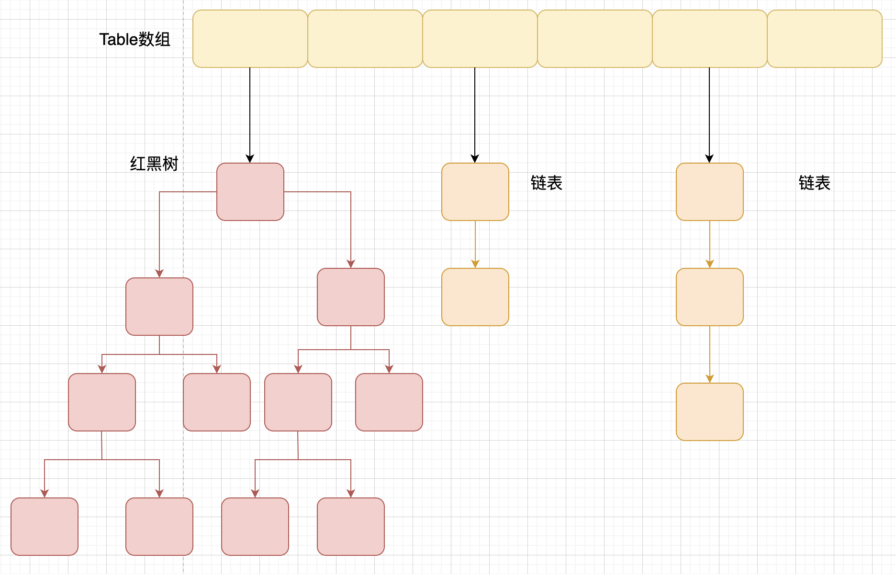

<!--more-->

# 动态代理
* 静态代理的麻烦：要为每一个实现类单独写一个代理类。
## JDK动态代理
* 对于实现了某个接口的类，能够直接生成**接口的**的代理对象（而不用写代理类）。
* 基本原理：利用Java反射机制
* 基本思路：
  1. 接口有方法的定义，但是没有方法体，也没有构造器。通过反射的某个方法根据接口的方法信息创建一个有相同类结构信息但是有构造器的**某个**类。 -> `java.lang.reflect.Proxy`类，提供静态方法`getProxyClass(ClassLoader loader, Class<?> ... interfaces)`，只要提供一个类加载器和接口(数组)，就可以生成一个代理类的`Class`对象。而这个代理类是有构造器的(可以通过`Class`对象调用`getConstructors()`)。该类没有无参构造器，需要传入实现`InvocationHandler`的类实例。
  2. 接口的方法体为空，在代理对象中使用传入的实现了`InvocationHandler`的实例即可利用代理目标在代理对象中执行代理目标的方法，并在代理目标的方法调用前后进行额外的操作或控制。代理对象需要持有实现了`InvocationHandler`接口的实例。在代理对象上调用代理目标的方法时，代理对象会通过实现了`InvocationHandler`的实例，将调用转移到代理目标上。
   ```java
        interface InvocationHandler {
            ...
            Object invoke(Object proxy, Method method, Object[] args);
            ...
        }
   ```
   其中，`proxy`为代理对象本身（而不是代理目标）。`method`为调用的方法，需要对`method`指定执行方法的目标才可以通过该参数调用方法。`args`为传入的参数。总之，单独有实现了`InvocationHandler`接口的实例还是不能正常地调用目标对象的方法，我们需要设法让`invoke`方法中可以获得到目标对象的引用。方法之一是让实现了`InvocationHandler`的类持有代理目标的引用（可以用构造函数传参的方式）。
   ```java
        class MyInvocationHandler implements InvocationHandler {
            private final Object target;

            public MyInvocationHandler(Object target) {
                this.target = target;
            }
            
            @Override
            public Objcet invoke(...) {
                ...
            }
        }
   ```
   3. 更简单地获得代理对象的方法：`Proxy.newProxyInstance(ClassLoader loader, Class<?>[] interfaces, InvocationHandler handler)`
* 优点：不用写代理类，直接生成代理对象。接口增加新方法时，代理对象可以不用进行修改。
* 缺点：只能对实现了接口的类使用。在代理对象上只能调用接口中定义的方法。

## CGLIB动态代理
* CGLIB(Code Generation Library)是一个基于ASM的字节码生成库，它允许我们在运行时对字节码进行修改和动态生成。CGLIB 通过继承方式实现代理。很多知名的开源框架都使用到了CGLIB， 例如 Spring 中的 AOP 模块中：如果目标对象实现了接口，则默认采用 JDK 动态代理，否则采用 CGLIB 动态代理。CGLIB属于开源项目，需要额外依赖。
* 基本思路：
  1. 自定义`MethodInterceptor`并重写`intercept`方法。该方法用于拦截增强代理目标的方法，类似于JDK动态代理的`invoke`。
   ```java
        public class MyInterceptor implements MethodInterceptor {
            @Override
            public Object intercept(Object o, Method method, Object[] args, MethodProxy methodProxy) {
                ...
            }
        }
   ```
   其中`o`是已经被增强的代理目标(the enhanced object)，`method`是被增强的方法(Intercepted Method)，`args`是方法调用的参数。`methodProxy`用于调用原始方法(super method, non-intercepted method)。
   2. 获得代理类
   ```java
        // 假设需要代理的目标类的Class对象是clazz
        Enhancer enhancer = new Enhancer();
        enhancer.setClassLoader(clazz.getClassLoader());
        enhancer.setSuperclass(clazz);
        enhancer.setCallback(new MyInterceptor());
   ```
* CGLIB动态代理是通过生成一个代理目标的子类来拦截代理类的方法调用，因此不能代理声明为`final`的类和方法。

# 集合
## 集合概述


## Comparable和Comparator
* 不同的接口，`Comparable`的方法是`compareTo(obj)`，`Comparator`的方法是`compare(obj1, obj2)`

## 集合底层数据结构
### List
* `ArrayList`、`Vector`: `Object[]`数组。`Vector`线程安全。
* `ArrayList`:
  * 真正持有函数的成员为`transient Object[] elementData`
  * 无参构造时，为`elementData`赋予静态成员`DEFAULTCAPACITY_EMPTY_ELEMENTDATA`
  * 带参构造时，如果参数`initialCapacity`为0，那么为`elementData`赋予静态成员`EMPTY_ELEMENTDATA`。如果参数为正整数则为`elementData`初始化一个指定容量的新数组。其他情况则抛出异常。
  * 带参构造时，如果参数为空的集合(不是`null`)，那么也赋予`elementData`静态成员`EMPTY_ELEMENTDATA`的值
  * 调用`add`方法时要调用`ensureCapacityInternal`方法保证数组容量足够。
  * 无论如何，如果最开始不显式指定容量或者使用非空集合创建`ArrayList`，`ArrayList`都会将创建`DEFAULT_CAPACITY`个元素这一行为推迟到向`ArrayList`加入第一个元素时。
  * `ArrayList`的扩容过程：
    1. 首先计算扩容后的最小容量。如果当前数据为`DEFAULTCAPACITY_EMPTY_ELEMENTDATA`，则扩容后容量至少为`Math.max(DEFAULT_CAPACITY, minCapacity)`。`DEFAULT_CAPACITY`为10。否则扩容后容量至少为`size + 1`
    2. 如果`minCapacity > elementData.length`则需要扩容。扩容的总体规则是，如果旧容量的1.5倍大于`minCapacity`则扩容1.5倍，否则扩容到`minCapacity`。此时创建扩容后的新数组并把原本存放在`elementData`中的元素复制到新数组
    3. Java数组存在最大容量。最大容量一般稍微小于`Integer.MAX_VALUE`。`ArrayList`内部用`MAX_ARRAY_SIZE`保存一个稍微小于`Integer.MAX_VALUE`的值。如果出现了计算得到的新数组容量存在`newCapacity - MAX_ARRAY_SIZE > 0`的情况，则判断`minCapacity`有没有溢出。如果溢出了32位整数的取值范围，则抛出OOM异常，如果没有溢出，则新容量为`(minCapacity > MAX_ARRAY_SIZE) ? Integer.MAX_VALUE : MAX_ARRAY_SIZE`。
   * 为什么要区分`DEFAULTCAPACITY_EMPTY_ELEMENTDATA`和`EMPTY_ELEMENTDATA`？（since Java 8）
     * 为了区分 "我就是要一个初始容量为0的`ArrayList`（显示指定初始容量为0，使用空集合初始化`ArrayList`）" 和 "我想要一个初始容量为`DEFAULT_CAPACITY`的`ArrayList`，但是我不一定马上要用，因此先返回容量为0的数组，等我要用的时候(第一次加入元素的时候)，再给我一次扩容上来" 。
* `LinkedList`: 双向（不循环）链表

### Set
* `HashSet`: 基于`HashMap`实现，底层使用`HashMap`，使用成员对象来计算hashcode
  * 检查重复的方法：先计算hashcode值来判断对象加入的位置，同时与其它对象的hashcode值进行比较。如果发现相同hashcode值的对象，需要调用`equals`方法来检测对象是否真正相同。（hashcode的定义：同一个对象不可能有两个hashcode，不同对象的hashcode可能相同，其实就是“函数”的定义）
* `LinkedHashSet`: 基于`LinkedHashMap`，能够按照添加的顺序进行遍历
* `TreeSet`: 有序，能按照添加元素的顺序进行遍历，唯一，基于红黑树

### Map(需要重新看)
* `HashTable`：内部方法都是synchronized的，线程安全。
* `HashMap`: 底层数据结构是数组+链表/红黑树。使用拉链法解决哈希冲突，JDK 1.8引入红黑树来优化过长的链表。HashMap会重新计算键的哈希值而不是使用hashCode。
  * 初始大小(`capacity`)为16，每次扩容时容量为原来的2倍。`HashMap`会让集合中的元素保持在一个合理的范围内（由装填因子load factor限制），如果元素数超过指定的阈值`this.threshold`时，则需要进行扩容并进行rehash。
  * `HashMap`总是使用2的幂作为哈希表`capacity`的大小。目的是为了加快通过hash计算KV对存储位置的速度。
  * 使用Key来计算hashcode。通过key的hashcode经过`HashMap`的扰动函数`hash()`处理(防止较差的`hashCode()`实现导致`HashMap`性能下降)后得到真正的hash值，然后通过`(n - 1) & hash`（`n`为HashMap数组的长度，该运算等价于用hash对长度取余）的方式计算当前元素要存储的位置。
  * Table数组：hash表的桶(bucket)。数组的每个位置上都是一个链表。当链表长度大于阈值（默认为8）时，如果当前数组长度小于64，则进行数组扩容，否则将这个链表转换为红黑树。
  
    * 红黑树：
      * 首先是一种二叉搜索树：左子树小于根小于右子树
      * 根节点是黑色，叶子节点（Nil）是黑色
      * 每个红色节点的叶子节点都是黑色
      * 任意节点到每个叶子节点的路径都有数量相同的黑色节点
* `TreeMap`实现了`NavigableMap`实现对集合内元素的搜索能力，实现`SortedMap`来实现对元素根据key进行排序的能力。
* `HashMap`不是线程安全的

### HashMap
#### 初始化
* 初始容量`initialCapacity`
* 负载因子`loadFactor`
* 阈值`threshold`: 键值对数超过这个值要扩容

#### 查找
* 需要用插入键值对的key的hashCode进行再次hash
  * hash方法的规则：如果key为null则返回0。否则计算`hashcode ^ (hashcode >>> 16)`
  * 目的：
    1. 对hashCode进行扰动，防止分布性不佳的hashCode影响HashMap的性能
    2. 当数组长度n比较小时可能只有hashCode的低位信息能参与计算，用hashcode的高16位和低16位进行异或，变相让hashcode的高位参与计算，提高了hash值的随机性。
* 用`(n - 1) & hash`的方法将hash对数组长度进行求余，效率高。但这要求数组长度必须是2的幂

#### 遍历
* 迭代器`HashIterator`：
  * 构造方法：找到第一个包含链表节点引用的桶
  * `nextNode`方法：如果当前节点非空，则返回的是当前节点，同时如果当前节点的next字段为空（当前桶没有下一个元素了），则寻找下一个包含节点引用的桶。

#### 插入（重点）
##### 插入操作总体逻辑
1. 首先通过hash方法（`hashcode ^ (hashcode >>> 16)`）计算出真正要使用的`hash`值
2. HashMap桶数组初始化可以延迟到第一次插入时。开始插入时首先判断table是否被初始化。如果没有则需要初始化。
3. 通过`(n - 1) & hash`计算出桶的位置，如果此处还没有节点，直接新建节点存入该桶即可。
4. 否则，开始查找该桶中存不存在Key相同的节点`e`
   * 如果节点是链表节点，则对链表进行遍历，找不到key相同的节点时将节点插入到链表的尾部。如果链表的长度在插入后大于等于树化阈值，则要将链表转换为红黑树。
   * 如果节点是树节点，则调用红黑树的插入方法。
   * 如果在定位插入位置的时候找到了Key相同的节点，则会返回Key相同的节点而不会进行插入。
5. 判断要插入的键值对是否已经存在(`e != null`)。如果已经存在，则用新的值替换旧的值，并返回旧的值。否则，说明上一步进行过插入操作，如果插入后节点数量大于阈值，则需要对数组进行扩容。

##### 链表树化机制
* 如果只使用链表，当发生碰撞的次数过多性能会下降，JDK1.8引入红黑树来处理这个问题
* 树化链表需要满足：
  1. 桶数组长度大于等于`MIN_TREEIFY_CAPACITY = 64`。原因可能是因为当桶数组容量较小时，键值对出现哈希冲突的概率会比较高，较容易导致链表长度较长。高碰撞率是因为桶数组容量较小时，应该有限扩容桶数组。并且桶容量较小时，扩容会比较频繁，而扩容时需要拆分红黑树并且进行重新映射。
  2. 链表长度大于等于`TREEIFY_THRESHOLD = 8`。
* 链表树化的比较依据（Key不要求实现Comparable接口）：
  1. 比较key之间的hash大小，如果hash相同则继续
  2. 检测键是否实现了Comparable接口，如果实现则调用compareTo进行比较，否则继续
  3. 如果仍不能比较出大小，使用tieBreakOrder进行仲裁确定顺序
* TreeNode节点仍保持了next引用和prev引用（链表型节点是单链表，TreeNode才会有prev引用），链表树化之后原链表的顺序会得到保留

##### 桶数组扩容机制
* 使用`resize`方法进行扩容
* 计算出新数组容量和新阈值
* 根据新容量创建新的桶数组
* 将键值对节点重新映射到新的桶数组。如果节点是TreeNode类型，则需要拆分红黑树。如果是普通节点，则节点按原顺序进行分组。
1. 计算出新数组容量和新阈值
  1. 当`oldCap > 0`时，桶数组`table`已经被初始化
    1. 当`oldCap >= MAXIMUM_CAPACITY`(2^30)时，不再扩容
    2. 当`newCap < MAXIMUM_CAPACITY && oldCap >= DEFAULT_INITIAL_CAPACITY`时，会通过乘以2的方式计算新阈值，此时新阈值`newThr = oldThr << 1`可能会溢出。（`loadFactor`可能大于1）
2. 创建数组
3. 键值对节点的重新映射：对于树形节点，需要先拆分红黑树再进行映射。对于链表型节点，需要先对链表进行分组再映射。
  * 扩容后的数组长度为原数组长度的两倍，并且数组的长度永远是2的幂
  * 对链表型节点的分组映射
    * 对于扩容前的长度`m`和扩容后的长度`n`，`n - 1`比`m - 1`在最高有效位上多一位1。
    * 举例：如果原容量为16，扩容后为32，那么`16 - 1 = 15`的二进制表示为`0000 1111`, `32 - 1 = 31`的二进制表示为`0001 1111`
    * 因此可知扩容后，链表中的元素会根据第5位为1还是0被分成两组。使用`m & hash`(即`oldCap & hash`)的值即可判断元素应该属于哪一组
    * 遍历旧链表，根据当前元素`oldCap & hash`的计算结果是否为0，可以将链表中的旧元素使用尾插法插入两个新链表中，完成链表分组。
    * 最后将两条新链表分别确定插入位置后插入桶中即可完成扩容中的重新映射步骤。
      * 确定的方式：假设原链表所在的数组位置为`index`。对于新参与`hash & (n - 1)`计算的位为1的所有节点，该位的新结果必定为1。因此这些节点的新位置应该为`index + m`，即`index + oldCap`。相对的，对于该位为0的所有节点，扩容后`hash & (n - 1)`的计算结果会与原来保持不变，因此这些节点的位置不会改变。
  * 对树形节点的拆分和重映射
    * 树形节点的分组方式和链表型节点是一样的，也是通过`oldCap & hash`的方式确定分组。然后以遍历链表的方式(利用next引用)遍历红黑树，将树中的节点用尾插法插入到两个链表中。
    * 分别确定两个链表的新插入位置并将两个链表插入新位置。
    * 如果链表长度小于等于`UNTREEIFY_THRESHOLD = 6`，则将原本的红黑树转换为链表。
    * 否则，如果另一个链表不为空，说明当前链表中的一部分节点重新分组到了另一个链表，需要对当前链表重新进行树化。

#### 删除
1. 定位桶的位置
2. 如果是TreeNode类型，用红黑树的查找逻辑定位到待删除节点，调用删除方法
3. 如果是链表类型，找到待删除节点和它的前驱节点，删除待删除结点。

#### 为什么桶数组table被transient修饰
* HashMap不使用默认的序列化机制，而是使用`readObject`/`writeObject`两个方法定制了序列化和反序列化的过程。
* 只要保存了键值对，桶数组可以根据键值对的数据重建HashMap
* 由于装填因子的设置，多数情况下table无法被存满，保存table会浪费空间
* 如果键对象没有重写hashCode方法，计算hash时需要使用`Object`类的hashCode方法，而该方法不同的JVM的实现可能不同。如果同一个键产生了不同的Hash，原本的table就无法继续使用了。

#### 为什么TREEIFY_THRESHOLD的取值是8
理想状态下，在默认装填因子为0.75时，容器中的节点遵循参数λ=5的泊松分布。链表中的元素达到8个的概率是非常低的。

#### 为什么UNTREEIFY_THRESHOLD的取值是6（而不是7）
如果为7，删除一个元素就会转换成链表，插入一个元素又会转换成红黑树。