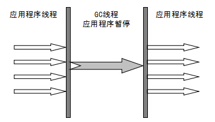
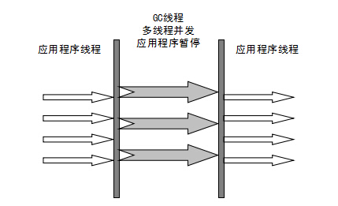
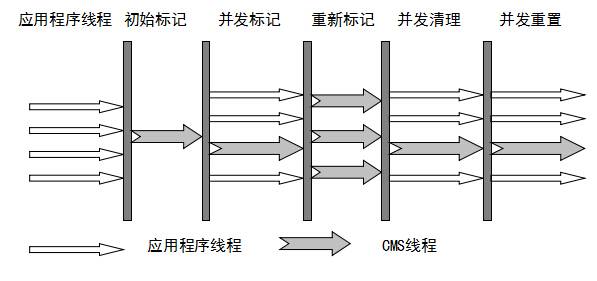
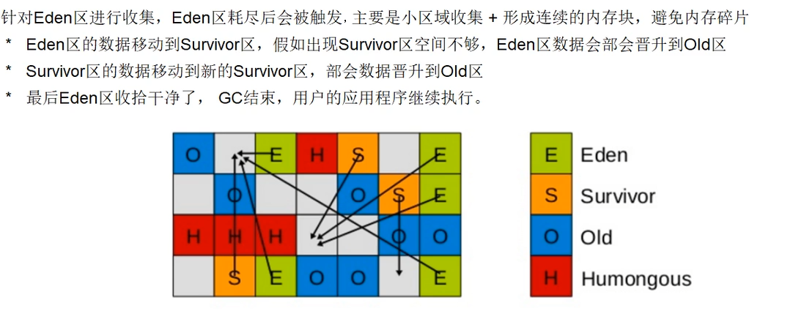
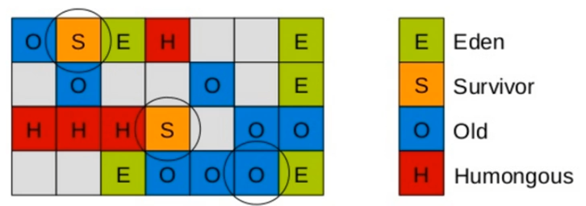

<!--more-->

# 内存区域
## 运行时数据区域
### 线程私有
#### 程序计数器：
* 程序计数器是一块较小的内存空间，可以看作是当前线程所执行的字节码的行号指示器。字节码解释器工作时通过改变这个计数器的值来选取下一条需要执行的字节码指令，分支、循环、跳转、异常处理、线程恢复等功能都需要依赖这个计数器来完成。每条线程都需要有一个独立的程序计数器，各线程之间计数器互不影响，独立存储，我们称这类内存区域为“线程私有”的内存。唯一一个不会出现`OutOfMemoryError`的内存区域。
#### 虚拟机栈
* 生命周期和线程相同，描述的是 Java 方法执行的内存模型，每次方法调用的数据都是通过栈传递的。
* 实际上，Java 虚拟机栈是由一个个栈帧组成，而每个栈帧中都拥有：局部变量表、操作数栈、动态链接、方法出口信息。
* 局部变量表主要存放了编译期可知的各种数据类型（boolean、byte、char、short、int、float、long、double）、对象引用（reference 类型，它不同于对象本身，可能是一个指向对象起始地址的引用指针，也可能是指向一个代表对象的句柄或其他与此对象相关的位置）。
* `StackOverflowError`: 若 Java 虚拟机栈的内存大小不允许动态扩展，那么当线程请求栈的深度超过当前 Java 虚拟机栈的最大深度的时候，就抛出 `StackOverFlowError`错误。
* `OutOfMemoryError`: 若 Java 虚拟机堆中没有空闲内存，并且垃圾回收器也无法提供更多内存的话。就会抛出`OutOfMemoryError`错误。
#### 本地方法栈
* 拟机栈为虚拟机执行 Java 方法 （也就是字节码）服务，而本地方法栈则为虚拟机使用到的 Native 方法服务。 在 HotSpot 虚拟机中和 Java 虚拟机栈合二为一。本地方法被执行的时候，在本地方法栈也会创建一个栈帧，用于存放该本地方法的局部变量表、操作数栈、动态链接、出口信息。
* 也会出现`StackOverflowError`和`OutOfMemoryError`错误。

### 线程共享：
#### 堆
* Java 虚拟机所管理的内存中最大的一块，Java 堆是所有线程共享的一块内存区域，在虚拟机启动时创建。此内存区域的唯一目的就是存放对象实例，**几乎**所有的对象实例以及数组都在这里分配内存。
* 逃逸分析/栈上分配: 如果某些方法中的对象引用没有被返回，或者未被外面使用，对象可以直接在栈上分配内存。
* 分代垃圾回收：
  * JDK < 7：新生代、老年代、方法区（HotSpot 永久代）
  * JDK 7: JDK1.7 字符串常量池被从方法区拿到了堆中, 这里没有提到运行时常量池,也就是说字符串常量池被单独拿到堆,运行时常量池剩下的东西还在方法区, 也就是hotspot中的永久代 。
  * JDK >= 8: 移除堆中的方法区（永久代）、将除了`StringTable`以外的运行时常量池内容移动到直接内存中的元空间（Metaspace）
  * Eden区、From Survivor区、To Survivor区
* `OutOfMemoryError: GC Overhead Limit Exceeded`: JVM花太多时间执行垃圾回收并且只能回收很少垃圾
* `java.lang.OutOfMemoryError: Java heap space`: 创建新对象时堆内存空间不足存放新创建的对象（和配置的内存大小有关，和本机物理内存无关）
#### （逻辑上的）方法区
* 它用于存储已被虚拟机加载的类信息、常量、静态变量、即时编译器编译后的代码等数据。
* JDK >= 8: `StringTable`存放于堆内存，其余内容存放于直接内存（元空间）
* 为什么要将永久代替换为元空间？
  * 整个永久代有一个 JVM 本身设置固定大小上限，无法进行调整，而元空间使用的是直接内存，受本机可用内存的限制，虽然元空间仍旧可能溢出，但是比原来出现的几率会更小。（当元空间溢出时会得到如下错误： `java.lang.OutOfMemoryError: MetaSpace`）
  * 元空间里面存放的是类的元数据，这样加载多少类的元数据就不由`MaxPermSize`控制了, 而可以只由由系统的实际可用空间来控制（也可以用参数进行限制，默认为unlimited），这样能加载的类就更多了。
* 运行时常量池：

#### 直接内存（非运行时数据区的一部分）
* 直接内存并不是虚拟机运行时数据区的一部分，也不是虚拟机规范中定义的内存区域，但是这部分内存也被频繁地使用。而且也可能导致`OutOfMemoryError`错误出现。
* NIO(New Input/Output) 类，引入了一种基于通道（Channel） 与缓存区（Buffer） 的 I/O 方式，它可以直接使用 Native 函数库直接分配堆外内存，然后通过一个存储在 Java 堆中的 DirectByteBuffer 对象作为这块内存的引用进行操作。这样就能在一些场景中显著提高性能，因为避免了在 Java 堆和 Native 堆之间来回复制数据。
* 不会受到 Java 堆的限制，但是，既然是内存就会受到本机总内存大小以及处理器寻址空间的限制。

## 对象的创建过程
### 1.类加载检查
虚拟机遇到一条 new 指令时，首先将去检查这个指令的参数是否能在常量池中定位到这个类的符号引用，并且检查这个符号引用代表的类是否已被加载过、解析和初始化过。如果没有，那必须先执行相应的类加载过程。
* 符号引用：大概是一个名字，用名字（字符串）来表达引用关系
* 直接引用：方法或类的信息被解析到JVM中的数据结构的引用，可以直接使用的数据或指令的引用
* JVM只有真正需要用到的时候才会将符号引用解析为直接引用

### 2.分配内存
#### 基本步骤
在类加载检查通过后，接下来虚拟机将为新生对象分配内存。对象所需的内存大小在类加载完成后便可确定，为对象分配空间的任务等同于把一块确定大小的内存从 Java 堆中划分出来。分配方式有 “指针碰撞” 和 “空闲列表” 两种，选择哪种分配方式由 Java 堆是否规整决定，而 Java 堆是否规整又由所采用的垃圾收集器是否带有压缩整理功能决定。
#### 内存分配
1. 指针碰撞
   * 适用场景：堆内存规整、没有碎片
   * 原理：用过的内存全部整合到一边、没用过的放在另一边，中间有个分界值指针、只要向着没用过的内存方向将该指针移动内存大小位置即可
   * 对应的GC收集器：Serial、ParNew
2. 空闲列表
   * 适用：堆内存不规整
   * 原理：JVM维护列表，列表记录哪些内存块可用，分配时找出足够大的内存块为对象分配并更新列表
   * GC收集器：CMS
#### 内存分配的线程安全问题
分配内存的操作需要保证原子性。
1. CAS：一种乐观锁的实现，冲突则重试
2. TLAB：为每个线程预先在Eden区分配一部分内存，优先使用TLAB内存，TLAB内存不够用时再通过CAS+重试的方法进行内存分配。

### 3.初始化零值
内存分配完成后，虚拟机需要将分配到的内存空间都初始化为零值（默认值？）（不包括对象头），这一步操作保证了对象的实例字段在 Java 代码中可以不赋初始值就直接使用，程序能访问到这些字段的数据类型所对应的零值。

### 4.设置对象头
初始化零值完成之后，虚拟机要对对象进行必要的设置，例如这个对象是哪个类的实例、如何才能找到类的元数据信息、对象的哈希码、对象的 GC 分代年龄等信息。 这些信息存放在对象头中。 另外，根据虚拟机当前运行状态的不同，如是否启用偏向锁等，对象头会有不同的设置方式。

### 5.执行init方法
在上面工作都完成之后，从虚拟机的视角来看，一个新的对象已经产生了，但从 Java 程序的视角来看，对象创建才刚开始，`<init>` 方法还没有执行，所有的字段都还为零。所以一般来说，执行`new`指令之后会接着执行`<init>`方法，把对象按照程序员的意愿进行初始化，这样一个真正可用的对象才算完全产生出来。

## 对象的内存布局
对象在内存中的布局：对象头、实例数据、对齐填充。
Hotspot 虚拟机的对象头包括两部分信息，第一部分用于存储对象自身的运行时数据（哈希码、GC 分代年龄、锁状态标志等等），另一部分是类型指针，即对象指向它的类元数据的指针，虚拟机通过这个指针来确定这个对象是那个类的实例。

实例数据部分是对象真正存储的有效信息，也是在程序中所定义的各种类型的字段内容。

对齐填充部分不是必然存在的，也没有什么特别的含义，仅仅起占位作用。 因为 Hotspot 虚拟机的自动内存管理系统要求对象起始地址必须是 8 字节的整数倍，换句话说就是对象的大小必须是 8 字节的整数倍。而对象头部分正好是 8 字节的倍数（1 倍或 2 倍），因此，当对象实例数据部分没有对齐时，就需要通过对齐填充来补全。

## 对象的访问定位（如何通过引用访问一个具体对象）
### 句柄
* Java 堆中划分出一块内存来作为句柄池，reference 中存储的就是对象的句柄地址，而句柄中包含了对象实例数据与类型数据各自的具体地址信息；（一次间接地址）
* 优点：移动对象不需要改变引用，只需要改变句柄池中到对象实例数据的指针。
### 直接指针
* 如果使用直接指针，Java 堆对象的布局中就必须考虑如何放置访问类型数据的相关信息，而 reference 中存储的直接就是对象的地址。
* 优点：速度快，少一次指针定位

## String常量池
```java
String str1 = "abcd";//先检查字符串常量池中有没有"abcd"，如果字符串常量池中没有，则创建一个，然后 str1 指向字符串常量池中的对象，如果有，则直接将 str1 指向"abcd""；
String str2 = new String("abcd");//堆中创建一个新的对象，如果常量池中没有这个字符串常量，则也要创建一个
String str3 = new String("abcd");//堆中创建一个新的对象，注意new关键字一定会在堆上创建新的对象
System.out.println(str1==str2);//false
System.out.println(str2==str3);//false
```

# 垃圾回收
## GC的三个任务
* 确定回收目标（哪些是垃圾）
* 确定回收时机
* 怎么回收

## 堆内存的区域划分
### 新生代
存放新生对象，一般占1/3，由于频繁创建对象，会频繁触发MinorGC进行垃圾回收。
* Eden区：新对象的出生地（如果新对象占用内存很大会直接分配到老年代）。Eden区内存不够的时候会触发MinorGC，对新生代进行一次垃圾回收
* Survivor From：上一次GC的幸存者，作为这一次GC的被扫描者
* Survivor To：保留一次MinorGC过程中的幸存者

#### MinorGC的过程（复制算法）
1. 将Eden区和Survivor From区域中经历过GC而存活的对象复制到Survivor To区域，如果有对象的年龄到达了进入老年代的标准，则移动到老年代区。复制的同时将这些对象的年龄+1。如果Survivor To空间不足则直接移动到老年代
2. 然后清空Eden区和Survivor From区
3. 将Survivor From区和Survivor To区的角色互换，原本的Survivor To区会成为下一次GC的Survivor From区

### 老年代
主要存放生命周期长的内存对象。因为对象较为稳定所以Old GC不会频繁执行。一般情况下，进行Minor GC使得新生代对象需要移动到老年代，导致老年代空间不足时才触发。如果找不到足够大的连续空间分配给新创建的较大对象时也会提前触发一次Old GC。

#### Old GC的过程（标记-清除算法）
首先扫描一次所有老年代，标记出存活的对象，然后回收没有标记的对象。OldGC 的耗时比较长，因为要扫描再回收。OldGC 会产生内存碎片，为了减少内存损耗，我们一般需要进行合并或者标记出来方便下次直接分配。当老年代也满了装不下的时候，就会抛出OOM（Out of Memory）异常。

## 如何确定垃圾
### 引用计数法
引用和对象是有关联的。如果要操作对象则必须用引用进行。因此，很显然一个简单的办法是通过引用计数来判断一个对象是否可以回收。简单说，即一个对象如果有任何与之关联的引用，即引用计数为0，则说明对象不太可能再被用到，那么这个对象就是可回收对象。但是该方法难以处理循环引用的情况。

### 可达性分析
通过GC Roots对象为起点进行搜索，节点走过的路径为引用链。GC Roots就是一组必须活跃的引用。当一个对象到GC Roots没有任何引用链相连的话，证明此对象是不可用的。
* 可以作为GC Roots的对象
  * 虚拟机栈中（栈帧中的本地变量表）的对象
  * 本地方法栈(Native 方法)中引用的对象
  * 方法区中类静态属性引用的对象
  * 方法区中的常量引用的对象（`static final`...)
  * 所有被同步锁持有的对象

## 垃圾回收算法
* 标记-清除：内存碎片
* 标记-整理
* 标记-复制：实现简单效率高，但是内存可用空间减小。存活对象增多的时候复制开销大（因此适合对象生命周期不长的新生代）
* 分代收集：新生代多数采取复制算法。老年代可能使用标记-整理

## 3种垃圾回收算法的比较
* https://www.yuque.com/yulongsun/java/pa8khv

## 四种引用类型
* 在程序设计中一般很少使用弱引用与虚引用，使用软引用的情况较多，这是因为软引用可以加速 JVM 对垃圾内存的回收速度，可以维护系统的运行安全，防止内存溢出（OutOfMemory）等问题的产生。
### 强引用
在Java 中最常见的就是强引用，把一个对象赋给一个引用变量，这个引用变量就是一个强引用。当一个对象被强引用变量引用时，它处于可达状态，它是不可能被垃圾回收机制回收的，即使该对象以后永远都不会被用到JVM也不会回收。因此强引用是造成Java 内存泄漏的主要原因之一。

### 软引用
软引用需要用SoftReference 类来实现，对于只有软引用的对象来说，当系统内存足够时它不会被回收，当系统内存空间不足时它会被回收。软引用通常用在对内存敏感的程序中。软引用可以和一个引用队列（ReferenceQueue）联合使用，如果软引用所引用的对象被垃圾回收，JAVA 虚拟机就会把这个软引用加入到与之关联的引用队列中。应用场景：内存cache，性能不足的设备上的多任务（多应用、后台应用）。

### 弱引用
弱引用需要用WeakReference 类来实现，它比软引用的生存期更短，对于**只**有弱引用的对象来说，只要垃圾回收机制一运行，不管JVM 的内存空间是否足够，总会回收该对象占用的内存。不过，由于垃圾回收器是一个优先级很低的线程， 因此不一定会很快发现那些只具有弱引用的对象。
* `WeakHashMap`: 不使用的Key会被移除。更准确地说，不会阻止垃圾回收器将Key进行回收。

### 虚引用
虚引用需要PhantomReference 类来实现，它不能单独使用，必须和引用队列联合使用。虚引用与软引用和弱引用的一个区别在于： 虚引用必须和引用队列（ReferenceQueue）联合使用。当垃圾回收器准备回收一个对象时，如果发现它还有虚引用，就会在回收对象的内存之前，把这个虚引用加入到与之关联的引用队列中。程序可以通过判断引用队列中是否已经加入了虚引用，来了解被引用的对象是否将要被垃圾回收。程序如果发现某个虚引用已经被加入到引用队列，那么就可以在所引用的对象的内存被回收之前采取必要的行动。
设置虚引用关联的唯一目的就是在这个对象被收集器回收的时候收到一个系统通知，或者后续添加进一步的处理。允许`finalize()`方法在垃圾收集器将对象从内存中清除出去之前做必要的清理工作。对虚引用调用`get()`会返回null。
清理工作：例如使用`DirectByteBuffer`的时候回收堆外内存。

### 引用队列
对象在被GC后会被添加到引用队列中。

## 被判定为需要回收的对象的回收时机
要真正宣告一个对象死亡，至少要经历两次标记过程；可达性分析法中不可达的对象被第一次标记并且进行一次筛选，筛选的条件是此对象是否有必要执行 finalize 方法。当对象没有覆盖 finalize 方法，或 finalize 方法已经被虚拟机调用过时，虚拟机将这两种情况视为没有必要执行。
被判定为需要执行的对象将会被放在一个队列中进行第二次标记，除非这个对象与引用链上的任何一个对象建立关联，否则就会被真的回收。（在finalize方法上强行将引用挂到一个可达对象上可以抢救一个对象，但是下次GC若被判定为需要回收，则不会再次调用finalize方法）
* finalize方法并不推荐使用。JVM不会保证等到finalize方法执行完成。

## 方法区的垃圾回收
* 方法区（“永久代”）并不是不会进行垃圾回收。方法区GC的主要对象是废弃常量和无用的类。
### 运行时常量池的垃圾回收
假如在字符串常量池中存在字符串 "abc"，如果当前没有任何 String 对象引用该字符串常量的话，就说明常量 "abc" 就是废弃常量，如果这时发生内存回收的话而且有必要的话，"abc" 就会被系统清理出常量池了。

### 如何判断无用的类
* 该类所有的实例都已经被回收，也就是 Java 堆中不存在该类的任何实例。
* 加载该类的`ClassLoader`已经被回收。
* 该类对应的`java.lang.Class`对象没有在任何地方被引用，无法在任何地方通过反射访问该类的方法。
虚拟机可以对满足上述 3 个条件的无用类进行回收，这里说的仅仅是“可以”，而并不是和对象一样不使用了就会必然被回收。

## 垃圾收集器（重点是CMS和G1）
### Serial
Serial（串行）收集器是最基本、历史最悠久的垃圾收集器了。大家看名字就知道这个收集器是一个单线程收集器了。它的 “单线程” 的意义不仅仅意味着它只会使用一条垃圾收集线程去完成垃圾收集工作，更重要的是它在进行垃圾收集工作的时候必须暂停其他所有的工作线程（ "Stop The World" ），直到它收集结束。

新生代采用标记-复制算法，老年代采用标记-整理算法。


### ParNew
ParNew 收集器其实就是 Serial 收集器的多线程版本，除了使用多线程进行垃圾收集外，其余行为（控制参数、收集算法、回收策略等等）和 Serial 收集器完全一样。它是许多运行在 Server 模式下的虚拟机的首要选择，除了 Serial 收集器外，只有它能与 CMS 收集器（真正意义上的并发收集器，后面会介绍到）配合工作。

会暂停用户线程（Stop The World），适用与科学计算、大数据处理等弱交互场景。

新生代采用标记-复制算法，老年代采用标记-整理算法。
* 并行（Parallel） ：指多条垃圾收集线程并行工作，但此时用户线程仍然处于等待状态。
* 并发（Concurrent）：指用户线程与垃圾收集线程同时执行（但不一定是并行，可能会交替执行），用户程序在继续运行，而垃圾收集器运行在另一个 CPU 上。


### Parallel Scavenge
Parallel Scavenge 收集器也是使用标记-复制算法的多线程收集器，它看上去几乎和 ParNew 都一样。 那么它有什么特别之处呢？（Parallel Scavenge无法与CMS配合工作）
Parallel Scavenge 收集器关注点是吞吐量（高效率的利用 CPU）。CMS 等垃圾收集器的关注点更多的是用户线程的停顿时间（提高用户体验）。（降低总的停顿时间 vs 降低单次停顿需要的时间）所谓吞吐量就是 CPU 中用于运行用户代码的时间与 CPU 总消耗时间的比值。 Parallel Scavenge 收集器提供了很多参数供用户找到最合适的停顿时间或最大吞吐量，如果对于收集器运作不太了解，手工优化存在困难的时候，使用 Parallel Scavenge 收集器配合自适应调节策略，把内存管理优化交给虚拟机去完成也是一个不错的选择。
此为JDK1.8的默认收集器。

新生代采用标记-复制算法，老年代采用标记-整理算法。

### Serial Old
Serial 收集器的老年代版本，它同样是一个单线程收集器。它主要有两大用途：一种用途是在 JDK1.5 以及以前的版本中与 Parallel Scavenge 收集器搭配使用，另一种用途是作为 CMS 收集器的后备方案。

### Parallel Old
Parallel Scavenge 收集器的老年代版本。使用多线程和“标记-整理”算法。在注重吞吐量以及 CPU 资源的场合，都可以优先考虑 Parallel Scavenge 收集器和 Parallel Old 收集器。

### CMS（Concurrent Mark Sweep，也是用于老年代的垃圾收集器）
CMS（Concurrent Mark Sweep）收集器是一种以获取最短回收停顿时间为目标的收集器。它非常符合在注重用户体验的应用上使用。是 HotSpot 虚拟机第一款真正意义上的并发收集器，它第一次实现了让垃圾收集线程与用户线程（基本上）同时工作。是一种标记-清除算法的实现。
* 工作过程
  * 初始标记： 暂停所有的其他线程，并记录下直接与 root 相连的对象，速度很快
  * 并发标记： 同时开启 GC 和用户线程，用一个闭包结构去记录可达对象。但在这个阶段结束，这个闭包结构并不能保证包含当前所有的可达对象。因为用户线程可能会不断的更新引用域，所以 GC 线程无法保证可达性分析的实时性。所以这个算法里会跟踪记录这些发生引用更新的地方。
  * 重新标记： 重新标记阶段就是为了修正并发标记期间因为用户程序继续运行而导致标记产生变动的那一部分对象的标记记录（由于用户程序的并发运行，一部分被标记为不可达的对象又可达了），这个阶段的停顿时间一般会比初始标记阶段的时间稍长，远远比并发标记阶段时间短。
  * 并发清除： 开启用户线程，同时 GC 线程开始对未标记的区域做清扫。
  * 并发重置（？）

* 优点：并发收集、低停顿
* 缺点：
  * 对CPU资源敏感
  * 无法处理浮动垃圾：并发标记过程中，由于用户线程继续运行，可能会产生新的垃圾（这种现象成为Mutation， Mutator Problems），这部分垃圾并没有被GC线程识别（标记成了活动对象，不会被回收），称为浮动垃圾。而重新标记阶段的作用只是修改并发标记获得的不可达对象，没有办法处理，只能等到下一次GC再进行。
  * 标记清除算法会产生内存碎片 -> **CMS怎么解决内存碎片问题?**
    1. 在应用访问量少的时候调用`System.gc()`。`System.gc()`会对堆内存进行整理。
    2. 在应用启动完并完成所有初始化工作之后，主动调用`System.gc()`，可以将初始化的数据整理到一个连续的块中，以腾出更多连续内存空间给新生代晋升使用。
    3. 降低`-XX:CMSInitiatingOccupancyFraction=NNN`参数，让CMS提前开始并发收集。并发收集不会进行整理，但是会合并老年代中相邻的可用空间，让新生代有足够的连续空间可以用于晋升。该参数是并发收集启动的老年代内存占用率阈值，当老年代内存占用达到`NNN`（百分比）时，启动并发收集。但是频繁GC也会带来频繁的停顿，需要避免。
    4. (9以上已废弃)开启`-XX:+UseCMSCompactAtFullColletion`，并设置`-XX:CMSFullGCBeforeCompaction=NNN`，可以在`NNN`次Full GC之后进行标记整理。
    5. 触发**Concurrent Mode Failure**：用户线程向老年代请求分配的空间超过预留空间，后台线程的收集没有赶上应用线程的分配速度
       * 可能触发后备收集器Serial Old进行标记整理（Full GC）。
       * 可能触发CMS的foreground模式进行标记整理(第4点，9以上已经废弃)
       * 都会触发Stop The World

### G1（Garbage-First，新生代、老年代都可以，from Java 8）
G1 (Garbage-First) 是一款面向服务器的垃圾收集器,主要针对配备多颗处理器及大容量内存的机器. 以极高概率满足 GC 停顿时间要求的同时,还具备高吞吐量性能特征
* 特点
  * 并行与并发：G1 能充分利用 CPU、多核环境下的硬件优势，使用多个 CPU（CPU 或者 CPU 核心）来缩短 Stop-The-World 停顿时间。部分其他收集器原本需要停顿 Java 线程执行的 GC 动作，G1 收集器仍然可以通过并发的方式让 java 程序继续执行。
  * 分代收集：虽然 G1 可以**不需要其他收集器配合**就能独立管理整个 GC 堆，但是还是保留了分代的概念。
    * G1并没有将堆划分为连续的新生代（以及其中的Eden区，Survivor0区，Survivor1区）、老年代，而是将堆划分为若干个区域（Region）。
    * 这些Region的一部分包含新生代，负责新生代的GC仍然采用暂停所有应用线程的方式（Stop The World），将存活对象复制到老年代或者Survivor To空间。
    * 这些Region的一部分包含老年代，G1收集器通过将对象从一个区域复制到另一个区域完成了清理工作。这意味着在正常的处理过程中G1完成了（一部分）堆的压缩。解决了CMS的内存碎片问题。
    * G1中有一种特殊区域：Humongous区。之前的做法是将巨型对象分配到老年代，但是如果该对象生存时间短就会对GC产生负面影响。G1为此专门划分了Humongous区来存放巨型对象。G1会寻找一个或连续的H分区来存储巨型对象，有时候可能会启用Full GC。
  * 空间整合：与 CMS 的“标记-清理”算法不同，G1 从整体来看是基于“标记-整理”算法实现的收集器；从局部上来看是基于“标记-复制”算法实现的。不会产生内存碎片。
  * 可预测的停顿：这是 G1 相对于 CMS 的另一个大优势，降低停顿时间是 G1 和 CMS 共同的关注点，但 G1 除了追求低停顿外，还能建立可预测的停顿时间模型，能让使用者明确指定在一个长度为 M 毫秒的时间片段内。
  * G1 收集器在后台**维护了一个优先列表**，每次**根据允许的收集时间，优先选择回收价值最大的 Region**(这也就是它的名字 Garbage-First 的由来) 。这种使用 Region 划分内存空间以及有优先级的区域回收方式，保证了 G1 收集器在有限时间内可以尽可能高的收集效率（把内存化整为零）。
### 工作过程（类似于CMS
  * 初始标记（STW）
  * 并发标记
  * 最终标记（STW）
  * 筛选回收
### G1收集器的Young GC/Minor GC
针对Eden进行收集，当Eden区空间耗尽会触发。


### 常见参数
* `-XX:+UseG1GC`
* `-XX:G1HeapRegionSize=N`: G1划分单个区域的大小
* `-XX:MaxGCPauseMillis=N`: 最大GC停顿时间，JVM追求尽可能小于该值（对G1的STW时间进行预测
* `-XX:InitiatingHeapOccupancyPercent=N`: 堆占用达到多少的时候触发GC
* `-XX:ConcGCThreads=N`: 并发GC使用的线程数
* `-XX:G1ReservePercent=N`: 作为空闲空间的预留内存百分比，降低目标空间的溢出风险

## 内存分配策略
### 1. 对象优先在 Eden 分配
大多数情况下，对象在新生代 Eden 上分配，**当 Eden 空间不够时，发起 Minor GC**。

### 2. 大对象直接进入老年代
大对象是指需要连续内存空间的对象，最典型的大对象是那种很长的字符串以及数组。

经常出现大对象会提前触发垃圾收集以获取足够的连续空间分配给大对象。

-XX:PretenureSizeThreshold，大于此值的对象直接在老年代分配，避免在 Eden 和 Survivor 之间的大量内存复制。

### 3. 长期存活的对象进入老年代
为对象定义年龄计数器，对象在 Eden 出生并经过 Minor GC 依然存活，将移动到 Survivor 中，年龄就增加 1 岁，增加到一定年龄则移动到老年代中。

-XX:MaxTenuringThreshold 用来定义年龄的阈值。

### 4. 动态对象年龄判定
虚拟机并不是永远要求对象的年龄必须达到 MaxTenuringThreshold 才能晋升老年代，如果在 Survivor 中相同年龄所有对象大小的总和大于 Survivor 空间的一半，则年龄大于或等于该年龄的对象可以直接进入老年代，无需等到 MaxTenuringThreshold 中要求的年龄。

### 5. 空间分配担保
在发生 Minor GC 之前，虚拟机先检查老年代最大可用的连续空间是否大于新生代所有对象总空间，如果条件成立的话，那么 Minor GC 可以确认是安全的。
如果不成立的话虚拟机会查看 HandlePromotionFailure 的值是否允许担保失败，如果允许那么就会继续检查老年代最大可用的连续空间是否大于历次晋升到老年代对象的平均大小，如果大于，将尝试着进行一次 Minor GC；如果小于，或者 HandlePromotionFailure 的值不允许冒险，那么就要进行一次 Full GC。
  * 新生代使用标记-复制算法，Survivor From区和Eden区存活的对象都需要复制到Survivor To区，而Survivor To区的空间是比较小的。这需要老年代进行担保，将Survivor无法容纳的对象放到老年代。这要求老年代有足够的空间容纳这些对象，需要用某些方式估计晋升到老年代对象的大小。
  * 如果老年代可以容纳当前新生代的所有对象，即使遇到最极端的情况（新生代的对象全部存活），可以断定本次Minor GC肯定是安全的。
  * 如果上述条件不满足，则Minor GC有失败风险，需要确定是否冒险进行Minor GC。如果`HandlePromotionFailure = true`，说明可以冒险进行Minor GC，则使用另一种方式对晋升老年代的对象大小进行评估，即参考晋升老年代对象的平均大小。如果还是空间不足，则只能进行Full GC，让老年代腾出空间。

## Full GC 的触发条件
对于 Minor GC，其触发条件非常简单，当 Eden 空间满时，就将触发一次 Minor GC。而 Full GC 则相对复杂，有以下条件：

### 1. 调用 System.gc()
只是建议虚拟机执行 Full GC，但是虚拟机不一定真正去执行。不建议使用这种方式，而是让虚拟机管理内存。

### 2. 老年代空间不足
老年代空间不足的常见场景为前文所讲的大对象直接进入老年代、长期存活的对象进入老年代等。

为了避免以上原因引起的 Full GC，应当尽量不要创建过大的对象以及数组。除此之外，可以通过 -Xmn 虚拟机参数调大新生代的大小，让对象尽量在新生代被回收掉，不进入老年代。还可以通过 -XX:MaxTenuringThreshold 调大对象进入老年代的年龄，让对象在新生代多存活一段时间。

### 3. 空间分配担保失败
使用复制算法的 Minor GC 需要老年代的内存空间作担保，如果担保失败会执行一次 Full GC。具体内容请参考上面的第 5 小节。

### 4. JDK 1.7 及以前的永久代空间不足
在 JDK 1.7 及以前，HotSpot 虚拟机中的方法区是用永久代实现的，永久代中存放的为一些 Class 的信息、常量、静态变量等数据。

当系统中要加载的类、反射的类和调用的方法较多时，永久代可能会被占满，在未配置为采用 CMS GC 的情况下也会执行 Full GC。如果经过 Full GC 仍然回收不了，那么虚拟机会抛出 java.lang.OutOfMemoryError。

为避免以上原因引起的 Full GC，可采用的方法为增大永久代空间或转为使用 CMS GC。

### 5. Concurrent Mode Failure
执行 CMS GC 的过程中同时有对象要放入老年代，而此时老年代空间不足（可能是 GC 过程中浮动垃圾过多导致暂时性的空间不足），便会报 Concurrent Mode Failure 错误，并触发 Full GC。

## OutOfMemoryError
### Java heap space
### StackOverflowError
### GC overhead limit exceeded
GC耗时过长且回收效果差（回收了很小一部分堆内存）。
### DirectBufferMemory
* NIO: 可以直接分配堆外内存（OS的本地内存，**不属于GC的管辖范围**，不需要内存拷贝（Java堆和Native堆之间）所以速度较快）
* 错误表示堆外内存耗尽
### unable to create native thread
* 一个进程中创建了太多线程。线程的上限和OS有关。
### Metaspace
加载太多类。

# Java内存泄漏
* 内存溢出：内存溢出是指没有足够的内存空间可供程序使用，出现OutOfMemoryError。内存中加载的数据量过于庞大，静态集合类中对对象的引用使用完未清空等。
* 内存泄漏：申请内存后无法及时释放内存空间，造成可达但没有用的对象，这些对象不会被GC，依然占用内存空间。内存泄漏最终会导致内存溢出。
  * 可能的场景：全局（静态）的集合（长生命周期对象持有短生命周期对象的强引用 -> `WeakHashMap`），Key使用强引用，不关闭数据库连接。
* 如何判断分析：频繁出现Full GC。
  * 进行堆转储并分析堆内对象的大小。
    * JVM参数：`-XX:+HeapDumpOnOutOfMemoryError`
    * `jmap -dump:format=b file=[文件名] [pid]`
    * JMX: 使用Jconsole找到名为`HotSpotDiagnostic`的MBean，即可完成堆转储。

# 类文件结构（？）
关键点：
* 当前类名
* 父类名
* 接口数量
* 所有实现的接口
* 有多少字段
* 字段的具体信息（字段名/字段类型）
* 方法数量
* 方法信息

# 类的生命周期
## 类加载过程(跟对象创建过程进行一下区别和联系)
* 加载、连接（验证、准备、解析）、初始化
### 加载
类加载过程的第一步，主要完成下面3件事情：
1. 通过全类名获取定义此类的二进制字节流
2. 将字节流所代表的静态存储结构转换为方法区的运行时数据结构
3. 在内存中生成一个代表该类的 Class 对象,作为方法区这些数据的访问入口
加载是类加载过程中的一个阶段，这个阶段会在内存中生成一个代表这个类的java.lang.Class 对象，作为方法区这个类的各种数据的入口。注意这里不一定非得要从一个Class 文件获取，这里既可以从ZIP 包中读取（比如从jar 包和war 包中读取），也可以在运行时计算生成（动态代理），也可以由其它文件生成（比如将JSP 文件转换成对应的Class 类）。
* 一个非数组类的加载阶段（加载阶段获取类的二进制字节流的动作）是可控性最强的阶段，这一步我们可以去完成还可以自定义类加载器去控制字节流的获取方式（重写一个类加载器的`loadClass()`方法）。数组类型不通过类加载器创建，它由 Java 虚拟机直接创建。

### 验证
确保 Class 文件的字节流中包含的信息符合当前虚拟机的要求，并且不会危害虚拟机自身的安全。

### 准备
准备阶段是正式为类变量分配内存并设置类变量初始值的阶段，这些内存都将在方法区中分配。
1. 这时候进行内存分配的仅包括类变量（static），而不包括实例变量，实例变量会在对象实例化时随着对象一块分配在 Java 堆中。
2. 这里所设置的初始值"通常情况"下是数据类型默认的零值（如0、0L、null、false等），比如我们定义了`public static int value=111` ，那么 `value` 变量在准备阶段的初始值就是 0 而不是111（初始化阶段才会赋值）。特殊情况：比如给 value 变量加上了 `fianl` 关键字`public static final int value=111` ，那么准备阶段 value 的值就被赋值为 111。

### 解析（？）
解析阶段是虚拟机将常量池内的符号引用替换为直接引用的过程。解析动作主要针对类或接口、字段、类方法、接口方法、方法类型、方法句柄和调用限定符7类符号引用进行。

符号引用就是一组符号来描述目标，可以是任何字面量。直接引用就是直接指向目标的指针、相对偏移量或一个间接定位到目标的句柄。在程序实际运行时，只有符号引用是不够的，举个例子：在程序执行方法时，系统需要明确知道这个方法所在的位置。Java 虚拟机为每个类都准备了一张方法表来存放类中所有的方法。当需要调用一个类的方法的时候，只要知道这个方法在方法表中的偏移量就可以直接调用该方法了。通过解析操作符号引用就可以直接转变为目标方法在类中方法表的位置，从而使得方法可以被调用。

综上，解析阶段是虚拟机将常量池内的符号引用替换为直接引用的过程，也就是得到类或者字段、方法在内存中的指针或者偏移量。

### 初始化
初始化是类加载的最后一步，也是真正执行类中定义的 Java 程序代码(字节码)，初始化阶段是执行初始化方法 `<clinit> ()`方法的过程。

对于`<clinit>()` 方法的调用，虚拟机会自己确保其在多线程环境中的安全性。因为 `<clinit>()` 方法是带锁线程安全，所以在多线程环境下进行类初始化的话可能会引起死锁，并且这种死锁很难被发现。

对于初始化阶段，虚拟机严格规范了必须对类进行初始化的情况(只有主动去使用类才会初始化类)：
1. 当遇到 `new` 、 `getstatic`、`putstatic`或`invokestatic` 这4条直接码指令时，比如 `new` 一个类，读取一个静态字段(未被 final 修饰)、或调用一个类的静态方法时。
   * 当jvm执行new指令时会初始化类。即当程序创建一个类的实例对象。
   * 当jvm执行getstatic指令时会初始化类。即程序访问类的静态变量(不是静态常量，常量会被加载到运行时常量池)。
   * 当jvm执行putstatic指令时会初始化类。即程序给类的静态变量赋值。
   * 当jvm执行invokestatic指令时会初始化类。即程序调用类的静态方法。
2. 使用 java.lang.reflect 包的方法对类进行反射调用时如Class.forname("..."),newInstance()等等。 如果类没初始化，需要触发其初始化。
3. 初始化一个类，如果其父类还未初始化，则先触发该父类的初始化。
4. 当虚拟机启动时，用户需要定义一个要执行的主类 (包含 main 方法的那个类)，虚拟机会先初始化这个类。
5. MethodHandle和VarHandle可以看作是轻量级的反射调用机制，而要想使用这2个调用， 就必须先使用findStaticVarHandle来初始化要调用的类。
6. 当一个接口中定义了JDK8新加入的默认方法（被default关键字修饰的接口方法）时，如果有这个接口的实现类发生了初始化，那该接口要在其之前被初始化。

### 卸载
卸载类即该类的Class对象被GC。
卸载类需要满足3个要求:
1. 该类的所有的实例对象都已被GC，也就是说堆不存在该类的实例对象。
2. 该类没有在其他任何地方被引用
3. **该类的类加载器的实例已被GC**
所以，在JVM生命周期内，由**jvm自带的类加载器加载的类是不会被卸载的**。但是由我们自定义的类加载器加载的类是可能被卸载的。
jdk自带的BootstrapClassLoader,ExtClassLoader,AppClassLoader负责加载jdk提供的类，所以它们(类加载器的实例)肯定不会被回收。而我们自定义的类加载器的实例是可以被回收的，所以使用我们自定义加载器加载的类是可以被卸载掉的。

# 类加载机制
所有的类都由类加载器加载，加载的作用就是将 .class文件加载到内存。

## JVM内置ClassLoader
JVM 中内置了三个重要的 ClassLoader，除了 `BootstrapClassLoader` 其他类加载器均由 Java 实现且全部继承自`java.lang.ClassLoader`：
* BootstrapClassLoader(启动类加载器) ：最顶层的加载类，由C++实现，负责加载 %JAVA_HOME%/lib目录下的jar包和类或者或被 -Xbootclasspath参数指定的路径中的所有类。(`java.xxx.*`、`java.util.*`、`java.io`...)
* ExtensionClassLoader(扩展类加载器) ：主要负责加载目录 %JRE_HOME%/lib/ext 目录下的jar包和类，或被 java.ext.dirs 系统变量所指定的路径下的jar包。(`javax.*`...)
* AppClassLoader(应用程序类加载器) :面向我们用户的加载器，负责加载当前应用classpath下的所有jar包和类。

## 为什么要自定义ClassLoader？
* Java中提供的默认ClassLoader，只加载指定目录下的jar和class，如果我们想加载其它位置的类或jar时，比如：我要加载网络上的一个class文件，通过动态加载到内存之后，要调用这个类中的方法实现我的业务逻辑。在这样的情况下，默认的ClassLoader就不能满足我们的需求了，所以需要定义自己的ClassLoader。
* JVM运行时并不会一次性加载所需要的全部类，它是按需加载（懒加载、延迟加载）。比如你在调用某个类的静态方法时，首先这个类肯定是需要被加载的，但是并不会触及这个类的实例字段，那么实例字段的类别 Class 就可以暂时不必去加载，但是它可能会加载静态字段相关的类别，因为静态方法会访问静态字段。而实例字段的类别需要等到你实例化对象的时候才可能会加载。
* 程序在运行过程中，遇到了一个未知的类，它会选择哪个 ClassLoader 来加载它呢？虚拟机的策略是使用调用者 Class 对象的 ClassLoader 来加载当前未知的类。何为调用者 Class 对象？就是在遇到这个未知的类时，虚拟机肯定正在运行一个方法调用（静态方法或者实例方法），这个方法挂在哪个类上面，那这个类就是调用者 Class 对象。前面我们提到每个 Class 对象里面都有一个 classLoader 属性记录了当前的类是由谁来加载的。


## 双亲委派模型
每一个类都有一个对应它的类加载器。系统中的`ClassLoder`在协同工作的时候会默认使用**双亲委派模型**。每一个ClassLoader的实例都有一个父类加载器的引用。在类加载的时候，系统会首先判断当前类是否被加载过。已经被加载的类会直接返回，否则才会尝试加载。加载的时候，首先会把该请求委派该父类加载器的`loadClass()`处理，因此所有的请求最终都应该传送到顶层的启动类加载器 `BootstrapClassLoader` 中。当父类加载器无法处理时，才由自己来处理。当父类加载器为null时，会使用启动类加载器 `BootstrapClassLoader` 作为父类加载器。
`AppClassLoader`的父类加载器为`ExtClassLoader`。 `ExtClassLoader`的父类加载器为`null`，`null`并不代表`ExtClassLoader`没有父类加载器，而是 `BootstrapClassLoader` 。
* When loading a class, a class loader first "delegates" the search for the class to its parent class loader before attempting to find the class itself.
```java
private final ClassLoader parent; 
protected Class<?> loadClass(String name, boolean resolve)
        throws ClassNotFoundException
    {
        synchronized (getClassLoadingLock(name)) {
            // 首先，检查请求的类是否已经被加载过
            Class<?> c = findLoadedClass(name);
            if (c == null) {
                long t0 = System.nanoTime();
                try {
                    if (parent != null) {//父加载器不为空，调用父加载器loadClass()方法处理
                        c = parent.loadClass(name, false);
                    } else {//父加载器为空，使用启动类加载器 BootstrapClassLoader 加载
                        c = findBootstrapClassOrNull(name);
                    }
                } catch (ClassNotFoundException e) {
                   //抛出异常说明父类加载器无法完成加载请求
                }
                
                if (c == null) {
                    long t1 = System.nanoTime();
                    //自己尝试加载
                    c = findClass(name);

                    // this is the defining class loader; record the stats
                    sun.misc.PerfCounter.getParentDelegationTime().addTime(t1 - t0);
                    sun.misc.PerfCounter.getFindClassTime().addElapsedTimeFrom(t1);
                    sun.misc.PerfCounter.getFindClasses().increment();
                }
            }
            if (resolve) {
                resolveClass(c);
            }
            return c;
        }
    }

```
`loadClass()` 方法是加载目标类的入口，它首先会查找当前 `ClassLoader` 以及它的双亲里面是否已经加载了目标类，如果没有找到就会让双亲尝试加载，如果双亲都加载不了，就会调用 `findClass()` 让自定义加载器自己来加载目标类。`ClassLoader` 的 `findClass()` 方法是需要子类来覆盖的，不同的加载器将使用不同的逻辑来获取目标类的字节码。拿到这个字节码之后再调用 `defineClass()` 方法将字节码转换成 Class 对象。

## 为什么要使用双亲委派模型
* 双亲委派模型保证了Java程序的稳定运行，可以避免类的重复加载（**JVM 区分不同类的方式不仅仅根据类名，相同的类文件被不同的类加载器加载产生的是两个不同的类**），当父类加载器已经加载该类的时候，没有必要让子ClassLoader再加载一次。保证了 Java 的核心 API 不被篡改（？）。
* 如果不使用这种委托模式，那我们就可以随时使用自定义的String来动态替代java核心api中定义的类型，这样会存在非常大的安全隐患，而双亲委托的方式，就可以避免这种情况，因为String已经在启动时就被引导类加载器（Bootstrcp ClassLoader）加载，所以用户自定义的ClassLoader永远也无法加载一个自己写的String，除非你改变JDK中ClassLoader搜索类的默认算法。
* JVM在判定两个class是否相同时，不仅要判断两个类名是否相同，而且要判断是否由同一个类加载器实例加载的。只有两者同时满足的情况下，JVM才认为这两个class是相同的。

## 钻石依赖问题(为什么JVM不只根据类名来区分不同类?)
* 钻石依赖问题：软件依赖导致同一个软件包的两个版本需要共存而不能冲突。
* Maven怎么解决钻石依赖：扁平化依赖管理
  * 依赖于JVM的默认懒加载策略。
  * 从多个冲突的版本中选一个。如果不同版本之间的兼容性很糟糕，则程序无法正常编译运行。
* ClassLoader的解决方案：使用不同的ClassLoader加载不同版本的软件包。位于不同的ClassLoader中名称一样的类实际上是不同的类。
  * 只能使用反射或者接口的形式进行动态调用。
* ClassLoader：相当于命名空间，一定程度上起到类隔离的作用。
 

## 如何打破双亲委派机制
* 自定义加载器需要继承`ClassLoader`(除了`BootstrapClassLoader`所有的类加载器都继承自`ClassLoader`)
* 自定义加载器的话，需要继承 ClassLoader 。如果我们不想打破双亲委派模型，就重写 ClassLoader 类中的 findClass() 方法即可，无法被父类加载器加载的类最终会通过这个方法被加载。但是，如果想打破双亲委派模型则需要重写 `loadClass()` 方法

## Class.forName vs ClassLoader.loadClass
这两个方法都可以用来加载目标类，它们之间有一个小小的区别，那就是 `Class.forName()` 方法可以获取原生类型的 Class，而 `ClassLoader.loadClass()` 则会报错。

## 经典应用场景
* Tomcat：
  * 保证同一个服务器的两个Web应用的Java类库互相隔离。
  * 保证同一个服务器的两个Web应用程序的Java类库又可以共享（？？？）
  * 保证服务器尽可能保证自身安全，不受到web应用的影响。
  * JSP的HotSwap？
* OSGi？


# JVM 命令
## JVM的参数类型
### 标配参数
### X参数
  * 解释执行
  * 第一次就编译成本地代码
  * 混合模式
### XX参数
* -XX:+/-: 开启/关闭某个属性值
* K-V设值类型：-XX:MetspaceSize=blabla
* 堆内存大小
  * 初始： -Xms= 等价于 -XX:InitialHeapSiZE：
  * 最大： -Xmx= 等价于 -XX:MaxlHeapSiZE：
  * 最小： -Xmn
* 栈内存大小
  * -Xss：单个线程栈的大小
## 查看运行中的java程序
* jps：查看进程号
* jinfo ：查看运行参数 `jinfo -flag [设置] <进程号>`
## 查看JVM默认值
* -XX:+PrintFlagsInitial
## 查看被修改过的JVM参数
* -XX:+PrintFlagFinal
## 查看（默认）JVM命令
* -XX:PrintCommandLineFlags