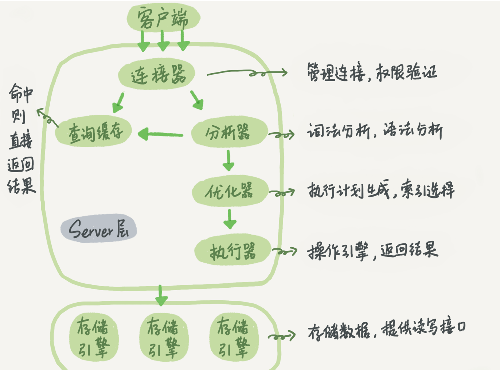
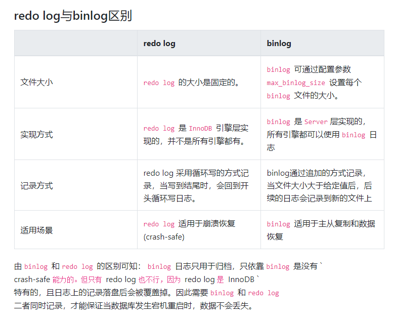

<!--more-->

- [] MVCC彻底理解清楚
- [] 分库分表
- [] MySQL Cluster在CAP中的定位

# 关系数据库基本概念
## 3大范式是什么
* 函数依赖：对于X, Y, 如果不存在关系，使得X上的属性值相等而Y的属性值不等，称Y函数依赖于X。此时X称为决定因素。
* 完全函数依赖：对于X的任何一个真子集X'，都不满足X' -> Y，说明Y完全函数依赖与X
* 部分函数依赖：如果存在X的真子集X'，满足X'->Y，说明Y对X部分函数依赖
* 如果X->Y, Y不属于X（防止Y->X）, Y -> Z, Z不属于Y（防止Z->Y），称Z对X传递函数依赖。
* 码：如果K -F-> U（完全函数确定），K是R的候选码。
* 1NF: 关系模式中的每一个分量是不可分的数据项
* 2NF: 如果某个关系满足1NF，并且任何一个非主属性都完全函数依赖于任何一个候选码，则该关系模式满足2NF
* 3NF: 如果任何一个非主属性既不部分依赖于码，也不传递依赖于码，说明该关系模式满足3NF
* BCNF: 如果每一个决定因素都包含码，说明该关系模式满足BCNF

## ACID
* A原子性：一个事务中的操作要么全部完成，要么都不完成。
* C一致性：数据从一个一致的状态转换为另一个一致的状态，维持数据性约束，数据的完整性不会被破坏。对数据库作出的修改必须符合预定义的规则，不能违反预定义的不变量。（这些“规则”和“不变量”都是与业务强相关的）
* I隔离性：多个事务的执行不能互相干扰。隔离性可以防止多个事务并发执行时由于交叉执行而导致数据不一致。
* D持久性：事务做出的更改应该是持久的，即使系统故障也不会丢失。

# MyISAM vs InnoDB
* 是否支持行级锁 : MyISAM 只有表级锁(table-level locking)，而InnoDB 支持行级锁(row-level locking)和表级锁,默认为行级锁。
* 是否支持事务和崩溃后的安全恢复： MyISAM 强调的是性能，每次查询具有原子性,其执行速度比InnoDB类型更快，但是不提供事务支持。但是InnoDB 提供事务支持，外部键等高级数据库功能。 具有事务(commit)、回滚(rollback)和崩溃修复能力(crash recovery capabilities)的事务安全(transaction-safe (ACID compliant))型表。
* MyISAM不支持外键，InnoDB支持外键
* 是否支持MVCC ：仅 InnoDB 支持。应对高并发事务, MVCC比单纯的加锁更高效;MVCC只在 READ COMMITTED 和 REPEATABLE READ 两个隔离级别下工作;MVCC可以使用 乐观(optimistic)锁 和 悲观(pessimistic)锁来实现;

# 索引
## 为什么要用？
* 创建唯一性索引可以保证每行数据的唯一性
* 加快数据检索速度
* 帮助服务器避免排序和临时表（？）
* 将随机IO变为顺序IO
* 加速表之间的连接
## 为什么不为每一个列创建索引
* 索引需要维护，加入索引会降低对数据更新的速度
* 索引要占据物理空间

## 注意事项
* 在经常需要搜索的列上，可以加快搜索的速度；

* 在经常使用在WHERE子句中的列上面创建索引，加快条件的判断速度。

* 在经常需要排序的列上创 建索引，因为索引已经排序，这样查询可以利用索引的排序，加快排序查询时间；

* 对于中到大型表索引都是非常有效的，但是特大型表的话维护开销会很大，不适合建索引

* 在经常用在连接的列上，这 些列主要是一些外键，可以加快连接的速度；

* 避免 where 子句中对字段施加函数，这会造成无法命中索引。

* 在使用InnoDB时使用与业务无关的自增主键作为主键，即使用逻辑主键，而不要使用业务主键。

* 单行访问是很慢的。特别是在机械硬盘存储中(SSD的随机I/O要快很多，不过这一点仍然成立）。如果服务器从存储中读取一个数据块只是为了获取其中一行，那么就浪费了很多工作。最好读取的块中能包含尽可能多所需要的行。使用索引可以创建位置引用，以提升效率。
* 按顺序访问范围数据是很快的，这有两个原因。第一，顺序 I/O 不需要多次磁盘寻道，所以比随机I/O要快很多（特别是对机械硬盘）。第二，如果服务器能够按需要顺序读取数据，那么就不再需要额外的排序操作，并且GROUPBY查询也无须再做排序和将行按组进行聚合计算了。
* 索引覆盖查询是很快的。如果一个索引包含了查询需要的所有列，那么存储引擎就 不需要再回表查找行。这避免了大量的单行访问，而上面的第1点已经写明单行访 问是很慢的。

## BTree索引
* 数据结构：B+树
### B树 vs B+树
* B树的所有节点既存放key也存放data，但B+树只有叶子节点存放key和data，其它节点只存放key
* B 树的叶子节点都是独立的;B+树的叶子节点有一条引用链指向与它相邻的叶子节点。
* B 树的检索的过程相当于对范围内的每个节点的关键字做二分查找，可能还没有到达叶子节点，检索就结束了。而 B+树的检索效率就很稳定了，任何查找都是从根节点到叶子节点的过程。
### MyISAM实现
* 非聚簇索引，在索引数据结构（叶子节点的data域）上存放的是数据记录的地址。在索引检索的时候，首先按照B+Tree搜索算法搜索索引，如果指定的Key存在，则取出其 data 域的值，然后以 data 域的值为地址读取相应的数据记录。非聚集索引的叶子节点并不一定存放数据的指针， 因为二级索引的叶子节点就存放的是主键，根据主键再回表查数据。
* MyISAM使用前缀压缩以减少索引，可以让更多的索引进入内存以减少磁盘IO的时间。MyISAM压缩索引库的方法是完全保存索引块中的第一个值，后续的值只保存和第一个值相同前缀的字节数和后续的不同部分。这样每个值的压缩前缀都依赖前面的值，所以MyISAM查找时无法在索引块使用二分查找而只能从头开始扫描，这会影响某些操作的性能，例如倒序扫描。
* 硬要说的话适合`UPDATE`密集的表
### InnoDB实现
* 聚簇索引，表数据文件本身就是按B+Tree组织的一个索引结构，树的叶节点data域保存了完整的数据记录。这个索引的key是数据表的主键，因此InnoDB表数据文件本身就是主索引。其它的索引都作为辅助索引，辅助索引的data域保存的是主键的值而不是地址。在根据主索引搜索时，直接找到key所在的节点即可取出数据；在根据辅助索引查找时，则需要先取出主键的值，再走一遍主索引。 因此，在设计表的时候，不建议使用过长的字段作为主键，也不建议使用非单调的字段作为主键，这样会造成主索引频繁分裂。
* MyISAM索引按照行存储的物理位置引用被索引的行，但是InnoDB按照主键值引用行。如果使用DML对表中数据进行操作（插入、删除、修改...），行的存储位置可能会发生变化，如果使用主键值引用行，此时就不需要对索引进行更新。
### 关于B+树索引的NULL值和 != 条件
* 记录的主键值不允许存储NULL值，因此在有与主键相关的`IS NULL`条件下查询优化器会直接优化这部分。（Impossible WHERE）
* 对于二级索引来说，索引列的值可以为NULL，这些索引记录存放在B+树的最左边。（Define the SQL NULL to be the smallest possible value of a field）
* 对于IS NULL, IS NOT NULL, != 条件，什么时候能够使用索引？
  * 读取二级索引记录的成本
  * 将二级索引记录执行回表操作，也就是到聚簇索引中找到完整的用户记录的操作所付出的成本。
  * 如果要扫描的二级索引记录条数越多，需要执行的回表操作次数也就越多。当二级索引的执行查询成本超过全表扫描的成本时，不如直接扫描聚簇索引。

## 哈希索引
* 数据结构：哈希表
* 对于哈希索引来说，底层的数据结构就是哈希表，因此在**绝大多数需求为单条记录查询**的时候，可以选择哈希索引，查询性能最快；其余大部分场景，建议选择BTree索引。哈希索引无法支持范围查询和顺序查询。
* InnoDB存储引擎和MyISAM存储引擎都无法建立Hash索引，只有Memory/HEAP/NDB存储引擎才能建立哈希索引
  * 然而Memory引擎效率差，没有数据备份恢复机制（只能依赖Server层的binlog，引擎层没有任何机制保障），重启之后数据表中的数据就会丢失

## 最左前缀原则
MySQL中的索引可以以一定顺序引用多列，这种索引叫作联合索引。而最左前缀原则指的是，如果查询的时候查询条件精确匹配索引的左边连续一列或几列，则此列就可以被用到。

## 联合索引的数据结构
对于`(a, b, c)`上的联合索引（只考虑`(a, b, c)`，不考虑自动创建的`a`, `(a, b)`等索引），B+树的每个节点都会包括索引中的所有列。排序规则是先按`a`排序，如果`a`相等时再按`b`排序，`a`和`b`都相等时再按`c`排序。


**问题**：对于`(a, b, c)`上的联合索引，对于条件`where a = 'xx' and c = 'yy'`，是否可以利用索引？
会利用索引。（why?）
**问题**：MySQL 8.0还需要遵守最左匹配原则吗？

# 查询缓存

# 事务
## 事务的特性
* 事务是逻辑上的一组操作，要么都执行，要么都不执行。
* 原子性（Atomicity）： 事务是最小的执行单位，不允许分割。事务的原子性确保动作要么全部完成，要么完全不起作用；
* 一致性（Consistency）： 执行事务后，数据库从一个正确的状态变化到另一个正确的状态；
* 隔离性（Isolation）： 并发访问数据库时，一个用户的事务不被其他事务所干扰，各并发事务之间数据库是独立的；
* 持久性（Durability）： 一个事务被提交之后。它对数据库中数据的改变是持久的，即使数据库发生故障也不应该对其有任何影响。

## MySQL如何保证事务的一致性
* <del>是目的，AID是手段(存疑)。</del>保证事务的原子性、隔离性和持久性是数据库保证一致性的手段。数据库提供的外键约束、级联操作和触发器也是保证一致性的手段。但是一致性是业务强相关的特性，而在代码中或在事务操作中故意写出违反约束的代码是可能的。
* MySQL如何保证事务的原子性：利用InnoDB的Undo log。Undo Log记录了回滚数据库事务操作所需要的信息，当事务执行失败或者主动调用ROLLBACK，事务可以利用Undo Log将数据回滚到未作出修改的状态。
* MySQL如何保证事务的持久性：利用InnoDB的Redo Log。
  * MySQL先把磁盘上的数据加载到内存中，在内存中对数据进行修改，最后再刷回硬盘。MySQL以页为单位与硬盘进行交互，单页的大小为16KB。而单次事务可能对多个页的一小部分数据进行修改，如果每次事务提交都需要将修改的页写回硬盘，性能将会大幅下降。因此MySQL使用Redo log，事务中的操作执行的同时将修改写在redo log，事务提交时将redo log写回硬盘。如果事务提交过程中出现宕机，在数据库恢复时可以恢复redo log的内容，再根据具体情况决定对修改进行回滚或是提交。
* MySQL如何保证事务的隔离性：利用锁机制和多版本并发控制来实现不同级别的事务隔离性。

## 并发事务的问题
* 脏读（Dirty read）：事务修改了数据但是还没有将修改提交到数据库中，另一个事务也访问了这个数据，然后使用了这个数据。因为这个数据是还没来得及提交的旧数据，读取的事务读到的是脏数据，根据这样的脏数据做的操作可能是不正确的
* 丢失修改（Lost to modify）：两个事务同时读取一个数据，并同时修改这个数据。第一个事务修改了这个数据后第二个事务也修改了这个数据，导致第一个事务的修改被丢失。
* 不可重复读（Unrepeatableread）：在一个事务内多次读同一数据。在这个事务还没结束时另一个事务也访问这个数据，并且可能对这个数据进行修改。这样，一个事务内的多次读取到的同一数据的值可能不一样，这种情况称为不可重复读
* 幻读（Phantom read）：在一个事务内用相同的条件查询多次数据，在这个事务查询一次数据之后，另一个并发的事务插入或删除了一些数据，因此事务后续用相同的条件进行查询时结果集会发生变化。

## 事务的隔离级别
* READ-UNCOMMITTED（读取未提交）：最低的隔离级别，允许读取尚未提交的数据变更。可能会导致脏读、幻读、不可重复读。
* READ-COMMITTED（读取已提交）：允许读取并发事务已经提交的数据，可以阻止脏读，但是无法阻止幻读和不可重复读。
* REPEATABLE-READ（可重复读）：默认的隔离级别。一个事务内对同一字段的多次读取结果是一致的，除非数据本身已经被事务自己改变。可以阻止脏读和不可重复读，但是仍然可能发生**幻读**。
* SERIALIZABLE（可串行化）：最高的隔离级别，分布式事务的情况下一般使用可串行化的隔离级别，完全满足ACID性质，所有的事务依次逐个执行，互不干扰。可以防止脏读、不可重复读和幻读。

# MySQL 锁机制
## 按照锁的粒度分类
* 表级锁：对整张表加锁，实现简单，消耗资源少，加锁快，不会出现死锁，粒度最大，并发度最低。
* 行级锁：粒度最小的锁，减少数据库操作的锁冲突，并发度高，但加锁开销大，加锁慢，可能出现死锁。

## 共享/排他锁
* S锁：可以是行级也可以是表级
* X锁：可以实行级也可以是表级
* IS锁：表级
* IX锁：表级

## 其他锁
### 记录锁(Record locks)
* 记录锁是施加在索引记录上的锁。（是指主索引吗？）
* 记录锁永远只会对索引记录施加，即使表没有定义任何索引。在这种情况下，InnoDB会创建一个隐藏的聚簇索引，用该索引实现记录锁。

### 间隙锁(Gap locks) <- ?
* 间隙锁是施加在索引记录之间间隙、在第一个索引记录之前和最后一个索引记录之后的锁。例如查询
  ```SELECT c1 FROM t WHERE c1 BETWEEN 10 and 20 FOR UPDATE```会阻止其他事务插入一个`t.c1 = 15`的行，因为在这个范围内的间隙都已被加锁。（一个间隙指的是一个区间）
* 间隙锁是性能和并发性之间权衡的一部分，在某些事务隔离级别中使用（目测是为了防止幻读），而在其他级别中则不使用。
* 当使用唯一索引搜索唯一行时，不需要使用间隙锁。但是使用多列唯一索引的部分列进行搜索时，间隙锁会发生作用。
* 不同事务可以持有互相冲突的间隙锁。
* InnoDB中的间隙锁是纯禁止性的，间隙锁的唯一目的就是防止其它事务向间隙中插入数据。

### 邻键锁(Next-Key locks) <- ?
* 邻键锁是记录锁和在索引记录之前的间隙锁的结合（a combination of a record lock on the index record and a gap lock on the gap before the index record）。
* InnoDB是这样实现行级锁的：当搜索或扫描表的索引时，InnoDB在它遇到的索引记录上施加共享锁或排他锁。因此行级锁实际上是索引记录锁。
* 邻键锁对索引记录加锁，同时对索引记录之前的(一个)间隙加锁。
* 在`REPEATABLE_READ`事务隔离级别下，InnoDB使用邻键锁来进行搜索和索引扫描，避免**幻读**的出现(->因此REPEATABLE_READ隔离级别不存在幻读问题？

### 插入意向锁(Insert Intension locks)
* 插入意图锁是一种间隙锁，是由`INSERT`操作在行插入之前设置的。该锁表明插入数据的意向，多个事务向同一个间隙(区间)插入数据时，如果他们插入的位置不同，则不需要互相等待。

### 自增锁(AUTO-INC locks)
* 自增锁是一种特殊的表级锁，当事务需要向包含`AUTO_INCREMENT`列的表插入数据时自增锁会发挥作用。如果一个事务正在向表中插入数据，另一个需要插入数据的事务必须等待，这样插入表中的行才能有连续的自增主键。
* 通过更改`innodb_autoinc_lock_mode`配置项可以选择用于自增锁的算法，更改该选项用户可以自由地在自增值的可预测性和插入操作的并发性之间进行权衡取舍。

# 大表优化
## 限定数据范围，禁止不带任何限制范围条件的查询语句
## 读写分离
主库写、从库读
## 垂直分区
根据数据库里面数据表的相关性进行拆分。 例如，用户表中既有用户的登录信息又有用户的基本信息，可以将用户表拆分成两个单独的表，甚至放到单独的库做分库。
简单来说垂直拆分是指数据表列的拆分，把一张列比较多的表拆分为多张表。 
优点：列数据变小，减少读取的block数，减少IO次数，简化表的结构，易于维护。
缺点：主键冗余，增加join操作，让事务变得更复杂。
## 水平分区
保持数据表结构不变，通过某种策略存储数据分片。这样每一片数据分散到不同的表或者库中（比如，按时间区间水平分区，按ID水平分区），达到了分布式的目的。 水平拆分可以支撑非常大的数据量。
分表仅仅是解决了单一表数据过大的问题，但由于表的数据还是在同一台机器上，其实对于提升MySQL并发能力没有什么意义，所以 水平拆分**最好分库** 。
水平拆分能够 支持非常大的数据量存储，应用端改造也少，但 分片事务难以解决 ，跨节点Join性能较差，逻辑复杂。
* 分片的常见方案:
  * 客户端代理：分片逻辑在应用端，封装在jar包中，通过修改或封装JDBC层来实现。（？）
  * 中间件代理：在应用和数据中间加了一个代理层。分片逻辑统一维护在中间件服务中。（？）
## SQL
* 使用慢查询日志找出较慢的SQL
* 不做列运算：`SELECT id WHERE age + 1 = 10`，任何对列的操作都将导致表扫描，它包括数据库教程函数、计算表达式等等，查询时要尽可能将操作移至等号右边
* 对列进行函数操作可能会导致无法使用索引 -> 函数索引。隐式类型转换也会导致索引失效。
* 尽量不用`SELECT *`，而是显式指定需要的列
* 不用函数和触发器，在应用程序实现（？）
* 少用JOIN
* 尽量避免在`WHERE`中使用`!=`, `<>`, 这类条件无法利用索引，而只能使用全表扫描。

## 索引
* 频繁的查询优先考虑使用覆盖索引（包含了所查询字段的索引），这样可以必满InnoDB表进行索引的二次查询。
  * 例如，要通过某个建立了二级索引的列`A`上的条件查询列`B`的值，如果只使用`A`上的索引，由于该索引的叶子节点只保存了主键的值，因此此时需要回表，即在主键索引上再次进行查找，才能找到对应行的`B`的值。如果在`A`和`B`上建立一个联合索引，在叶子节点处就会存在`B`列的值，不需要进行回表。
* 一个 SQL 只能利用到复合索引中的一列进行范围查询。如：有 a,b,c 列的联合索引，在查询条件中有 a 列的范围查询，则在 b,c 列上的索引将不会被用到。

## 模糊查询
* 严禁左模糊（例如，`a like '%123'`。形如`a like '123%'`，即左侧具体的条件，是可以使用列上的索引的）或者全模糊，有这种需求的时候需要使用搜索引擎。B树索引有最左前缀匹配的特性，最左边的值不确定时无法使用。

## 外键
* 对于外键和级联的一种好的方式是在应用层实现。外键与级联更新适用于单机低并发，不适合分布式、高并发集群;级联更新是强阻塞，存在数据库更新风暴的风 险;外键影响数据库的插入速度。并且分库分表的情况下数据库级别的外键也无法生效。
* 外键也有一定的好处：在DB层面就保证了数据的一致性和完整性，并且由数据库自动完成级联操作也可以减少代码量。
* 在定义联合索引时，如果 a 列要用到范围查找的话，就要把 a 列放到联合索引的右侧，使用 left join 或 not exists 来优化 not in 操作，因为 not in 也通常会使用索引失效。

# 池化（数据库连接池）
建立连接是需要消耗时间的，如果有较多的任务陆续提交而不进行任何特殊处理，就需要重复建立连接-关闭连接的过程，浪费时间。因此池化技术的思想就是复用这些创建的连接。（数据库连接的本质可以视为一个socket连接）。

# SQL语句的执行过程

## 主要组件
* Server层
  * 连接器： 身份认证和权限相关(登录 MySQL 的时候)。
  * 查询缓存:  执行查询语句的时候，会先查询缓存（MySQL 8.0 版本后移除，因为这个功能不太实用）。执行查询语句的时候，会先查询缓存，MySQL 会先校验这个 sql 是否执行过，以 Key-Value 的形式缓存在内存中，Key 是查询预计，Value 是结果集。如果缓存 key 被命中，就会直接返回给客户端，如果没有命中，就会执行后续的操作，完成后也会把结果缓存起来，方便下一次调用。
  * 分析器:  没有命中缓存的话，SQL 语句就会经过分析器，分析器说白了就是要先看你的 SQL 语句要干嘛，再检查你的 SQL 语句语法是否正确。词法分析提取关键字，语法分析校验SQL语法是否正确。
  * 优化器： 按照 MySQL 认为最优的方案，生成查询计划去执行。 比如决定如何选择索引。
  * 执行器:  执行语句，然后从存储引擎返回数据。执行器在执行前会首先检查用户有没有权限。
* 存储引擎：InnoDB包括Redolog模块

## 更新语句的执行流程(Server层和InnoDB存储引擎的交互)
执行更新语句时要记录日志。MySQL使用binlog进行日志记录，InnoDB还自带一个日志模块redo log。
1. 拿到待修改的数据，进行修改，然后调用引擎API接口写入修改后的数据。InnoDB会将数据保存在内存中，同时记录Redo log（**写不写硬盘？**），此时redo log进入prepare状态，然后告诉执行器执行完成，随时可以提交。
2. 执行器收到通知后记录binlog（**写不写硬盘？**），然后调用引擎接口，提交redo log为提交状态（**写不写硬盘？**）。
3. 更新完成。（**怎么记录undo log？**）

* 为什么要用两个日志模块？
  * 这是因为最开始 MySQL 并没有 InnoDB 引擎( InnoDB 引擎是其他公司以插件形式插入 MySQL 的) ，MySQL 自带的引擎是 MyISAM，但是我们知道 redo log 是 InnoDB 引擎特有的，其他存储引擎都没有，这就导致会没有 crash-safe 的能力(crash-safe 的能力即使数据库发生异常重启，之前提交的记录都不会丢失)，binlog 日志只能用来归档（？？）。

* 为什么要先让redo log进入prepare状态，然后记录binlog，最后commit redo log？
  * 先写 redo log 直接提交，然后写 binlog，假设写完 redo log 后，机器挂了，binlog 日志没有被写入，那么机器重启后，这台机器会通过 redo log 恢复数据，但是这个时候 bingog 并没有记录该数据，后续进行机器备份的时候，就会丢失这一条数据，同时主从同步也会丢失这一条数据。
  * 先写 binlog，然后写 redo log，假设写完了 binlog，机器异常重启了，由于没有 redo log，本机是无法恢复这一条记录的，但是 binlog 又有记录，那么和上面同样的道理，就会产生数据不一致的情况。（**直接用binlog恢复可以吗？**）
如果采用 redo log 两阶段提交的方式就不一样了，写完 binglog 后，然后再提交 redo log 就会防止出现上述的问题，从而保证了数据的一致性。那么问题来了，有没有一个极端的情况呢？假设 redo log 处于预提交状态，binglog 也已经写完了，这个时候发生了异常重启会怎么样呢？ 这个就要依赖于 MySQL 的处理机制了，MySQL 的处理过程如下：
  * 判断 redo log 是否完整，如果判断是完整的，就立即提交。（什么叫是否完整？意思是是否已经是commit状态？）
  * 如果 redo log 只是预提交但不是 commit 状态，这个时候就会去判断 binlog 是否完整（什么叫是否完整？），如果完整就提交 redo log, 不完整就回滚事务。
这样就解决了数据一致性的问题。

# MySQL日志
* binlog：二进制日志
* redo log、undo log：事务日志（？）
* redo log：物理日志，记录数据页的物理修改，而不是对某一行的具体修改
* undo log：逻辑日志（？）
* 慢查询日志

## binlog
binlog 用于记录数据库执行的**写入性操作**(不包括查询)信息，以二进制的形式保存在磁盘中。 binlog 是 mysql的**逻辑日志**，并且由 Server 层进行记录，使用任何存储引擎的 mysql 数据库都会记录 binlog 日志。
* 包含引起或可能引起数据库改变的事件信息。
* 对于事务操作，二进制日志只在事务提交的时候一次性写入。提交前的每个二进制日志记录都会先写到内存，事务提交时写入硬盘。
* 是Server层产生的，不管什么存储引擎对数据库进行了修改都会产生binlog
* 逻辑日志： 逻辑性的语句。基于语句时直接记录SQL语句，基于行时记录行数据的修改情况。
* 物理日志： mysql 数据最终是保存在数据页中的，物理日志记录的就是数据页变更。

### 使用场景
* 主从复制 ：在 Master 端开启 binlog ，然后将 binlog 发送到各个 Slave 端， Slave 端重放 binlog 从而达到主从数据一致。
* 数据恢复 ：通过使用 mysqlbinlog 工具来恢复数据。

### 刷盘时机
对于 InnoDB 存储引擎而言，只有在事务提交时才会记录 binlog ，此时记录还在内存中。mysql 通过 `sync_binlog` 参数控制 biglog 的刷盘(调用`fsync`)时机（影响的是如果操作系统崩溃，是否会丢失修改。如果单纯数据库服务器崩溃，似乎操作系统缓冲区的内容还是能够刷入磁盘），取值范围是 0-N：
* 0：不去强制要求，由系统自行判断何时写入磁盘；
* 1（默认）：每次 commit 的时候都要将 binlog 写入磁盘；
* N：每N个事务，才会将 binlog 写入磁盘。

## redo log
事务的持久性：只要提交成功，对数据库的修改就要永久保存。
内存与硬盘数据的一致性如何保证？最简单的方法是每次事务提交的时候就把涉及到的数据页全部刷写到磁盘中。可能每次事务只会改一个页里的几个字节，却要把整个页完整地刷新到磁盘（InnoDB以页为单位与磁盘交互），而且一个事务可能涉及多个数据页，这样性能太差。
* redo log：记录事务对数据页做了哪些修改。
redo log 包括两部分：一个是内存中的日志缓冲(redo log buffer)，另一个是磁盘上的日志文件(redo logfile)。 mysql 每执行一条 DML 语句，先将记录写入redo log buffer，后续某个时间点再一次性将多个操作记录写到 redo log file 。这种 先写日志，再写磁盘 的技术就是 MySQL里经常说到的 WAL(Write-Ahead Logging) 技术。
  * redo log buffer是易失性的。磁盘上的redo log file是持久的。
  * log file其实指的是内存中内核空间的操作系统缓冲区(OS Buffer)中的redo log。InnoDB会以一定的时间间隔（例如每个事务提交时）调用`fsync`将OS Buffer中的redo log内容刷到硬盘上的真正的redo log文件。
  * 可以通过调整`innodb_flush_log_at_trx_commit`的参数值来调整调用fsync的时机。
    * 1：每次提交都写入os buffer并fsync。主从复制时必须设置为1.
    * 0：每秒将log buffer写入os buffer并调用fsync。
    * 2：每次提交都写入os buffer，但每秒调用一次fsync。

* redo log记录数据页的变更（物理日志？）redo log采用大小固定、循环写入的方式，到达结尾时会回到开头循环写日志。日志上的记录在数据落盘后会被覆盖掉。
  * redo log group：一组redo log需要由几个redo log file构成。
  * 第一个redo log file写完后会开始写第二个。第二个写完后会开始覆盖第一个redo log file的内容。
* redolog会在数据准备修改前先写入缓存中的redolog，然后再对缓存中的数据执行实际操作。

### redo log的内容
* redo_log_type：redo log的日志类型
* space：表空间的ID（？）
* page_no：页的偏移量（？？）
* redo_log_body：数据部分

## redo log和binlog的区别
* redo log是InnoDB引擎特有的；binlog是MySQL的Server层实现的，所有引擎都可以用。



## undo log
数据库事务四大特性中有一个是 原子性 ，具体来说就是 原子性是指对数据库的一系列操作，要么全部成功，要么全部失败，不可能出现部分成功的情况。实际上， 原子性 底层就是通过 undo log 实现的。 undo log 主要记录了数据的逻辑变化，比如一条INSERT语句，对应一条 DELETE 的 undo log ，对于每个UPDATE 语句，对应一条相反的 UPDATE 的undo log ，这样在发生错误时，就能回滚到事务之前的数据状态。同时， undo log 也是 MVCC(多版本并发控制)实现的关键。

## 慢查询日志
* 执行时间、执行用户、查询用时、具体的查询语句
* 如何分析？使用`explain`语句

# MVCC（多版本并发控制）
* 为什么要引入MVCC?：只让写写互相阻塞，其它操作可以并行
* MySQL的大多数事务型存储引擎实现的其实都不是简单的行级锁。基于提升并发性能的考虑, 它们一般都同时实现了多版本并发控制(MVCC)。可以认为MVCC是行级锁的一个变种, 但是它在很多情况下避免了加锁操作, 因此开销更低。虽然实现机制有所不同, 但大都实现了非阻塞的读操作，写操作也只锁定必要的行。MVCC的实现方式有多种, 典型的有乐观(optimistic)并发控制 和 悲观(pessimistic)并发控制。
* 只在`READ COMMITTED`和`READ REPEATABLE`隔离级别下工作。因为 `READ UNCOMMITTED` 总是读取最新的数据行, 而不是符合当前事务版本的数据行。而 `SERIALIZABLE` 则会对所有读取的行都加锁。
## MVCC在InnoDB中的实现
在InnoDB中，会在每行数据后添加3个额外的隐藏的值来实现MVCC：
* DB_TRX_ID: 插入或更新该行的最后一个事务的标识符。删除也算一种更新，有特殊的标志位说明该行已经被删除。
* DB_ROLL_PTR: （Roll Pointer）指向回滚段中的undo log记录。如果该行被更新，使用undo log可以重构出该行更新前的数据。
  * undo log记录的是旧版本的数据，其它事务读取数据的时候，根据DB_TRX_ID和DB_ROLL_PTR从undo log链中找到符合可见性要求的数据。undo log中的数据通过DB_ROLL_PTR和主数据关联。
* DB_ROW_ID: 行标识，是一个随着新行插入单调自增的行ID。如果InnoDB自动生成了聚簇索引（用户没有指定主键），这个聚簇索引的索引列就是这个单调自增行ID。否则这一列不会出现在任何索引中。

### 一致性读和加锁读
* Consistent Nonlocking reads：Consistent read是一种读操作，使用基于某个时间点的快照信息来展示查询结果，而忽略同时运行的其他事务做出的修改。对于查询而言，在快照的时间点之前已经提交的事务所做出的更改是可见的，而在该时间点之后做出的更改或未提交的事务所作出的更改是不可见的（例外情况：同一事务中之前的语句做出的修改是可见的）。
  * 是`REPEATABLE_READ`和`READ_COMMITTED`隔离级别下InnoDB处理`SELECT`语句的默认模式。
  * 不会对行或表加锁，同时会忽略所有在读视图记录上加的任何锁。
* Locking Read: 如果想要确保读到最新数据，需要使用`FOR UPDATE`、`FOR SHARE`加入互斥锁或共享锁，或者使用`READ_UNCOMMITTED`隔离级别。

### 快照的本质
* 每个事务启动的瞬间（还是创建快照时？）都会记录当前所有“活跃事务”（已经启动但还没有提交）的事务标识符(ID)。
* 最小的活跃事务ID为低水位
* **所有已经出现过的**最大事务ID + 1为高水位（即**下一个开启的事务会被分配的ID**）
* 可见性判断：用当前数据的DB_TRX_ID和数组中的事务ID进行比较。低水位以前的数据版本可见（肯定已经提交了），大于等于高水位的数据版本不可见（还没开始）。如果处于高水位和低水位之间，需要看当前数据版本的DB_TRX是否存在于高低水位之间，如果存在，则说明事务仍未提交，该版本对当前事务不可见，否则说明事务已经提交，该版本对当前事务可见。
* 寻找可见的数据版本：如果发现当前版本的数据不可见，则根据隐藏列DB_ROLL_PTR在undo log中找到旧版本的版本号，重新判断，知道找到可见的版本，读出该版本的数据。

### 快照的创建时机
#### `REPEATABLE_READ`可重复读
* 对于可重复读的事务隔离级别，快照会基于事务的第一次读操作进行构建，同一事务中的所有consistent Read操作读出的内容都是（基于）这一快照的。如果数据已经被其他事务修改，原始数据会通过undo log的内容进行重构。在该隔离级别下，每个在同一事务中的普通的（不使用锁的）`SELECT`语句都是一致的。

#### `READ_COMMITTED`读已提交
* 对于每次的Consistent Read操作，即使他们都在同一个事务中，他们都会对快照进行更新并读取最新快照。

### `START TRANSACTION WITH CONSISTENT SNAPSHOT`
* 立即启动事务并创建一致性读快照，相当于马上执行一个普通的SELECT语句。

### Undo Log
1. INSERT UNDO LOG：对插入数据产生的UNDO LOG，只有在事务回滚的时候才需要，事务提交之后就可以丢弃。
2. UPDATE UNDO LOG: 对修改和删除数据产生的UNDO LOG，快照读也是需要的。只有当数据库所使用的快照不涉及该日志记录（低于低水位？）时对应的回滚日志才会被删除。
* purge线程：需要删除时只是先设置旧记录的标志位，InnoDB使用专门的purge线程来清理这些记录。

### 加锁读
#### 读已提交
* 对于locking read操作、`UPDATE`语句、`DELETE`语句，InnoDB只会对索引记录加锁，而不会对他们之前的gap加锁，因此允许在这些被锁住的记录旁边插入新记录。Gap锁只会被用于外键约束检查和重复键检查。
* 个人理解：已提交读不会出现脏读，而可能出现幻读（允许插入数据）和不可重复读（要对快照进行更新并读取最新快照）。

#### 可重复读
* 对于locking reads（使用`FOR UPDATE`或`FOR SHARE`的`SELECT`），如何加锁取决于该`SELECT`语句是在唯一索引(unique index)上使用了唯一的搜索条件，还是使用了范围型的搜索条件。
  * 对于在使用唯一索引和唯一的搜索条件的情况，InnoDB只会对结果集中的记录的索引进行加锁，而不会对其之前的gap（其它能够插入数据的位置）进行加锁。（此时结果集中的记录的索引已经被加锁，不会被删除也不会被修改）。
  * 对于其他搜索条件，InnoDB会对所有扫描的索引范围加锁，使用gap locks或next-key locks对其它试图在范围中的gap进行数据插入的操作进行阻塞。（个人理解：结果集中的行的间隙(gap)也会加锁，覆盖到的范围都会加锁，不让其它session在可以插入数据的位置进行插入）
* 个人理解：可重复读隔离级别解决了脏读、不可重复读问题，交替使用快照读和加锁读会出现幻读。

# 高级主题
## MySQL 主从模式
* 主从模式的好处
  * 一定程度上解决了单点故障问题
  * 可以实现读写分离，降低单台服务器的负载
* 主从复制的策略
  * 同步复制：等到所有Slave的回应才会提交并返回结果
  * 半同步复制：等到至少一个Slave的回应就返回
  * 异步复制：Master不等Slave回应就返回结果
  * 延迟策略？