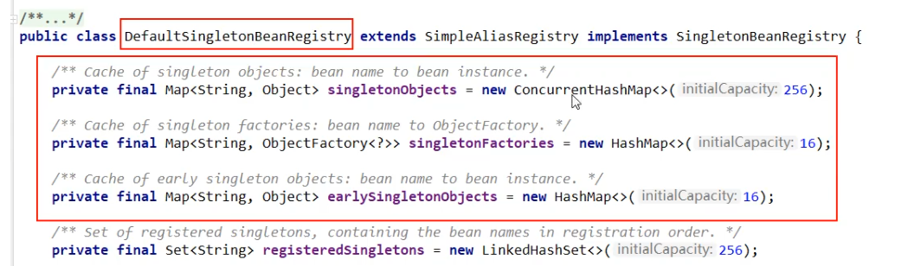
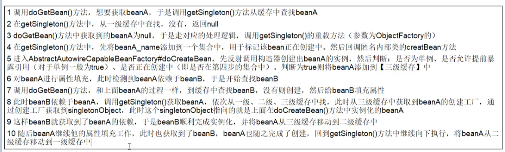
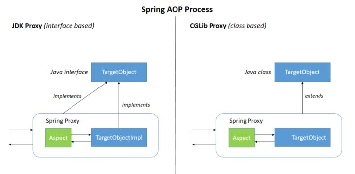

<!--more-->

- [x] SpringMVC原理

# Spring框架
* 多模块的集合
  * 核心容器（IOC）
  * 数据访问
  * Web
  * AOP

## 常用注解
### @Component和@Bean
* `@Component`作用于类，使用该注解的类通常会通过classpath扫描来自动侦测并被装配到Spring容器中。可以通过`@ComponentScan`来定义要扫描的路径，以及定义排除规则。
* `@Bean`作用于方法，说明标有该注解的方法中会产生一个Bean。使用第三方库的时候，如果需要将第三方库的类装配到Spring容器中，可以定义一个产生该类的方法并附加`@Bean`注解。同时，使用`@Bean`可以实现根据不同条件进行不同的装配操作（在方法中编写条件代码），比`@Component`相对灵活。

### 如何将一个类声明为Spring的Bean
* `@Component`: 通用
* `@Repository`: 对应持久层（DAO）
* `@Service`: 对应服务层
* `@Controller`: 对应控制层
* `@Configuration`: 配置类
* 名称：`@....(value = "...")`

### @Controller, @RestController
* 都是表明某类是一个Controller的注解。Dispatcher会扫描使用了这两个注解的类的方法，并检查该方法是否使用了`@RequestMapping`或`@GetMapping`一类的注解。
* `@Controller`一般用于返回一个视图（一个页面，可以是使用模板引擎进行渲染的页面）。如果要返回JSON或XML格式的数据，需要搭配使用`@ResponseBody`注解。如果处理器方法被注解`@ResponseBody`的话，该方法的返回类型会通过适当的Converter转换后写到`HttpServletResponse`中，而不是被当成视图处理。
* `@RestController`，是`@Controller`和`@ResponseBody`的结合，只返回对象，对象数据直接以JSON或XML形式写入HTTP响应中。

### 属性注入：@Autowired @Qualifier @Resource
* `@AutoWired`：根据类型进行自动装配
* `@Qualifier`: 根据属性名称进行注入，需要和`@Autowired`配合使用。`@Qualifier(value = "...")`
* `@Resource`: 可以根据类型注入，也可以根据名称注入
* `@Value`：注入普通类型属性, `@Value("classpath:/...")`...

### 前后端传值
* `@PathVariable`: 路径参数
* `@RequestParam`: 查询参数（Query String）
* `@RequestBody`: 读取Request请求。`Content-Type`为`application/json`格式时，接收到数据之后会自动将数据绑定到Java对象上去。系统使用`HttpMessageConverter`或自定义的Converter将body中的json字符串转换为Java对象。

### 读取配置信息
* `@PropertySource("app.properties")` + `@Value("${app.property:defaultValue}")`
* `@ConfigurationProperties(prefix = "...")`: 读取配置信息并与Bean绑定

### Json数据处理
* `@JsonIgnoreProperties({"字段名"})`: 过滤掉特定字段不返回或者不解析
* `@JsonIgnore`: 同上，不过直接作用于类的属性上
* `@JsonFormat`: 格式化JSON数据
* `@JsonUnwrapped`: 扁平化对象

# IOC
## 怎么理解IOC
IoC（Inverse of Control:控制反转）是一种设计思想，就是 将原本在程序中**手动创建对象的控制权，交由Spring框架来管理**。IoC 容器是 Spring 用来实现 IoC 的载体， IoC 容器实际上就是个Map（key，value）,Map 中存放的是各种对象。这样可以很大程度上简化应用的开发，把应用从复杂的依赖关系中解放出来。 IoC 容器就像是一个工厂一样，当我们需要创建一个对象的时候，只需要配置好配置文件/注解即可，完全不用考虑对象是如何被创建出来的。
* 传统的`new`关键字进行手动装配存在一定困难
  * 实例化组件的过程是复杂的，某些组件需要读取配置才能完成实例化
  * 组件之间存在依赖关系，但多个组件依赖一个组件时，很多时候只需要依赖组件的单个实例，没有必要多次实例化。而实现这一点需要理清组件之间的依赖关系，以确定恰当的实例化顺序，这对于手动装配而言是麻烦的
  * 有时候组件需要进行销毁以释放资源，但销毁组件时需要确定所有依赖该组件的其他组件也已经被销毁
* 因此IOC容器的职责就是
  * 负责创建组件
  * 负责根据依赖关系组装组件
  * 按照依赖顺序正确地销毁组件
* Spring IOC的无侵入性：组件无需要实现框架特定的接口。因此编写完成的组件可以自动装配也可以手动装配。并且测试组件的时候可以单独进行测试。 
资源（对象）不由使用和提供资源的双方管理，而由第三方管理，集中式的管理容易配置，容易管理，也降低了资源提供方和使用方的耦合度。使得通过配置文件而不是在代码里硬编码（hardcode）的方式来实例化对象和装配对象图。
* 本质上，IOC容器是个Map。IOC容器可以这样完成自动装配
  * `BeanFactory`或`ApplicationContext`通过XML配置文件或classpath扫描获得所有的附加了`@Bean`的方法或者附加了`@Component`的注解，获得所有Bean的类名。通过对类名使用`Class.forName`可以完成类加载
  * `BeanFactory`：加载配置时不创建对象，第一次通过`getBean`获取Bean时才会创建对象。`ApplicationContext`：加载配置时就创建对象
    

## Spring Bean管理
### Bean的作用域
Spring IOC容器原本支持的作用域只有singleton和prototpye。其它作用域是后续框架的增强。
* singleton：默认是单例的
* prototype：每次获取bean时都会创建一个新的bean实例
* request：每一次HTTP请求都会生成一个新的bean，仅在当前HTTP request内有效
* session：每一次HTTP请求都会生成一个新的bean，仅在当前HTTP session内有效

### 单例bean的线程安全问题
* 多个线程操作同一个单例对象时对这个对象的成员变量的写操作存在线程安全问题。
* 一般情况下，Controller、Service、Dao等Bean都应该是无状态的，不保存数据的Bean即使被多线程使用也是安全的。
* 如果需要成员变量，可以将成员变量保存在`ThreadLocal`中。或者将Bean的作用域改为prototype

### Bean的生命周期
* 实例化：实例化一个Bean对象
* 属性赋值：为Bean设置相关属性。如果该Bean依赖其它Bean，则获取对其它bean的引用
* 初始化：可能的Aware相关接口，BeanPostProcessor的前后置处理，是否实现`InitializingBean`接口，自定义的`init-method`（`@PostConstruct`）（如果Bean有定义初始化方法，则调用这些初始化方法）
* 销毁：自定义的`destroy-method`（容器关闭的时候，如果bean调用了销毁方法，则调用销毁方法`@PreDestroy`）
#### 常用扩展点（生命周期钩子？）
##### 影响多个Bean的接口：后置处理器
* 实现了这些接口的Bean会**切入到多个Bean的生命周期**中。
* BeanPostProcessor：**初始化**阶段的前后，Bean实例会被传入这个后置处理器的方法。同时会返回一个Bean。String AOP可以在此处完成对Bean的增强，返回代理对象
  * `postProcessBeforeInitialization`
  * `postProcessAfterInitialization`
* InstantiationAwareBeanPostProcessor：**实例化**阶段的前后
##### 只调用一次的接口

## Spring中的设计模式
* 工厂模式：通过`BeanFactory`、`ApplicationContext`创建对象
* 代理模式：Spring AOP
* 单例模式：Spring中的单例Bean

# SpringMVC
## 为什么要使用MVC设计模式
* 将数据模型定义、控制逻辑和表现逻辑分离，降低各个模块之间的耦合度。
* 视图：呈现模型，展示数据，直接与用户交互
* 控制器：取得用户的输入，解读其对模型的操作，据此改变视图的状态、改变视图的显示
* 模型：模型封装持有的数据、状态和业务逻辑，不需要对控制器和视图的存在进行感知，只提供操作和检索状态的接口，并发送状态改变通知给观察者。

## MVC vs MVVM
* MVC: M封装数据和逻辑，V提供展示，C进行控制：V向C请求修改Model，C帮V调用Model的操作，得到Model的反馈后用新的数据更新V。
* MVVM：VM完成V与M的双向绑定。直接对V上的数据进行修改，VM会自动将对V的修改同步到M上。反之对M进行修改，VM会自动将对M的修改同步到V上，表现为用户界面的变化。

## 工作原理
* 客户端发送请求，通过`DispatcherServlet`接收请求。
* `DispatcherServlet`根据请求信息，从`HandlerMapping`查找对应的`HandlerAdapter`。
* 与`HandlerAdapter`相关的`Handler`调用真正的处理器来处理请求，完成相应的业务逻辑。
  * 为什么要区分`Handler`和`HandlerAdapter`？
  * `HandlerAdapter`相当于一个代理。
  * 我们编写的Controller希望能够将路径参数、URL参数和请求体都作为方法的参数传入。因此`HandlerAdapter`可以将`HttpServletRequest`中的URL参数、请求体等进行解析，然后使用反射机制调用`Handler`的方法，实现这一目的。
* 处理完请求后，如果是RESTful接口，则将返回数据通过适当的转换器转换后写到`HttpServletResponse`中。
* 如果不是一个RESTful接口，处理完业务后会返回一个`ModelAndView`对象。

# Spring 三级缓存
* 一级缓存：`singletonObjects`：单例池，存放已经经历了完整生命周期的Bean(已经初始化好的Bean)
* 二级缓存：`earlySingletonObjects`：存放早期暴露出来的Bean对象，生命周期未结束（未完成初始化，属性未填充完）
* 三级缓存：`singletonFactories`：存放可以生成Bean的工厂

* 四大方法:
  * `getSingleton`
    * 一级缓存没有，并且当前对象并不是创建过程中（`isSingletonCurrentlyInCreation`返回`false`）就去二级缓存找
    * 二级缓存没有，就去三级缓存找
    * 三级缓存有的话（能够获得对应的FactoryBean），就通过factory创建一个原始Bean，放到二级缓存，并删除三级缓存中的factory
  * `doCreateBean`
  * `populateBean`
  * `earlySingletonObjects`
* Spring创建Bean的过程：创建原始的bean对象，然后填充对象属性进行初始化
* 每次创建单例Bean之前先在一级缓存中检查是否已经创建过

# 循环依赖问题
### 问题
* 多个Bean之间互相依赖，形成闭环。默认B的单例Bean中，属性互相引用的场景。
* 构造方法注入，setter方法注入
* 构造方法注入可能导致循环依赖问题。并且坚持使用构造方法注入是无法解决的。
  * 注：一般情况下推荐使用构造注入
  * 使用基于setter方法的注入代替构造方法注入
  * 只要注入方式是setter方法注入，且Bean为单例Bean(`@Component`)，则能够解决循环依赖问题
  * 原型（prototpye, `@Scope(ConfigurableBeanFactory.SCOPE_PROTOTYPE)`, `@Scope("prototype")`）的场景无法支持循环依赖，会报错`BeanCurrentlyInCreationException`。

### 解决
* Spring内部通过三级缓存解决循环依赖：`DefaultSingletonBeanRegistry`
* 单例Bean：三级缓存提前暴露，依靠Bean的“中间态”概念，中间态指的是已经实例化但没有初始化的状态
* 非单例Bean：每次都要获取一个新的对象，要重新创建，没有缓存
* 创建单例Bean A的原始对象后（未填充属性），将其放入三级缓存，然后开始填充对象属性。此时发现Bean A需要依赖Bean B，顺序查找三级缓存未能找到Bean B，于是进行BeanB的创建。经过相似的过程后会发现创建Bean B需要Bean A
* 此时Bean B在第三级缓存中查找到Bean A的原始对象，直接将原始对象注入Bean B（提前暴露Bean A），完成对Bean B的创建。
* Bean B创建完毕后Bean A的创建流程即可继续，完成属性填充的工作。

### 为什么一定要用三级缓存？
* 维持Spring Bean的生命周期

# AOP
## 怎么理解
能够将那些与业务无关，却为业务模块所共同调用的逻辑或责任（例如事务处理、日志管理、权限控制、统一的错误处理等）封装起来，便于减少系统的重复代码，降低模块间的耦合度，并有利于未来的可拓展性和可维护性。

## 原理
Spring AOP基于动态代理。如果代理对象实现了某个接口，使用JDK动态代理。否则使用CGLIB生产一个被代理对象的子类作为代理。

## Spring AOP和AspectJ AOP的区别
* Spring AOP无论是使用JDK提供的Proxy还是CGLIB，本质都是动态代理，在运行时对类进行增强。而AspectJ AOP其实使用了静态代理的方法，在编译字节码时在方法的周围加上业务逻辑，是编译期通过操作字节码完成静态织入。
* AspectJ的功能更强大，同时性能更好，因为对方法的增强在编译期就已经完成了。

## 常用注解
* `@Before`
* `@After`
* `@AfterReturning`
* `@AfterThrowing`
* `@Around`

## AOP的执行顺序
* 正常执行：环绕Before -> Before -> AfterReturn -> After -> 环绕After
* 异常流程：环绕Before -> Before -> AfterThrowing -> After

# Spring事务
* 编程式事务：`TransactionTemplate`，`TransactionManager`
* 声明式事务：基于XML、基于注解
  * 实现原理：动态代理
## Spring事务的隔离级别(isolation)
* `TransactionDefinition.ISOLATION_DEFAULT`: 使用后端数据库默认的隔离级别，Mysql 默认采用的 REPEATABLE_READ隔离级别 Oracle 默认采用的 READ_COMMITTED隔离级别.
* `TransactionDefinition.ISOLATION_READ_UNCOMMITTED`: 最低的隔离级别，允许读取尚未提交的数据变更，可能会导致脏读、幻读或不可重复读
* `TransactionDefinition.ISOLATION_READ_COMMITTED`: 允许读取并发事务已经提交的数据，可以阻止脏读，但是幻读或不可重复读仍有可能发生
* `TransactionDefinition.ISOLATION_REPEATABLE_READ`: 对同一字段的多次读取结果都是一致的，除非数据是被本身事务自己所修改，可以阻止脏读和不可重复读，但幻读仍有可能发生。
* `TransactionDefinition.ISOLATION_SERIALIZABLE`: 最高的隔离级别，完全服从ACID的隔离级别。所有的事务依次逐个执行，这样事务之间就完全不可能产生干扰，也就是说，该级别可以防止脏读、不可重复读以及幻读。但是这将严重影响程序的性能。通常情况下也不会用到该级别。

## Spring事务的传播(propagation)
### 加入当前事务
* `TransactionDefinition.PROPAGATION_REQUIRED`： 如果当前存在事务，则加入该事务；如果当前没有事务，则创建一个新的事务。
* `TransactionDefinition.PROPAGATION_SUPPORTS`： 如果当前存在事务，则加入该事务；如果当前没有事务，则以非事务的方式继续运行。
* `TransactionDefinition.PROPAGATION_MANDATORY`： 如果当前存在事务，则加入该事务；如果当前没有事务，则抛出异常。（mandatory：强制性）

### 挂起当前事务
* TransactionDefinition.PROPAGATION_REQUIRES_NEW： 创建一个新的事务，如果当前存在事务，则把当前事务挂起。
* TransactionDefinition.PROPAGATION_NOT_SUPPORTED： 以非事务方式运行，如果当前存在事务，则把当前事务挂起。
* TransactionDefinition.PROPAGATION_NEVER： 以非事务方式运行，如果当前存在事务，则抛出异常。

### 其他情况
* TransactionDefinition.PROPAGATION_NESTED： 如果当前存在事务，则创建一个事务作为当前事务的嵌套事务来运行；如果当前没有事务，则该取值等价于TransactionDefinition.PROPAGATION_REQUIRED。

## @Transcational(rollbackFor = Exception.class)
* 让Spring事务遇到非运行时异常时也回滚。

## 事务超时属性(timeout)
* 在`TransactionDefinition`中以int类型`timeout`表示超时时间

## 事务只读属性(readOnly)

## 自调用问题
若同一类中的其他没有 `@Transactional` 注解的方法内部调用有 `@Transactional` 注解的方法，有`@Transactional` 注解的方法的事务会失效。
因为Spring AOP的实现原因，当含有`@Transactional`注解的方法在类以外被调用的时候，Spring事务管理才生效。