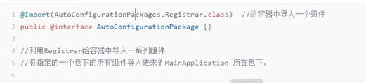

<!--more-->

TODOS:
- [] SpringBoot的启动流程

# SpringBoot帮我们干了什么
## 依赖管理
* 父项目完成依赖管理（`spring-boot-starter-parent`）。父项目几乎声明了常用的所有依赖的版本号
* 开发时导入starter场景启动器：对于一个场景，引入starter依赖会引入该场景相关的所有常规依赖
  * 所有场景启动器都依赖`spring-boot-starter`
* 无需关注版本号，完成自动版本仲裁
  * 查看`spring-boot-dependencies`中的依赖标签名。也可以在项目中的`<properties>`标签中自定义依赖的版本号

## 自动配置
* 对于一个场景中的各种依赖会提供默认配置，开箱即用（例如`web.xml`中的各种设置，例如字符编码...etc）
* 默认的包结构（包扫描的目录：主程序所在的包及其子包中的所有类都会被扫描
* 各种配置拥有默认值（默认端口，默认值...），配置类持有这些默认值，而在SpringBoot类的项目配置文件中(`application.properties`/`application.yml`)进行设置可以将这些值绑定到**对应的**配置类上，配置类会被加载到容器中发挥作用。
* 按需加载自动配置项：引入的时候自动配置才会开启
  * 所有的自动配置功能都在`spring-boot-autoconfigure`中

# 底层注解
## @SpringBootApplication
默认加在主类上，是`@SpringBootConfiguration`（其实就是`@Configuration`, 允许在Spring上下文中注册额外的Bean或导入其它配置类）、`@EnableAutoConfiguration`（启动Springboot自动配置机制）、`@ComponentScan`（扫描Bean，扫描该类所在包下所有的类）的集合。

## @Configuration
* 声明配置类，作用如`beans.xml`
* 创建Bean：
  * 在类中创建方法并附加`@Bean`注解，方法名就是组件ID，返回类型就是组件类型，返回值就是组件实例。默认为单例Bean
* 默认`proxyBeanMethods = true`：代理Bean的方法。可以说明`@Configuration`中的方法是被代理的。（重复直接调用单例Bean的创建方法不会返回不同对象，说明方法已经被代理）
  * Full配置与Lite配置：Full模式中配置类的`proxyBeanMethods = true`，Lite模式中为`false`

## @Import(Class<?>[])
* 向容器中导入指定的类的实例

## @Conditional
* 满足条件时才进行装配 

## @ImportResource
* 从classpath中搜索配置文件，注入配置文件中描述的Bean

## @ConfigurationProperties
* 从配置文件中读取配置，绑定到容器中的Bean的属性上
* `@EnableConfigurationProperties`：附加在配置类上，开启指定类的属性配置功能，同时把这个类的对象加入容器中。主要在为第三方包的类进行配置绑定时使用。（因为没办法在第三方的类加注解）

# 自动装配原理
## 核心注解`@EnableAutoConfiguration`
### @AutoConfigurationPackage


### @Import({AutoConfigurationImportSelector.class})
* 其中包含注解`@Import({AutoConfigurationImportSelector.class})`。
* `AutoConfigurationImportSelector` 类实现了 `ImportSelector`接口，也就实现了这个接口中的 `selectImports`方法，该方法主要用于获取所有符合条件的类的全限定类名，这些类需要被加载到 IoC 容器中
```java
private static final AutoConfigurationEntry EMPTY_ENTRY = new AutoConfigurationEntry();

AutoConfigurationEntry getAutoConfigurationEntry(AutoConfigurationMetadata autoConfigurationMetadata, AnnotationMetadata annotationMetadata) {
        //<1>.
        if (!this.isEnabled(annotationMetadata)) {
            return EMPTY_ENTRY;
        } else {
            //<2>.
            AnnotationAttributes attributes = this.getAttributes(annotationMetadata);
            //<3>.
            List<String> configurations = this.getCandidateConfigurations(annotationMetadata, attributes);
            //<4>.
            configurations = this.removeDuplicates(configurations);
            Set<String> exclusions = this.getExclusions(annotationMetadata, attributes);
            this.checkExcludedClasses(configurations, exclusions);
            configurations.removeAll(exclusions);
            configurations = this.filter(configurations, autoConfigurationMetadata);
            this.fireAutoConfigurationImportEvents(configurations, exclusions);
            return new AutoConfigurationImportSelector.AutoConfigurationEntry(configurations, exclusions);
        }
    }
```
1. 判断自动装配开关是否打开。默认spring.boot.enableautoconfiguration=true，可在 application.properties 或 application.yml 中设置
2. 用于获取EnableAutoConfiguration注解中的 exclude 和 excludeName。为排除
3. 获取需要自动装配的所有配置类，读取META-INF/spring.factories（所有引入的starter依赖中都需要定义`/META-INF/spring.factories`，才能被SpringBoot的自动装配机制捕捉到），查找出所有的`XXXAutoConfiguration`。
4. 对自动配置器进行筛选，在`XXXAutoConfiguration`类中的`@ConditionalOnClass`中，规定只有相关的类存在的时候（也就是classpath下有指定类的时候），才会将加载器实例化并注入IOC容器中，进而完成下一步的自动装配。

## 手写Starter
1. 命名最好是`XXX-spring-boot-starter`，而不是`spring-boot-starter-XXX`，后者是SpringBoot官方的Starter的命名方式
2. 引入依赖：`spring-boot-starter-parent`, `spring-boot-starter`
3. 创建自动配置器：带有`@Configuration`注解的类，这样其中的方法可以向IOC容器注入Bean。需要为类或者方法附加`@ConditionalOnClass`注解，否则无论如何都会为Spring注入Bean。
4. 在工程的resource目录下创建`/META-INF/spring.factories`文件，文件内容包含`org.springframework.boot.autoconfigure.EnableAutoConfiguration=\`以及自动装配器的全限定类名。
5. 最后在SpringBoot项目中引入该starter，即可实现自动装配。