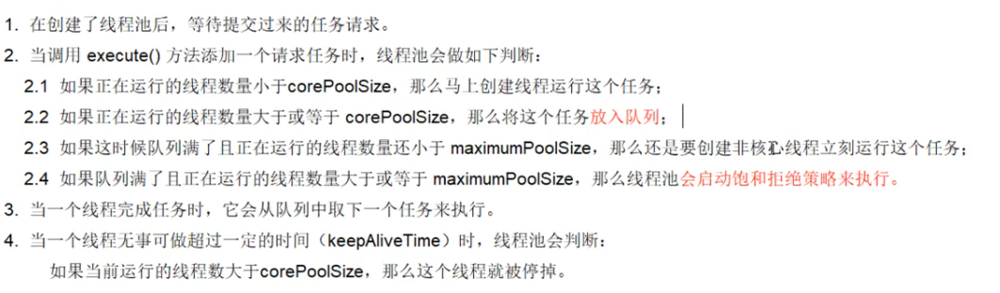
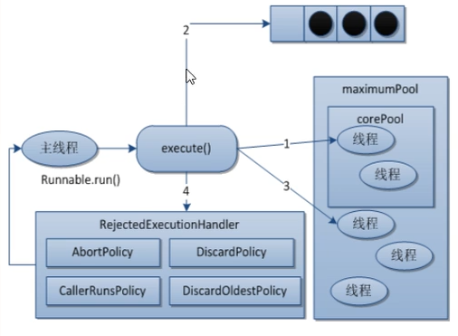
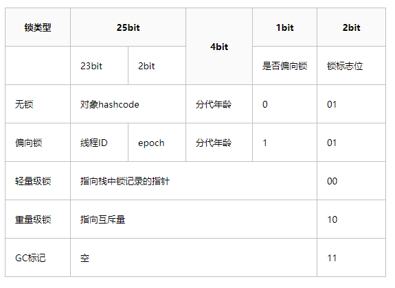
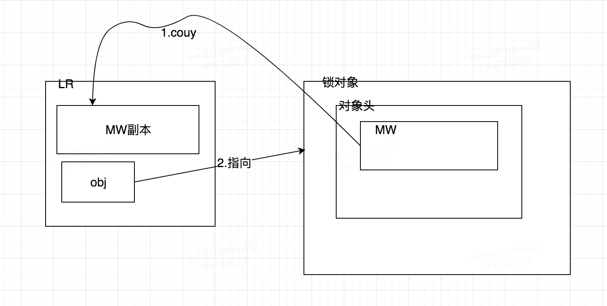
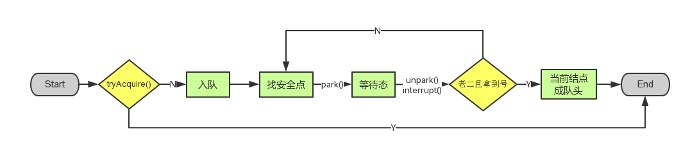
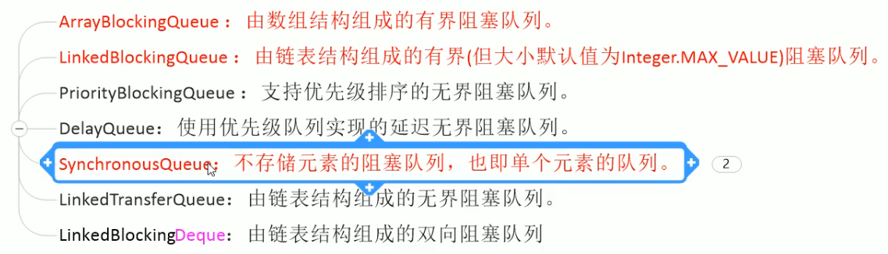
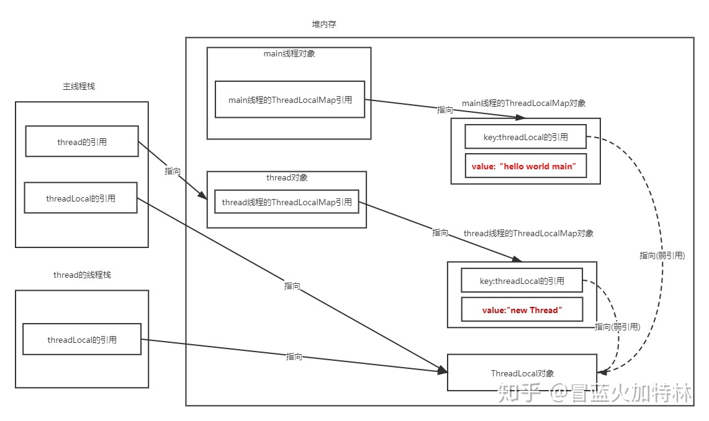

<!--more-->

Todos:
- [x] AQS
- [x] `volatile`
- [x] `synchronized`锁升级机制
- [x] monitor对象
- [x] `ThreadLocal`
- [ ] 线程安全的懒汉式单例模式

# 虚假唤醒问题
* `await()` / `wait()`需要放进循环中

# 线程池
* 控制运行的线程数量，处理过程中将任务放入队列，然后在线程创建后启动这些任务，如果线程数量超过了最大数量，超出数量的线程排队等候，等其它线程执行完毕，再从队列中取出任务来执行。
## 为什么要用
* 线程复用，降低线程创建和销毁，降低资源消耗
* 提高响应速度，任务到达时任务可以不需要等到线程创建就可以立即执行
* 提高线程的可管理性，无限制地创建线程会消耗系统资源。使用线程池可以对线程进行统一分配和监控。
## 7大参数
* `corePoollSize`
* `maximumPoolSize`
* `keepAliveTime`: 多余线程的存活时间
* `TimeUnit`
* `workQueue`
* `threadFactory`
* `handler`: 拒绝策略
  
## 工作顺序
工作队列满才会创建非核心线程，工作队列不满时不会将新任务提交给非核心线程。线程在一定时间(`keepAliveTime`)没接收到任务后就会被停止，最终线程池会收缩到`corePoolSize`的大小。


## 4大拒绝策略
拒绝策略触发的时机：任务数大于`corePoolSize`时会将任务放入队列缓冲区，填满了缓冲区后会判断当前任务书是否大于`maxPoolSize`，如果小于会新建线程处理，大于时会触发拒绝策略。
* CallerRunsPolicy（调用者运行）：触发拒绝策略时只要线程池没有关闭就交给提交任务的当前线程处理。（不允许失败、并发量小的场景）
* AbortPolicy（中止策略）：触发拒绝策略时直接抛出拒绝执行的异常，打断当前的执行流程。
* DiscardPolicy（丢弃策略）：触发拒绝策略时悄悄丢弃最新提交的任务，不抛出任何异常。
* DiscardOldestPolicy：抛弃队列中等待最久的任务，然后把当前任务加入队列中尝试再次提交当前任务。

# synchronized关键字
## 锁的内存语义
* 释放锁时，该线程对于的本地内存中的共享变量会刷新到主存中
* 获取锁时，该线程的本地内存会被设置为无效，被monitor保护的临界区代码必须从主内存中读取共享变量。

## synchronized的实现原理
### 什么是monitor
JVM基于进入和退出monitor对象来实现同步。同步代码块采用添加`monitorenter`和`monitorexit`实现，同步方法使用`ACC_SYNCHRONIZED`标记符实现。monitor对象存在于每个对象的对象头中。
线程执行`monitorenter`时，会尝试获取monitor的所有权。如果monitor的进入数为0，则该线程进入monitor，然后将进入数设置为1，该线程即为monitor的所有者；如果线程已经占有该monitor，只是重新进入，则进入monitor的进入数加1；如果其他线程已经占用了monitor，则该线程进入阻塞状态，直到monitor的进入数为0，再重新尝试获取monitor的所有权。
线程执行`monitorexit`时，对monitor进行释放，此时线程必须是monitor的持有者。指令执行时，monitor的进入数减1，如果减1后进入数为0，那线程退出monitor，不再是这个monitor的所有者。其他被这个monitor阻塞的线程可以尝试去获取这个 monitor 的所有权。

### 对象头
Java对象的内存布局：对象头、实例数据、对齐填充。对象头主要包括`Mark Word`标记字段和`Class Pointer`类型指针。
* Class Pointer 是对象指向它的类元数据的指针，虚拟机通过这个指针来确定这个对象是哪个类的实例。
* Mark Word 用于存储对象自身的运行时数据，比如哈希码、锁状态标识、GC年龄等信息。Mark Word里存储的数据会随着锁标志位的变化而变化。
  * 如果有线程需要取得对象锁，该线程需要保存一份对象的Mark Word的副本（用于恢复到无锁状态？）
  * 无锁(01)：hashcode、GC分代年龄、是否是偏向锁(0)
  * 偏向锁(01): 偏向线程ID、偏向时间戳(epoch)、对象GC分代年龄、是否偏向锁(1)
  * 轻量级锁(00)：指向栈中锁记录的指针
  * 重量级锁(10): 指向互斥量（重量级锁）的指针
  * 无锁状态会直接转到轻量级锁状态。可以通过`-XX:+UseBiasedLocking`控制是否启用偏向锁。
* (Identity) HashCode（`java.lang.Object.hashCode()`，以懒加载形式计算Identity HashCode，调用该方法时才计算Identity HashCode）和GC分代年龄都是每个对象必须记录和维护的信息，如果该对象被线程获取了对象锁，Mark Word中就要保存和锁有关的信息，此时HashCode和GC分代年龄怎么保存？
  * 当一个对象已经计算过Identity HashCode, 该对象就无法进入偏向锁状态
  * 如果一个对象已经进入偏向锁状态，但是需要计算Identity HashCode，则它的偏向锁会被撤销，膨胀成重量级锁
  * 重量级锁中，ObjectMonitor中有字段可以保存下非加锁状态的Mark Word，也就可以保存该对象的Identity HashCode值。
  * 这样的优化是基于一个假定：只有很少一部分对象真的需要调用`java.lang.Object.hashCode()`来计算Identity HashCode。

* 当前线程栈中存在Lock Record数据结构。


### 锁的优化
* 锁升级机制：无锁、偏向锁、轻量级锁、重量级锁
* 锁的状态变化是单向的，不会降级，只会升级。
#### 自旋锁
所谓自旋锁，就是指当一个线程尝试获取某个锁时，如果该锁已被其他线程占用，就一直循环检测锁是否被释放，而不是进入线程挂起或睡眠状态。
自旋锁本身是有缺点的，它不能代替阻塞。自旋等待虽然避免了线程切换的开销，但它要占用处理器时间。如果锁被占用的时间很短，自旋等待的效果就会非常好。反之，如果锁被占用的时间很长，那么自旋的线程只会白浪费处理器资源。所以，自旋等待的时间必须要有一定的限度，如果自旋超过了限定次数（默认是10次，可以使用-XX:PreBlockSpin来更改）没有成功获得锁，就应当挂起线程。
自旋锁的实现原理同样也是CAS，AtomicInteger中调用unsafe进行自增操作的源码中的do-while循环就是一个自旋操作，如果修改数值失败则通过循环来执行自旋，直至修改成功。

#### 自适应自旋锁
自旋的次数不固定，由前一次在同一个锁上自旋的时间和锁的拥有者的状态来决定。线程如果自旋成功了，那么下次自旋的次数会更加多，因为虚拟机认为既然上次成功了，那么此次自旋也很有可能会再次成功，那么它就会允许自旋等待持续的次数更多。反之，如果对于某个锁，很少有自旋能够成功，那么在以后要或者这个锁的时候自旋的次数会减少甚至省略掉自旋过程，以免浪费处理器资源。

#### 锁清除
JVM检测不到共享数据竞争时就会对这些同步锁进行锁清除。

#### 锁粗化
锁粗化就是将多个连续的加锁、解锁操作连接在一起，扩展成一个范围更大的锁。例如将循环内的加锁操作转移到循环外。

#### 偏向锁
**Question: 无锁状态怎么到偏向锁状态？**
* Ans：最初状态：ThreadID为空的可偏向状态，此时可以直接加偏向锁
* 关闭偏向锁或解除偏向锁后：无锁状态，此时再次加锁会直接加轻量级锁
在大多数情况下，锁总是由同一线程多次获得，不存在多线程竞争，所以出现了偏向锁。其目标就是在只有一个线程执行同步代码块时能够提高性能。
* 偏向锁阶段，偏向锁只会属于第一个取得它的线程。线程不会主动释放偏向锁。
* 如果在偏向锁阶段，某个线程发现偏向锁的线程ID不是自己，就一定会进行锁升级。
偏向锁是在单线程执行同步代码块时使用的机制，如果在多线程并发的环境下（即线程A尚未执行完同步代码块，线程B发起了申请锁的申请），则一定会转化为轻量级锁或者重量级锁。
当一个线程访问同步块并获取锁时，会在对象头（Mark Word）和栈帧中的锁记录里存储锁偏向的线程ID，以后该线程进入和退出同步块时不需要花费CAS操作来争夺锁资源，只需要检查是否为偏向锁、锁标识为以及ThreadID即可。
1. 检测对象头的Mark Word字段判断是否为可偏向状态或已偏向状态
2. 若为可偏向状态（锁状态为`01`，且当前Mark Word的Thread ID部分未被设置，即为空）（或者无锁状态？），则使用CAS尝试将Mark Word中的Thread ID设置为当前线程的ID。期望值：空，设置值：当前线程ID
  * 该步操作如果成功，则当前线程成功取得了偏向锁，可以执行同步代码块
  * 该步操作如果失败，说明已经有线程抢先取得了偏向锁，需要进行锁升级。
3. 若为已偏向状态（锁状态为`01`，但当前Mark Word的Thread ID部分不为空），则判断线程ID是否为当前线程ID
  * 如果是，则可以执行同步代码块
  * 如果不是，说明该锁属于其他线程，需要判断当前是否能够进行**重偏向**。
    * 偏向锁时间戳epoch，代表了偏向锁的有效性。其所属的class信息中也保存一个epoch值cepoch
    * 达到全局安全点时，如果要对整个类的所有对象进行批量重偏向，则首先对class对象的cepoch进行增加操作，得到一个新的cepoch。
    * 然后扫描所有持有实例的线程栈，对被锁定的对象赋予新的cepoch值。
    * 如果一个对象的对象头中的`epoch == cepoch`，说明当前对象仍处于锁定状态。否则，如果`epoch < cepoch`，其它线程可以通过CAS对这个偏向锁进行竞争。
  * 如果能重偏向则通过CAS进行竞争，尝试将Mark Word中的Thread ID修改为自己的线程ID，否则需要进行锁升级。
4. 偏向锁的升级：挂起持有锁的线程，首先进行偏向锁的撤销
  * 如果原来获取偏向锁的线程已经执行完了同步代码块，则原有的偏向锁无效。此时该对象会转换为不可偏向的无锁状态
  * 如果原本获取偏向锁的线程未执行完同步代码块，偏向锁依旧有效，此时对象会转换为被轻量级加锁的状态
  * 在当前线程的栈帧出创建Lock Record，将对象头的Mark Word复制到锁记录中（完成轻量级锁的加锁过程）。
偏向锁只有遇到其他线程尝试竞争偏向锁时，持有偏向锁的线程才会释放锁，线程不会主动释放偏向锁。
* 只有一个线程一定可以获得偏向锁吗？
  * 不一定，首先要确定当前JVM参数打开了偏向锁
  * 其次，计算了Identity HashCode的对象无法进入偏向状态。

#### 轻量级锁
当多个线程竞争偏向锁时就会升级为轻量级锁，其他线程会通过自旋的形式尝试获取锁，不会阻塞，从而提高性能。
1. 线程进入同步块时，如果同步对象锁状态为无锁状态（无锁和偏向锁都是`01`，但是无锁状态会将第三位置为`0`，表示当前对象不可偏向），虚拟机首先在当前线程的栈帧中建立一个名为Lock Record的空间，用于存储锁对象目前的Mark Word的拷贝。
2. 将对象头中的Mark Word复制到Lock Record中。
3. 复制成功后，虚拟机使用CAS操作尝试将对象Mark Word中的Lock Word（此时对象头Mark Word的内容）更新为指向当前当前线程Lock Record（线程栈帧中的空间）的指针，并将Lock Record里的owner指针指向对象Mark Word。
4. 如果这个更新动作成功了，那么当前线程就拥有了该对象的锁。此时对象Mark Word的锁标志位被设置为`00`，表示对象处于轻量级锁定状态。
5. 如果更新操作失败，JVM首先检查对象Mark Word中的Lock Word是否指向当前线程的栈帧，如果是，说明当前线程已经拥有此对象锁，可以进入同步块。否则进入**自旋状态**，如果自旋结束时仍未获得锁，轻量级锁就要升级为重量级锁，锁状态值变为`10`。
对于轻量级锁，其性能提升的依据是 “对于绝大部分的锁，在整个生命周期内都是不会存在竞争的”，如果打破这个依据则除了互斥的开销外，还有额外的CAS操作，因此在有多线程竞争的情况下，轻量级锁比重量级锁更慢。

#### 重量级锁
使用监视器锁，其本质依赖操作系统提供的Mutex Lock，因此需要进行系统调用，即完成从用户态到内核态的转换，因此这个成本非常高。

# Lock和Synchronized的区别
* `synchronized`是关键字，由JVM提供支持，底层通过`monitor`对象来完成（`monitorenter`/`monitorexit`），`wait`/`notify`方法也依赖monitor对象，因此这两个方法也只能在`synchronized`代码块中才能正常调用。`Lock`是具体类，当然`await`和`signal`也需要持有锁的时候调用，否则会抛出`IllegalMonitorStateException`异常。
* `synchronized`不需要手动释放锁，而`Lock`需要
* `synchronized`不可中断，除非抛出异常或者正常运行完成
* **`ReentrantLock`可以被中断**，`synchronized`在当前线程等待锁被阻塞时无法被中断。
  * 超时方法`tryLock`：可以立即返回，可以等待一个超时时间
  * `lockInterruptibly()`: 当前线程在等待过程中，其它线程对当前线程调用`interrupt()`可以中断当前线程，让当前线程优先响应中断异常`InterruptedExceptio
  * n`。
* `synchronized`是非公平锁，`Lock`可以是公平的。
* `ReentrantLock`可以绑定多个条件`Condition`，实现按照不同的需要分组唤醒线程，而`synchronized`只能随机唤醒一个线程或全部唤醒。

# LockSupport
## 是什么？
* 用于创建锁和其它同步类的基本线程阻塞原语
* `LockSupport`为**每个**使用它的线程提供一个permit（类似于`Semaphore`)，调用`park`方法时如果permit可用则立即返回并消耗这个permit，否则**可能**阻塞（类似于上限为1的信号量，重复`unpark`不会累积，最初调用`park`会直接阻塞，猜测初值应该为0）。调用`unpark`则可以释放permit。要保证对`LockSupport`的可靠使用，需要依靠`volatile`或原子变量来控制何时调用`park`或`unpark`。提供了阻塞和唤醒线程的功能。
* `park`会在调用线程被中断(interrupted)的时候返回，也支持超时机制，**也可能在任何时候没有任何原因地返回**。因此一般在循环中调用`park`以重新检测条件。这可以被视为一种优化的忙等待机制。
* 一般不直接使用而是用于构造高阶的同步机制。
* **唤醒(unpark)可以在park之前进行**，此时`park`不会被阻塞。
## 原理
* 通过`Unsafe`类中的native方法实现
* permit默认为0
* 每次`park`都必须消耗一个permit（即使是连续调用），而每次调用`unpark`会将permit设置为1，但是上限为1，达到上限后不会累计。

# AQS(AbstractQueuedSynchronizer)
## 是什么？
* `java.util.concurrent.locks.AbstractQueuedSynchronizer extends AbstractOwnableSynchronizer`
* 用于构建锁和其它同步器组件，用户使用AQS来实现自定义同步器时只需要实现共享资源`state`的获取与释放方式即可。至于线程等待队列的维护，线程获取资源失败入队，线程被唤醒获取到资源最终出队等操作，AQS已经实现好了。AQS内置了FIFO队列来完成获取资源的线程的排队工作，并通过（原子的）`int`类型的变量来表示持有锁的状态。
* `ReentrantLock`, `CountDownLatch`, `ReentrantRewriteLock`, `Semaphore`等类的实现都需要使用。
* 屏蔽（封装）了同步状态管理、阻塞线程、排队等操作：如果共享资源被占用，就需要一定的阻塞-等待-唤醒机制来保证锁的分配。将暂时获取不到锁的线程加入队列中，这个队列就是AQS的抽象表现。请求资源的线程 -> 队列的结点。
* 支持两种同步方式：共享式、独占式

## 实现
* 虚拟双向链表实现的队列
* 使用`volatile`的`int`类型成员变量`state`来表示同步状态。通过CAS完成对该状态的维护。
* 基于模板方法模式，使用者继承该类需要重写指定的方法。然后将AQS组合在自定义同步组件的实现中，并调用其模板方法，模板方法会调用使用者重写的方法。
  * `protected boolean tryAcquire(int arg)`: 独占式地获取同步状态（获取资源），成功返回true，否则返回false
  * `protected boolean tryRelease(int arg)`: 独占式地释放同步状态（释放资源），等待中的其他线程此时有机会获取到同步状态
  * `protected int tryAcquireShared(int arg)`: 共享式地获取同步状态，返回值大于等于0时成功，否则失败
  * `protected boolean tryReleaseShared(int arg)`: 共享式地释放同步状态，成功true，失败false
  * `protected boolean isHeldExclusively()`: 是否在独占模式下被线程占用。
* 在这些方法中用户可以使用AQS已经定义的对`state`的操作，例如`compareAndSetState`方法对`state`进行修改，使用`getState`来获取当前的`state`值。

* 核心方法: `acquireQueued`
### state
* `volatile`的`int`类型成员变量。
  * `EXCLUSIVE`状态下: 0: 可用；>= 1: 占用中。
  * `SHARED`状态下: `== 0`：可用，**但是没有剩余资源了**；`< 0`：不可用；`> 0`：可用，并且还有剩余资源。
  * 这样的设计可以保证
### AQS本身
* 通过自旋等待
* CLH队列的变种：双端队列 
* 对队列的原子操作：尾部入队，头部出队。当一个节点的前驱结点释放资源时，该节点会被通知。
### Node节点
* `static final Node SHARED`/`static final Node EXCLUSIVE`: 线程等待锁的模式：共享/独占
* `volatile int waitState`成员变量：Node的等待状态
  * 0：初始化时的默认值
  * CANCELLED/1: 已经取消了对锁的请求
  * CONDITION/-2: 在等待队列中，等待唤醒
  * PROPAGATE/-3: SHARED状态下才会使用
  * SIGNAL/-1: 线程已经准备好了
* `volatile Node prev`/`volatile Node next`: 前驱/后继节点
* `volatile Thread thread`: 与当前节点关联的排队中的节点

### 核心方法
#### acquire
```java
public final void acquire(int arg) {
    // 1. 首先调用使用者重写的tryAcquire方法。如果返回true，说明获取同步状态成功，后面的逻辑不再执行。
    //    如果返回false，说明获取同步状态失败，需要继续执行
    // 2. 构造独占式同步节点，通过addWaiter方法将此节点添加到同步队列的尾部。此时可能有多个线程节点试图加入同步队列尾部，
    //    需要保证线程安全。
    // 3. 该节点在队列中尝试获取同步状态(acquireQueued)，如果获取不到则阻塞节点线程(selfInterrput)，直到被前驱结点唤醒
    //    或者被中断
    if (!tryAcquire(arg) && acquireQueued(addWaiter(Node.EXCLUSIVE), arg))
        // 如果线程在等待资源的过程中被中断，它无法立即响应中断，只有在此时能够响应中断
        selfInterrupt();
}
```
`addWaiter`方法：构造一个Node节点并添加到队列尾部
```java
private Node addWaiter(Node mode) {
    Node node = new Node(Thread.currentThread(), mode);//构造结点
    //指向尾结点tail
    Node pred = tail;
    // 如果尾结点不为空，CAS快速尝试在尾部添加，若CAS设置成功，返回；否则进入enq方法。
    // 尾节点为空也需要进入enq方法
    if (pred != null) {
        node.prev = pred;
        // CAS操作
        if (compareAndSetTail(pred, node)) {
            pred.next = node;
            return node;
        }
    }
    enq(node);
    return node;
}
```
`enq`方法：如果队尾为空，通过CAS方法尝试创建一个节点作为头结点（和当前的为节点）。如果队列不为空，则通过CAS尝试将当前节点连接到尾节点。如果失败则一直自旋等待。
```java
private Node enq(final Node node) {
        for (;;) {
            Node t = tail;
            if (t == null) { //如果队列为空，创建结点，同时被head和tail引用
                if (compareAndSetHead(new Node()))
                    tail = head;
            } else {
                node.prev = t;
                if (compareAndSetTail(t, node)) {//cas设置尾结点，不成功就一直重试
                    t.next = node;
                    return t;
                }
            }
        }
    }
```
`acquireQueued`方法：
```java
final boolean acquireQueued(final Node node, int arg) {
    // 当前线程是否成功获得锁
    boolean failed = true;
    try {
        // 当前线程是否被阻塞过
        boolean interrupted = false;
        // 不停自旋
        for (;;) {
            // 找到当前结点的前驱结点
            final Node p = node.predecessor();
            // 如果前驱结点是头结点，才tryAcquire，其他结点是没有机会tryAcquire的。
            // 因为有可能前驱节点唤醒了当前节点。在这种情况下，当前节点应该尝试进行资源获取。
            if (p == head && tryAcquire(arg)) {
                // 获取同步状态成功，将当前结点设置为头结点。
                setHead(node);
                p.next = null; // 方便GC
                failed = false;
                return interrupted;
            }
            // 如果没有获取到同步状态，通过shouldParkAfterFailedAcquire判断是否应该阻塞，parkAndCheckInterrupt用来阻塞线程
            if (shouldParkAfterFailedAcquire(p, node) &&
                parkAndCheckInterrupt())
                interrupted = true;
        }
    } finally {
        if (failed)
            cancelAcquire(node);
    }
}
```
`shouldParkAfterFailedAcquire`: 判断当前节点线程是否应该被阻塞，主要根据前驱节点（`node.predecessor()`）的状态进行判断。
* 如果前驱节点的状态为`SIGNAL`，说明前驱节点准备好要获得锁，当前线程可以安全地被`LockSupport.park()`
* 如果前驱节点的状态为`CANCELLED`，说明前驱节点已经取消了对锁的获取，前驱节点已经是无效节点。需要在链表中从后往前遍历，找到一个非`CANCELLED`状态的节点，将当前线程的节点设置为它的后继节点。
* 如果前驱节点为其它状态(`CONDITION`, `PROPAGATE`)，则将前驱节点的状态通过CAS设置为`SIGNAL`。
* `parkAndCheckInterrupt`：使用`LockSupport.park(this)`阻塞当前线程。并返回`Thread.interrupted()`，让外部方法判断当前线程是否需要进行中断响应。


**acquire方法的逻辑总结**
1. 首先调用用户实现的`tryAcquire`尝试获得同步状态，成功则直接返回，失败则继续
2. 如果等待链表的头结点不为空，使用CAS方法构造一个节点加入同步队列中。如果头结点为空或CAS失败，则不停自旋重复这个过程直到成功。
3. 加入队列后的节点线程进入自旋状态。如果前驱节点是头结点，则尝试获取同步状态。否则，判断当前节点是否可以阻塞。
4. 如果前驱节点的状态为`SIGNAL`，则可以阻塞当前线程。其它情况下当前线程还不可以被阻塞，需要继续进行自旋。
5. 如果前驱节点的状态为`CANCELLED`，从当前位置向前找到链表中的一个状态为`SIGNAL`的节点，将当前节点设为其后继节点。如果前驱节点的状态为其它状态，则将其状态设置为`SIGNAL`。完成这一设置之后，线程继续进行自旋。
6. 当前线程在自选中获得了资源时，让当前线程对应的节点成为头节点。

#### release
线程释放同步状态的方法。
1. 调用使用者重写的`tryRelease`方法，如果成功则调用`unparkSuccessor`唤醒其后继节点，如果失败则返回false
2. `unparkSuccessor`首先会将当前节点的等待状态通过CAS设置为初始值0。如果当前节点的后继节点不为空且状态不为`CANCELLED`，调用`LockSupport.unpark(node.next.thread)`唤醒后继节点。否则，从尾向头寻找一个处于正常阻塞状态的节点(`waitStatus <= 0`)，将其唤醒。

#### acquireShared
调用用户实现的`tryAcquireShared`来完成资源获取，根据返回值判断资源获取的操作是否成功
与acquire的不同：
* `status`: 说明当前资源的占用情况
  * `SHARED`模式下，`tryAcquireShared`返回大于等于0的值即可说明资源获取成功。
* AQS的共享锁本质上是允许不超过指定数量的多个线程同时执行。


### 怎么用
* Lock接口的实现类：聚合一个队列同步器的子类(`Sync extends AbstractQueuedSynchronizer`)完成线程访问控制

### 案例 ReentrantLock
* 尝试加锁 -> 加锁失败进入阻塞队列 -> 线程阻塞
* 非公平加锁(`lock()`)，对AQS的`state`进行CAS: `compareAndSetState(0, 1)` 
  * 如果成功，则调用`setExclusiveOwnerThread(thread)`，将当前线程设置为独占线程。
  * 否则调用`acquire(int)`准备进行同步。
* `tryAcquire()`: 模板，由子类实现
  * 公平锁：先判断`hasQueuedPredecessors()`。
  * 如何实现可重入：
    * 让`state`作为当前的重入次数。
    * 当当前线程等于`getExclusiveOwnerThread`的结果时，可以判断是持有锁的线程重复获得锁。这个时候可以进行重入，让重入计数加1.

### 案例 ReentrantReadWriteLock
* 获取读锁: `tryAcquireShared`，获取写锁：`tryAcquired`
* `state`：高16位为读锁占用量，低16位为写锁占用量

# volatile
* 轻量级的同步机制
## 保证可见性
* `volatile`保证了不同线程对共享变量操作的可见性。一个线程修改了`volatile`修饰的变量，当修改写回主内存时，另一个线程会立即看到最新的值。
* 主内存和工作内存的一致性问题：写数据时通知其它CPU将该变量的缓存行设为无效状态，其它CPU需要读取时发现缓存失效，则需要从内存中重新读取。
  * 如何发现数据失效：嗅探总线上传播的数据检查当前缓存值是否过期。
* `volatile`写的内存语义：对一个`volatile`变量进行写操作时，该线程对应的本地内存中的共享变量值会刷新到主内存，然后通知其它CPU缓存失效。
* `volatile`读的内存语义：对一个`volatile`变量进行读操作时，该线程对应的本地内存会被置为无效，线程将会从主存中读取共享变量。
* 内存语义的实现：内存屏障策略。
## 不保证原子性
* 修改`volatile`变量需要将变量从主内存读取到线程的工作内存，在工作内存中修改变量值，然后将工作内存的变量值写回主内存。
* 但是对单个`volatile`变量的读和**赋值**操作可以被视为有原子性。
## 禁止指令重排序
* JMM规则下的问题：编译器/JIT/微处理器允许对每个线程内的代码进行重排序。
  * 单线程下的执行结果不能被改变：遵守`as-if-serial`语义
* 而在每个线程内不存在数据依赖性的指令在全局的指令执行顺序中可能是存在数据依赖性的。
  * 举个例子
    ```
        A = 0, B = 0
        Thread1: r2 = A -> B = 1
        Thread2: r1 = B -> A = 2

        执行顺序可能被重排为
        Thread1: B = 1 -> r2 = A
        Thread2: A = 2 -> r1 = B

        执行结果就可能变成r2 = 2, r1 = 1
    ```
    * 数据争用(data race):
      * 一个线程里有对一个变量的写操作
      * 另一个线程里有对同一个变量的读操作
      * 读写操作没有通过同步机制进行排序
* `volatile`关键字实现了禁止指令重排序的优化，避免多线程环境下出现乱序执行的情况
* 内存屏障：任何指令不能和内存屏障指令重排序
  * LoadLoad: 屏障前后的读操作不能重排序，屏障后的读操作执行前要保证屏障前的读操作读取完毕
  * StoreStore: 屏障后的写入操作执行前，要保证屏障前的写入操作对其它处理器可见
  * LoadStore：屏障后的数据写入操作被刷到内存前，要保证屏障前的读操作读取完毕
  * StoreLoad：屏障后的读取操作执行前，要保证屏障前的写入操作对其它处理器可见
* `volatile`的实现：
  * `volatile`写：写指令之前插入StoreStore屏障，在写指令之后插入StoreLoad屏障
  * `volatile`读：读指令之前插入LoadLoad屏障，之后插入LoadStore屏障

## 线程安全的懒汉式单例模式
```java
class Singleton {
    // 如果不对instance字段加volatile修饰符会怎样？
    // 对象构造并不是原子操作，它需要分配对象内存，调用构造器方法执行初始化，然后将对象引用赋值给变量。
    // 但是上述三个步骤可能发生重排序，比如可以先将对象引用赋值给变量，然后调用构造器的构造方法进行初始化。
    // 这样其它线程在检查instance是否为空时，能够判断instance是一个有指向的引用，因此判断instance != null
    // 但是实际上对象并没有完成初始化，其它线程可能会拿到一个“半成品”
    // volatile会制止该对象在初始化期间的指令重排序。
    private volatile static Singleton instance = null;
    private Singleton() {}
    public static Singleton getInstance() {
        // 第一次检查，如果此时instance已经非空了，那单例肯定已经被创建，可以直接返回单例
        if (instance == null) {
            synchronized (Singleton.class) {
                // 别的线程可能已经进入过一次synchronized代码块并对单例进行初始化，为了避免这种情况，我们需要进行二次检查
                if (instance == null) {
                    instance = new Singleton();
                }
            }
        }
        return instance;
    }
}
```

## 应用场景
* 某个属性被多个线程共享，其中有一个线程修改了此属性，其他线程可以立即得到修改后的值，比如boolean flag;或者作为触发器，实现轻量级同步。
* volatile的读写操作不需要加锁，因此成本低。但是只能用作于属性。
* volatile提供了可见性，任何一个线程对其的修改将立马对其他线程可见，volatile属性不会被线程缓存，始终从主存中读取。
* volatile提供了happens-before保证，对volatile变量v的写入happens-before所有其他线程后续对v的读操作。

# CAS(Compare and Swap) 
* 线程将工作内存中的内容写回主内存前先比较其期望值和主内存的真实值（比如，比较线程在读入时和当前主内存中变量的值是否相同），如果真实值和期望值相同，将新值写回主内存，否则表明该变量在当前线程读入工作内存后曾经被其他内存修改，不写回主内存。

## Unsafe
* Java无法直接访问底层系统，sun.misc.Unsafe相当于一个后门，可以直接直接操作特定内存的数据。
* CAS是一条并发原语。比较是否为预期值的并决定是否更改的过程是原子的。
* `AtomicInteger.getAndIncrement()`: 1. 先从主内存中直接读出变量值，2. 然后使用CAS判断内存中变量的当前值是否等于期望值（刚从主内存读出来的值），如果是，则将修改后的值写回主内存。注意，1是原子的，2是原子的，1+2整个操作并不是原子的。如果在2.中发现内存中的当前值不等于期望值，则**进行自旋等待(while一直循环)**。（这是一种乐观锁）

## 缺点？
* 循环时间长，开销大。如果CAS失败会一直进行自旋，可能会对CPU带来较大的开销。
* 只能保证**一个**共享变量的原子操作。如果需要对多个共享变量进行原子操作，必须加锁。
* ABA问题：
  * 问题描述：
    * 线程A从主内存读取变量到工作内存中，此时变量值为A。读取完毕后线程A因为某些原因被挂起
    * 线程B从主内存读取同一个变量到工作内存中，变量值为A，通过CAS将主内存中的变量值修改为B
    * 线程B再次通过CAS将主内存中的变量值修改为B
    * 线程A恢复运行，希望将对变量的修改写入主内存，并且此时比较能够通过，线程A会认为变量并未经过修改
    * **虽然变量的值看上去并没有变化，但是此时数据的语义很可能已经发生变化**。例如本来应该只发生一次的更改发生了多次。
  * 原子引用`AtomicReference<V>`: 让任意自定义类型实现类似`AtomicInteger`的功能
  * 如何规避ABA问题：新增版本号机制
    * 可以直接使用时间戳作为版本号：`AtomicStampedReference<V>`

# 线程同步工具
## CountDownLatch
* 一个同步辅助类，允许一个或多个线程等待另外一组线程完成工作。
* 提供一个计数器，需要等待的线程会等待该计数器的值减小到0。提供线程安全的方法供其它线程调用`countDown`方法减少计数器的值。
### 实现原理
* `CountDownLatch`内部包含了一个继承自AQS的`Sync`类实例。利用了AQS来实现共享锁。
* 基本思路是在构造的时候将state设置为大于0的值`count`，相当于当前资源`state`被占用，此时调用`await`方法的线程尝试获取共享锁会失败。
#### await方法
* 调用该方法时会尝试获取共享锁，当`state == 0`的时候能够成功获取到共享锁。在其他情况下，需要加入队列进行排队。
#### countDown方法
* 通过CAS的方式对state进行赋值，让作为锁计数器的`state`变量减1。必须有`count`次方法调用才能让锁计数器减少到0。

## CyclicBarrier
* 一个同步辅助类，允许多个线程互相等待。
* 主要借助`ReentrantLock`和`Condition`来实现。


# 线程安全集合
## List
### CopyOnWriteArrayList（写时复制）
* 数据使用`volatile`的数组进行保存
* 写时先获得锁，然后进行复制，在复制后的数组上进行写（并扩容），最后将原数组的引用指向新数组。

# 锁的类型
## 公平锁与非公平锁
* 公平锁：FIFO（获取锁的顺序就是申请锁的顺序）；非公平锁：获取锁的顺序不一定是申请锁的顺序，可能会造成优先级反转或者饥饿现象。
* `ReentrantLock`默认是非公平锁，可以通过在构造函数中对`fair`参数传入`true`让实例成为公平锁。
  * 公平：FIFO
  * 非公平：直接尝试获得锁，如果尝试失败则才在队列中进行排队。有点：吞吐量大。`synchronized`是一种非公平锁。

## 可重入锁（递归锁）
* 同一线程外层函数获得锁之后，内层递归函数仍然能获取该锁。线程可以进入任何一个它已经拥有的锁同步着的代码块。
* 例如：对于同一个对象内的`synchronized`方法，当前线程已经进入了一个`synchronized`方法内，说明该线程已经获得当前对象的对象锁，因此该线程在释放该锁之前同样可以调用该对象的其它`synchronized`方法。
* 最大的作用是避免死锁。
* 实现：计数 -> 加锁和解锁的操作需要配对

## 自旋锁
* 尝试获取锁的线程不会立即阻塞，而是采用循环的方式去尝试获取锁。好处是（在等待时间可能不长时）减少线程上下文切换的消耗，缺点是循环会消耗CPU。

## 互斥锁/排他锁 共享锁 
* 读读相容，独写不相容，写写不相容

## 阻塞队列
* 接口：`BlockingQueue`
* 常见实现：
  
* `SynchronousQueue`

### 实现原理
#### LinkedBlockingQueue
* 数据结构：有头结点的单链表
* 两把锁：使用两个`ReentrantLock`对象，分别保证出队操作和入队操作的线程安全，入队操作和出队操作不会互斥
* 两个`Condition`对象：保证队列中有元素才能出队，保证队列中有空闲位置才能入队
* 一个`AtomicInteger`：以线程安全的方式维护队列中的元素数量
* `put`方法
  1. 获取入队锁
  2. 如果当前队列已满，则在`notFull`条件下等待
  3. 完成入队操作，并调用`AtomicInteger`的方法增加元素个数
  4. 判断插入后队列是否已满，如果未满则对`notFull`调用`signal`让其它入队线程插入元素（为什么不是`signalAll`?)
  5. 释放入队锁
  6. 通知出队线程队列非空
* `take`方法
  1. 获取出队锁
  2. 如果队列空，在`notEmpty`条件下等待
  3. 完成出队操作，减小元素数
  4. 队列非空则通知其它出队线程
  5. 通知入队线程队列未满

#### ArrayBlockingQueue
* 为什么入队列和出队列公用一把锁了？
  * 因为直接使用数组，入队列和出队列操作开销小。如果两个操作分别用一把锁反而加锁解锁的开销大？

## Map
### ConcurrentHashMap
#### JDK 1.7
* `Segment<K, V>`: 将每个HashMap的Entry进行分组。记录需要插入HashMap需要先定位插入的Segment，再在Segment中定位插入的位置。相当于将原本的每个Entry分组。该类继承于`ReentrantLock`，因此具有获得可重入锁的功能。
  * 存储结构上，首先是一个不可扩容的`Segment`数组。`Segment`数组的长度取决于并发度(`concurrencyLevel`)，具体长度是大于`concurrencyLevel`的最近的2次幂。
  * 在每个`Segment`使用`HashEntry`数组来保存实际的键值对。该数组具有扩容机制，容量同样是2的幂。
* 执行put操作的时候，先进行第一次hash来定位segment的位置，如果segment还没有初始化即通过CAS进行赋值。然后进行第二次hash操作，找到相应的HashEntry的位置。之后调用继承自`ReentrantLock`的可超时方法`tryLock`尝试获取该Segment的锁。如果成功则在Segment中进行插入或修改。如果不成功，则当前线程会以自旋的方式继续调用`tryLock()`尝试获得锁。当前线程自旋超过指定的次数就会被挂起，等待被唤醒。
  * 超过扩容阈值时需要对`HashEntry`数组进行扩容。扩容 -> rehash -> 头插法
* 执行get操作不需要加锁。
* 执行size操作时，由于可能存在并发的线程正在插入数据，因此得到的size可能不等于实际的size。
  * 先尝试不加锁多次计算`ConcurrentHashMap`的size，比较多次计算的结果，如果一致就认为当前没有并发的插入操作，计算结果是准确的。
  * 如果不一致，则为每个Segment加锁，然后计算size并返回。

#### JDK 1.8
* 摒弃`Segment`的概念，直接使用 `Node<K, V>`数组，将Segment锁变为节点锁。
* 执行put操作的时候，通过一次hash来定位Node的位置，如果该Node还没有初始化即通过CAS进行赋值。如果该Node已经初始化，则使用`synchronized`关键字来获得该Node的对象锁，成功获得锁后再在该Node中定位插入/修改的位置。
##### `initTable`: 对Node数组进行初始化
* 使用`sizeCtl`来表示当前的初始化状态
  * -1: 当前正在进行初始化
  * -N: `Node`数组进行扩容时也使用该方法创建新数组，此时表示有N - 1个线程正在进行**扩容**(?)
  * 表示table的初始化大小（此时Node数组为空或长度为0）
  * 表示table的当前容量
* 如果当前`sizeCtl < 0`，说明有其它线程正在进行CAS（或者是在进行初始化，或者是在进行数组扩容），此时直接让出CPU的使用权(`Thread.yield()`)
* 否则自己通过CAS将`sizeCtl`设置为-1，当`Node`数组为空时，创建新的`Node`数组。

##### `put`: 插入K-V对，并判断是否要进行扩容操作
* 插入流程
1. 通过key本身的hashCode计算出hash值，进而定位到桶的位置
2. 如果桶为空，通过CAS的方式尝试创建一个新的`Node`插入桶，成功了则直接退出自旋，失败则继续自旋。
3. **如果桶不为空，但是该桶的hash值为`MOVED`，需要进行扩容？** -> `helpTransfer`
4. 上述能够不加锁插入键值对的情况都不满足，需要使用`synchronized`代码块对该节点（入口节点）进行加锁，然后进行插入。
  * 如果是链表，找到key相等的节点，然后修改这个节点的value。如果找不到key相等的节点，则使用尾插法插入到链表中。
  * 如果是红黑树，使用红黑树的插入方法
  * 插入完成后退出
5. 如果插入完成后链表节点数大于`TREEIFY_THRESHOLD`，需要判断是否要转化为红黑树
  * 如果当前数组长度小于`MIN_TREEIFY_CAPACITY`(64)，则将数组扩容为原来的两倍，并调用`transfer`方法重新调整节点的位置
6. 新增节点后，使用`addCount` 方法记录节点个数并检查是否需要扩容，数组个数达到阈值时会需要扩容，并触发`transfer`方法重新调整节点位置

* 扩容与重哈希
1. 新建一个长度为旧长度两倍的数组
2. 初始化`ForwardingNode`节点的实例，保存新数组的引用。该实例作为占位节点。
3. 处理当前桶中每个元素，


##### `get`
1. 用同样的方法确定桶的位置
2. 判断头结点的hash值情况
  * 如果头结点的hash值与当前查找的key相等，则判断头结点的key是否等于当前查找的key。如果相等则可以直接返回
  * 如果头结点的hash值**为负数**，说明当前数组正在扩容，或者当前桶的元素以红黑树形式存储。调用`find`进行查找。
  * 如果上述两个条件均不符合，说明当前节点是链表，在链表中查找。


## ConcurrentLinkedQueue
* **非阻塞**的线程安全队列
* 使用链表作为底层数据结构，使用CAS来实现线程安全（？）

## BlockingQueue
### ArrayBlockingQueue
ArrayBlockingQueue 是 BlockingQueue 接口的有界队列实现类，底层采用数组来实现。ArrayBlockingQueue 一旦创建，容量不能改变。其并发控制采用可重入锁来控制，不管是插入操作还是读取操作，都需要获取到锁才能进行操作。当队列容量满时，尝试将元素放入队列将导致操作阻塞;尝试从一个空队列中取一个元素也会同样阻塞。
ArrayBlockingQueue 默认情况下不能保证线程访问队列的公平性，所谓公平性是指严格按照线程等待的绝对时间顺序，即最先等待的线程能够最先访问到 ArrayBlockingQueue。而非公平性则是指访问 ArrayBlockingQueue 的顺序不是遵守严格的时间顺序，有可能存在，当 ArrayBlockingQueue 可以被访问时，长时间阻塞的线程依然无法访问到 ArrayBlockingQueue。如果保证公平性，通常会降低吞吐量。如果需要获得公平性的 ArrayBlockingQueue，可采用如下代码：

### LinkedBlockingQueue
LinkedBlockingQueue 底层基于单向链表实现的阻塞队列，可以当做无界队列也可以当做有界队列来使用，同样满足 FIFO 的特性，与 ArrayBlockingQueue 相比起来具有更高的吞吐量，为了防止 LinkedBlockingQueue 容量迅速增，损耗大量内存。通常在创建 LinkedBlockingQueue 对象时，会指定其大小，如果未指定，容量等于 Integer.MAX_VALUE。

### PriorityBlockingQueue
PriorityBlockingQueue 是一个支持优先级的无界阻塞队列。默认情况下元素采用自然顺序进行排序，也可以通过自定义类实现 compareTo() 方法来指定元素排序规则，或者初始化时通过构造器参数 Comparator 来指定排序规则。

PriorityBlockingQueue 并发控制采用的是 ReentrantLock，队列为无界队列（ArrayBlockingQueue 是有界队列，LinkedBlockingQueue 也可以通过在构造函数中传入 capacity 指定队列最大的容量，但是 PriorityBlockingQueue 只能指定初始的队列大小，后面插入元素的时候，如果空间不够的话会自动扩容）。

简单地说，它就是 PriorityQueue 的线程安全版本。不可以插入 null 值，同时，插入队列的对象必须是可比较大小的（comparable），否则报 ClassCastException 异常。它的插入操作 put 方法不会 block，因为它是无界队列（take 方法在队列为空的时候会阻塞）。

# ThreadLocal
## 用途
为每个线程提供一份独有的副本变量，多个线程互不干扰。

## 实现
`Thread`类有一个类型为`ThreadLocal.ThreadLocalMap`的实例变量`threadLocals`，即每个线程有一个自己的`ThreadLocalMap`。
该Map的元素是`Entry extends WeakReference<ThreadLocal<?>>`，即继承了`ThreadLocal<?>`的一个弱引用。每个线程在向`ThreadLocal`里放值的时候，其实都在向自己的`ThreadLocalMap`里存值。读也是以`ThreadLocal`作为引用，在自己的`map`里找对应的`key`，从而实现线程隔离。`ThreadLocalMap`类似于`HashMap`的结构，同样以数组结构存储数据。

`ThreadLocal`的`set`方法：用`Thread.currentThread()`通过`getMap(Thread)`方法取出当前线程对应的`ThreadLocalMap`。如果map为空则创建一个，如果不为空则将值加入map。
```java
void createMap(Thread t, T firstValue) {
    t.threadLocals = new ThreadLocalMap(this, firstValue);
}
```
由`createMap`方法可以看出，`ThreadLocalMap`是线程对象（`Thread`）的一个成员变量。

### ThreadLocalMap使用的Hash算法，如何解决冲突
* `ThreadLocalMap`使用和`HashMap`类似的定位方式：
```java
int i = key.threadLocalHashCode & (len - 1);
```
`threadLocalHashCode`用于对键值的插入位置进行定位。**因为ThreadLocalMap的Key都是同一个类型(泛型类`ThreadLocal<?>`的弱引用)，因此可以在ThreadLocal类中定义静态属性来生成优化的HashCode**。每个ThreadLocal对象在初始化时都会使用`nextHashCode`静态方法来确定自己的HashCode。而`nextHashCode`使用`AtomicInteger`来实现线程安全的HashCode生成。（斐波那契散列乘数？）
* `ThreadLocalMap`不使用链表来解决哈希冲突，而是使用线性探测法。如果当前位置已经存在Entry、Entry的key与当前key不相等且非空，则向后寻找直到找到第一个Key与当前key相等或为空的Entry。

### 为什么key要用ThreadLocal对象的弱引用
回忆弱引用的定义：下一次GC时如果**只有**弱引用，则该对象一定会被回收。
```java
// Entry的定义
/**
 * The entries in this hash map extend WeakReference, using
 * its main ref field as the key (which is always a
 * ThreadLocal object).  Note that null keys (i.e. entry.get()
 * == null) mean that the key is no longer referenced, so the
 * entry can be expunged from table.  Such entries are referred to
 * as "stale entries" in the code that follows.
 */
 // 通过继承WeakRefernce<ThreadLocal>的方式实现"以ThreadLocal对象的弱引用作为Key"
static class Entry extends WeakReference<ThreadLocal<?>> {
    /** The value associated with this ThreadLocal. */
    Object value;
    Entry(ThreadLocal<?> k, Object v) {
        // 此处完成WeakReference<ThreadLocal<?>>的初始化
        super(k);
        value = v;
    }
}

// ThreadLocalMap内部使用Entry数组进行存储
//ThreadLocalMap构造方法
ThreadLocalMap(ThreadLocal<?> firstKey, Object firstValue) {
        //内部成员数组，INITIAL_CAPACITY值为16的常量
        table = new Entry[INITIAL_CAPACITY];
        //位运算，结果与取模相同，计算出需要存放的位置
        //threadLocalHashCode比较有趣
        int i = firstKey.threadLocalHashCode & (INITIAL_CAPACITY - 1);
        table[i] = new Entry(firstKey, firstValue);
        size = 1;
        setThreshold(INITIAL_CAPACITY);
}
```

当还有线程正在使用某个`ThreadLocal`对象时，这些线程的栈中会保留一个指向这一`ThreadLocal`对象的强引用。如果没有线程要使用这个`ThreadLocal`对象了（每个线程都将指向`ThreadLocal`对象的引用置为null），这个`ThreadLocal`对象就应该被垃圾回收（例如随着包含他的对象一起被回收）。
如果某个线程没有完全结束，那么这个线程对应的`Thread`对象也不会被GC。而`Thread`对象里存在对`ThreadLocalMap`的引用（强引用）。如果`ThreadLocalMap`的key是对`ThreadLocal`的强引用，只要使用过这个`ThreadLocal`对象的线程没有都结束（还存在`Thread`对象未被GC），根据可达性分析，`ThreadLocal`对象会被视为可达，因为`ThreadLocalMap`持有对`ThreadLocal`的强引用，此时`ThreadLocal`对象不会被GC。如果`ThreadLocalMap`持有的是对`ThreadLocal`的弱引用，则此时`ThreadLocal`对象只存在弱引用，可以被GC。
* 说人话：使用弱引用的目的是使`ThreadLocal`对象在除了`ThreadLocalMap`之外没有任何引用的时候，能够被回收。


```java
class MyResource {
  // 为每个线程提供独有副本变量
  public ThreadLocal<String> myThreadLocal;
  // ... 
}

class Task implements Runnable {
  public void run() {
    MyResource threadLocalResource;
    // 线程在通过ThreadLocal对象获取独占的副本变量的时候，会持有ThreadLocal的强引用
    ThreadLocal<String> ref = threadLocalResource.myThreadLocal;
    String str = myThreadLocal.get();
    // 所有线程都使用完该资源之后，就不会有Task类的对象持有ThreadLocal对象的强引用
    // 当所没有任何对象持有MyResource的强引用时，ThreadLocal对象应该随着MyResource对象一起被回收
    // 但是每个Thread类中会持有一个ThreadLocalMap, 而ThreadLocalMap如果以ThreadLocal对象的强引用作为Key
    // 那么因为此时仍有可达对象保留强引用指向ThreadLocal对象，该ThreadLocal对象直到所有线程都退出
    // Thread对象被回收之前都不会被回收
    // 所以应该使用弱引用，当指向ThreadLocal的引用只剩弱引用时，说明到ThreadLocal的引用只剩下ThreadLocalMap的Key
    // 没有任何实际使用的线程，可以让其被回收
  }

  public static void createTask() {
    Thread thread = new Thread(new Task());
    thread.start();
  }
}
```

### Entry的内存泄漏问题
* ThreadLocalMap中的Key在什么时候、**哪个阶段**被GC?
Key是ThreadLocal对象的弱引用，当所有类都不存在对ThreadLocal对象的强引用时（所有线程都使用完了这个ThreadLocal对象），ThreadLocal对象会被回收。
* 至于阶段，**可能要看情况**？如果`ThreadLocal`对象一直有其他的强引用（我把它挂到某个生命周期很长的对象上，甚至可以挂到静态属性上），它是不是可以撑过垃圾回收？（因为它不止有`ThreadLocalMap`中的弱引用）。
* ThreadLocalMap中的Value在什么时候被GC?
即使`ThreadLocal`被GC，Entry中对value的引用是强引用，因此key被GC时value不会被GC，但这个value永远不会被访问到了。并且除非所有使用过这个`ThreadLocal`的线程都退出（`Thread`对象被回收），GC算法会把整个`ThreadLocalMap`GC，此时`ThreadLocal`才会被GC。Java为了尽可能减小这种内存泄漏的影响，在ThreadLocalMap的`get`方法、`set`方法和`remove`方法中会清除`ThreadLocalMap`中key为null的value。
  * `set`方法：`replaceStaleEntry`方法，插入时发现key为空时调用该方法替换key已经为空的value值
  * `get`方法：？
  * `remove`方法：只有手动调用`remove`方法才是最为保险的做法。该方法将当前线程中`ThreadLocalMap`的对应Key和Value都删除。