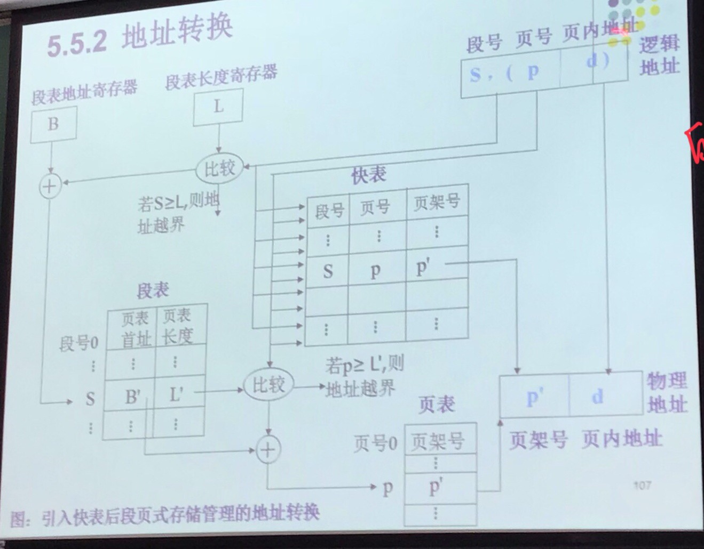

<!--more-->

- [x] OS里进程持有的"资源"具体有哪些？
- [x] 进程切换需要完成哪些工作？（为什么说进程切换开销大？
- [x] 线程切换需要完成哪些工作？

# 操作系统基础概念
* 管理计算机软硬件资源的程序
* 屏蔽了底层硬件的复杂性，对裸机进行了扩展
* 操作系统内核是OS的核心部分，负责进程调度（应用程序管理），内存管理，外部设备（硬件设备）管理，文件系统管理
## 系统调用
* 用户态：用户态运行的进程可以直接读取用户程序的数据。
* 内核态：内核态运行的进程可以不受限制地访问计算机的任何资源。
* 用户的程序中凡是请求系统资源的操作都需要通过系统调用的方式向操作系统提出服务请求，由操作系统代为完成这些操作。

## 栈
* 用途：记录当前任务的函数调用关系以便维护函数返回的跳转，保存当前任务的执行状态以完成任务切换。

### 用户态栈
* 进程栈
* 线程栈

### 内核态栈
* 进程内核栈：进程通过系统调用陷入内核之后，有一个单独内核空间的栈，用以支持内核函数的调用。
  * 在内核态中可能会发生进程切换（例如开始IO）。不同线程可以同时进入内核态，因此要为不同的进程维护不同的内核栈完成来为不同的进程维护调用关系。
* 中断栈：？

# 进程与线程
## 进程与线程的区别
* 进程：是程序的一次运行，是对运行中的程序的描述。
* 线程：也是对运行中的程序的描述，但是粒度小于进程。
* 进程是资源分配的最小单位，线程是CPU执行时间分配的最小单位。
* 同一进程下的多个线程可以共享进程的资源。
* 资源：地址空间，快表，文件描述符（fd）

## 进程持有的资源究竟是什么
* 进程映像：进程执行的上下文环境。是序列化的一个进程运行状态，主要用于进程调度和恢复。
  * 进程控制块(PCB)
    * 进程标识符
    * CPU通用寄存器的内容，例如PSW、PC
    * 进程调度的状态（ready、suspended、...）、调度优先级信息、进程等待的事件
    * 进程结构信息：子进程标识符...
    * 内存管理信息：页表、段表...
    * I/O状态信息：被分配的设备、I/O缓冲区地址...
  * 进程执行的程序（指令）
  * 进程执行时所用的数据
  * 进程栈：用户栈和内核栈
* 内存区域（虚拟内存空间）：包括了可执行代码、数据段、调用栈、堆内存
* 被分配给进程的资源描述符，例如文件描述符fd
* 处理器状态（处理器执行上下文），例如寄存器的内容

## 进程控制块与线程控制块？(Thread Control Block, TCB)
* 线程控制块有与PCB相似的字段：
  * 寄存器值
  * 栈指针：记录调用该函数的上一个函数的返回地址。
  * 程序计数器
  * 调度状态
* 线程控制块(可能)特有的内容
  * 线程标识符(ID)
  * 指向所属进程（控制块）的指针（？？）

## 进程切换（上下文切换）的开销
* 切换虚拟地址空间（加载下一个线程的页表）：
  * 有寄存器保存页表的起始地址和页表的大小，进程切换时需要完成这部分内容的切换。
* 切换内核栈
* 切换硬件上下文。最显著的开销是保存寄存器中的内容

## 线程切换的开销
* 不需要切换虚拟地址空间，其余与线程一致。

## 为什么进程切换比线程切换的开销大
* 进程切换涉及到虚拟地址空间的切换，而线程切换不涉及这个切换，因为同一进程的不同线程使用相同的虚拟地址空间和地址映射规则。将虚拟地址转换为物理地址需要查找页表，而到内存中查找页表是较慢的过程，因此通常使用快表来加速页表查询。当进行进程切换后页表也要切换，此时快表的内容就会失效，地址转换就会变慢。

## 进程的7状态模型
创建、就绪、运行、阻塞、就绪挂起、阻塞挂起、结束

## 进程间通信方式
* 各个进程有不同的地址空间，一个进程的内存空间对于另一个内存而言是无法访问的。因此进程间要交换数据需要通过内核，进程1将数据从用户空间拷贝到内核空间，然后进程2再从内核空间将数据读取走。
### 管道/匿名管道
* 管道中数据只能向一个方向流动，需要双方交换数据时需要建立两个管道。
* 只能用于父子进程或者兄弟进程之间进行通信
* 单独构成一种独立的文件系统。管道对于管道两端的进程而言是一个文件，但它并不是普通的文件，不属于某种文件系统，只存在于内存中。
* 本质是一个内核缓冲区，进程以FIFO的方式在这个缓冲区中存取数据。
* 缓冲区的大小是有限的，需要进行生产/消费同步
* 传送的是无格式字节流，通信双方需要约定
### 具名管道
* 与匿名管道相比，提供了一个路径名与之关联，以具名管道文件的形式存在于系统中，因此不相关的进程只要可以访问该路径就能通过有名管道相互通信。
* 严格遵循FIFO。
* 有名管道的名字存放于文件系统，内容存放在内存中。
### 信号
* Linux系统中进程通信的机制，信号可以在任何时候发给某一进程而不需要知道其状态。（相比之下，管道在创建/发送的时候可能需要对方进程的存在，否则就会阻塞）
* 如果该进程当前并未处于执行状态，则该信号就有内核保存起来，直到该进程回复执行并传递给它为止。
* 如果一个信号被进程设置为阻塞，则该信号的传递被延迟，直到其阻塞被取消是才被传递给进程。
* 是在软件层次上对中断的一种模拟，是一种异步通信方式。
### 消息队列
* 消息的链表，存在于内存中，由消息队列标识符标识。
* 允许一个或多个进程向他写入或读取消息
* 另外与管道不同的是，消息队列在某个进程往一个队列写入消息之前，并不需要另外某个进程在该队列上等待消息的到达。
* 消息队列可以随机查询，可以按消息的类型读取
### 共享内存
* 使得多个进程可以可以直接读写同一块内存空间，是最快的可用IPC形式。是针对其他通信机制运行效率较低而设计的。
* 为了在多个进程间交换信息，内核专门留出了一块内存区，可以由需要访问的进程将其映射到自己的私有地址空间。进程就可以直接读写这一块内存而不需要进行数据的拷贝，从而大大提高效率。
* 需要同步机制（如信号量）达到进程间同步和互斥
### 信号量
* 信号量是一个计数器，用于多进程对共享数据的访问，信号量的意图在于进程间同步。
* 对信号量值的测试和减1操作应该是原子的
### Socket
* socket是一种通信机制，使用这种机制，进程通信可以在单机上运行，也可以跨网络进行，即通过网络让不同计算机上的进程进行通信。

## 线程间通信方式
* 用互斥对象机制，只有拥有互斥对象的线程才有访问公共资源的权限。因为互斥对象只有一个，所以可以保证公共资源不会被多个线程同时访问。
* 信号量：它允许同一时刻多个线程访问同一资源，但是需要控制同一时刻访问此资源的最大线程数量。互斥量是一种特殊的信号量（最多允许一个线程访问资源）
* `volatile`和`synchronized`
* 事件（Event）、等待/通知操作：通过通知操作（wait/notify，await/signal）来保持线程同步。
* 管道输入/输出流

## 进程调度算法
* FCFS
* SJF
* 时间片轮转RR
* 多级反馈队列：除了最低级的队列都使用FCFS，高优先级的队列中没有进程时才会选取低优先级队列中的进程，得到时间片并使用完毕的线程需要降到低一级的优先级队列。最低级的队列使用时间片轮转算法进行调度。
* 优先级调度

# 内存管理
* 内存的分配与回收、内存地址映射：将逻辑地址转换为物理地址。
## 内存管理的方式
* 为每个进程分配单块连续的内存空间。-> 内存碎片
* 页式内存管理：将主存分为大小相等且固定的页，按页为进程分配内存，内存空间可以是不连续的。减少了内存碎片，通过页表完成逻辑地址到物理地址的映射。
  * 逻辑地址：页号+业内位移
  * 页表：页号-块号
  * 页表寄存器：页表始地址、页表长度
* 段式内存管理：将分配给进程的内存空间进行分段，每段赋予逻辑信息(主程序段、子程序段、数据段、（堆）栈段)，即按程序本身的逻辑对程序所用的内存空间进行分段（便于内存共享，某些进程所用的一些内存空间可能内容是一样的，例如同一个程序多次运行产生的多个进程）。通过段表完成逻辑地址到物理地址的映射。
  * 逻辑地址：段号+段内位移
  * 段表：段始地址、段长度
  * 段表寄存器：段表始地址、段表长度
* 段页式内存管理：先将主存进行分页，在此基础上定义段，每段包含若干页。
  * 等分内存：与页式存储管理对内存的分块一样
  * 作业或进程的地址空间与段式存储管理对作业地址空间的处理一样
  * 内存分配：以页为单位
  * 逻辑地址：段号、段内页号、页内位移 -> 物理地址：页框号、页内地址

  * 段表中的每一项都有自己的页表，记录了页表首地址和页表长度
  * 页表中记录对应的页号和页架号
  * 快表：段号、页号、页架号

## 页式内存管理中的快表
两个问题：
* 地址转换要快
* 地址空间大，要使用恰当的数据结构完成地址转换。
* 快表：页表的一部分，放在cache中，命中时只需要一次访存即可完成内存访问。未命中时需要到内存中查询页表，至少需要两次才能完成内存访问。快表还可以利用程序的局部性原理，因此快表的性能很好。
* 多级页表：避免把全部页表放进内存占用过多空间，不需要的页表可以置换到外存（硬盘）中。

## 页式内存管理和段式内存管理的区别和联系
* 共同：
  * 都为了提高内存利用率，减少内存碎片
  * 都是离散存储的，进程使用的内存地址都可以不连续。
* 区别：
  * 页的大小是固定的，由OS决定。段的大小取决于当前运行的程序。
  * 分页仅仅是为了满足OS更好地管理内存的需求。段通常是逻辑信息的单位，对用户程序进行分段可以满足用户分段装入/换出的需求。

## 逻辑地址和物理地址
* 因为用户程序每次运行时被装入内存的位置有可能是不一样的，用户程序每次运行的进程可能都获得了不同的物理地址空间，因此用户程序声明地址时一般只使用统一的逻辑地址。物理地址就是真实物理内存的地址，是内存单元真正的地址。
* 用户程序直接访问和修改真实内存地址可能会有意无意地破坏OS或者其它程序。
* 使用统一的虚拟地址，用户编写程序时无需考虑程序被装入内存时的真实位置，不需要担心程序中编写的内存地址是否被其它程序所拥有，同时也不需要知道OS为进程分配的内存是否连续，内存管理的复杂性一定程度上可以通过使用逻辑地址对编写用户程序的程序员进行屏蔽。

## 虚拟内存
* 内存与外存的速度与价格差距。
* 通过 虚拟内存 可以让程序可以拥有超过系统物理内存大小的可用内存空间。另外，虚拟内存为每个进程提供了一个一致的、私有的地址空间，它让每个进程产生了一种自己在独享主存的错觉（每个进程拥有一片连续完整的内存空间）。这样会更加有效地管理内存并减少出错。
* 理论支持：程序的局部性原理。
  * 时间局部性：如果程序中的某条指令一旦执行，不久以后该指令可能再次执行；如果某数据被访问过，不久以后该数据可能再次被访问。产生时间局部性的典型原因，是由于在程序中存在着大量的循环操作。
  * 空间局部性：空间局部性 ：一旦程序访问了某个存储单元，在不久之后，其附近的存储单元也将被访问，即程序在一段时间内所访问的地址，可能集中在一定的范围之内，这是因为指令通常是顺序存放、顺序执行的，数据也一般是以向量、数组、表等形式簇聚存储的。
  * 基于局部性原理，在程序装入时，可以将程序的一部分装入内存，而将其他部分留在外存，就可以启动程序执行。由于外存往往比内存大很多，所以我们运行的软件的内存大小实际上是可以比计算机系统实际的内存大小大的。在程序执行过程中，当所访问的信息不在内存时，由操作系统将所需要的部分调入内存，然后继续执行程序。另一方面，操作系统将内存中暂时不使用的内容换到外存上，从而腾出空间存放将要调入内存的信息。这样，计算机好像为用户提供了一个比实际内存大的多的存储器——虚拟存储器。

## 虚拟内存技术的实现
* 内存和外存（页表/段表、快表）
* 缺页中断机构：如果需要执行的指令或需要的数据尚未在内存 -> 由处理器通知OS将页/段调入到内存，然后继续执行程序
* 地址转换
### 请求分页存储管理
建立在分页管理之上，为了支持虚拟存储器功能而增加了**请求调页功能和页面置换功能**。请求分页是目前最常用的一种实现虚拟存储器的方法。请求分页存储管理系统中，在作业开始运行之前，**仅装入当前要执行的部分页即可运行**。假如在作业运行的过程中发现要访问的页面不在内存，则**由处理器通知操作系统按照对应的页面置换算法将相应的页面调入到主存**，同时操作系统也可以将暂时不用的页面置换到外存中。
### 请求分段存储管理
建立在分段存储管理之上，增加了请求调段功能、分段置换功能。请求分段储存管理方式就如同请求分页储存管理方式一样，在作业开始运行之前，仅装入当前要执行的部分段即可运行；在执行过程中，可使用请求调入中断动态装入要访问但又不在内存的程序段；当内存空间已满，而又需要装入新的段时，根据置换功能适当调出某个段，以便腾出空间而装入新的段。
### 请求段页式存储管理

### 页面置换算法
* OPT：无法实现，衡量标准
* FIFO
* LRU
* LFU：为每个页维护使用计数

## CPU寻址
CPU需要将虚拟地址转换为物理地址才能访问到真正的物理内存。完成这一地址转换的硬件是CPU的内存管理单元(MMU)。

# 并发/多任务
## 进程与线程
* Linux下（其它OS不知道）的内核级线程本质是轻量级进程，多个轻量级进程被OS进行调度的时候就当成进程进行调度，创建线程就像创建进程一样需要创建“进程控制块”之类的数据结构让OS感知其存在，不过在这个数据结构中可以标识这个轻量级进程所属的“组”（所属的进程）
  * 于是在同一个“组”中进行轻量级进程的切换的时候可以节省一些操作。
    * 内存寻址所需要的段表/页表/各种表应该是不同地址空间不一样的，每个进程的逻辑地址到物理地址应该有不同的映射规则。如果切换前后的轻量级进程属于同一个进程，那就不用进行页表切换了。至于快表中的内容在进程切换的时候是直接丢弃还是放进PCB之类的数据结构不得而知，但是在轻量级线程之间切换应该也不用对快表进行过多的操作了。
    * （除了地址空间和代码段，暂时想不出还有什么轻量级进程之间可以共享的资源，打开的文件描述符集合是可以在轻量级进程之间共享的吗？感觉应该可以，那么这些文件描述符需要进行互斥访问吗。）
  * 但是有些操作是省不了的
    * 栈内存区切换，但是由于同一进程内地址空间是一样的，改个指针应该没什么开销？
    * “运行上下文”的保存和切换，包括一些进程运行时放置在寄存器里的数据，最典型的是程序计数器
* 对于让应用级线程和用户级线程进行一一对应的程序（HotSpot VM似乎就是这样的），在用户态创建一个线程需要进行系统调用让OS创建一个轻量级进程。进行线程切换等于让OS进行轻量级进程的切换。
## 协程
* 协程的概念：在一个轻量级进程里创建多个用户级线程。要阻塞的操作（IO）尽量使用异步方式，不让整个轻量级进程被阻塞。在一个轻量级线程里维护协程共有的资源和协程私有的资源（可能存在的协程栈和协程计数器？）。
* 更直观的理解：非抢占调度的用户级线程。在用户程序中，编程者更清楚何时应该发生运行上下文的切换（比如IO操作时），因此非抢占调度可以减少无意义的上下文切换次数（多个活跃线程互相抢占CPU时间）。
* 主要的应用场景是IO操作密集的情况下。在Java中使用IO多路复用（NIO）一定程度上可以近似实现协程调度的效果。但是编写程序的用户需要自己维护程序运行的状态和上下文。如果语言层面上能够支持协程，可以以近似同步代码的方式编写包含(异步)IO操作的代码，代码的可读性更好，降低编写难度。
  * 对于一个有多步IO操作的业务逻辑，在其Handler中按照IO操作进行分割，并在Handler中保存状态。
  * 每当需要进行IO操作时，将当前执行状态保存，用状态标志变量表示当前业务逻辑的执行进度，将当前IO操作对应的事件连同当前Handler的实例注册到选择器中，然后当前worker线程即可退出。
  * 下一次选择器选中该IO操作对应的事件时，就可以从SelectionKey取出绑定过的Handler实例，而Handler实例中保存了执行状态，此时再将该Handler的处理方法提交到线程池中即可恢复业务的执行。
* 用户程序需要维护协程调度器。
  * 要利用多核怎么办：多对多映射，创建多个轻量级进程，每个轻量级进程负责多个协程

# Linux
## 文件系统
### Inode
* 保存文件元信息的数据结构：每一块的地址，文件所有者，创建时间，权限，大小
* 索引可以是多级的，Inode中的地址存放的可能是次一级的Inode
* Block：实际文件的内容。一个block只能包含一个文件的信息。

### 文件类型
* 普通文件-
* 目录文件d
* 块设备文件b：随机读写，如磁盘
* 字符设备文件c：字符流。/dev/null：所有内容被忽略
* 管道文件p：一头流入另一头流出
* 套接字s：socket

# Some random shit
## IO
* 可以利用操作系统缓冲区。OS在内存的内核区域维护缓冲区，用户程序在进行IO操作的时候可以只将数据写入该缓冲区。然后再定期通过`fsync`等操作将缓冲区中的内容同步到硬盘上。
* 也可以不利用缓冲区，在flag参数中设置`O_DIRECT`标志，让用户将内存中用户区域的数据直接写到外部设备。适用于用户程序自己维护缓冲区的情况。
