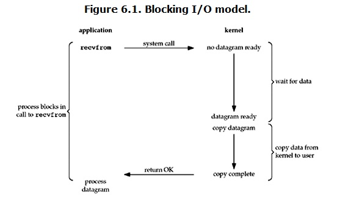
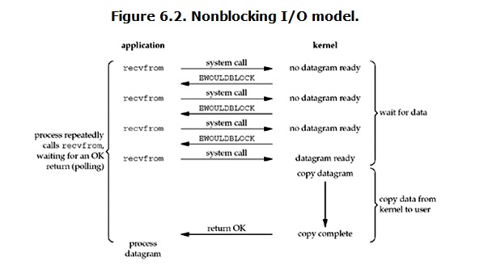
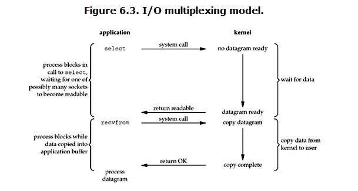
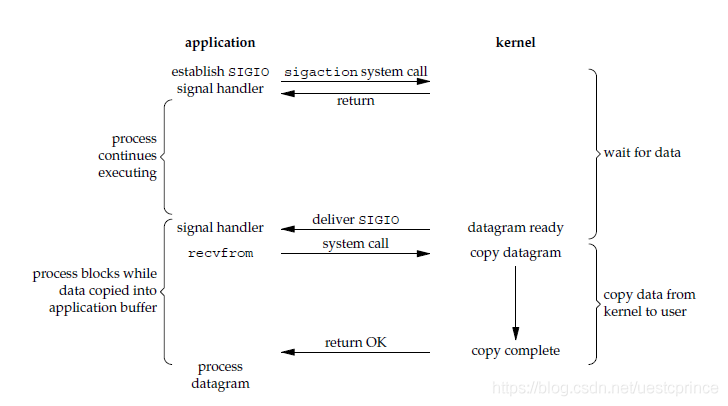
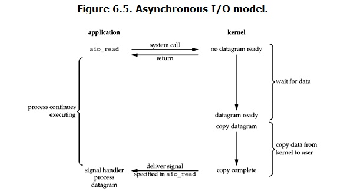

<!--more-->
# 标准I/O
将IO数据先复制到内核缓冲区，然后从内核缓冲区复制到应用程序的地址空间。

# 5种IO模型
* blocking/nonblocking：一直block到操作完成/内核缓冲区数据准备好时才开始block，否则立刻返回
* sync/async：做IO operation时（内核缓冲区和应用程序的数据交换）是否会block
## 阻塞IO

## 同步非阻塞IO

## IO多路复用
* select/poll/epoll
* multiplexing函数可以具有超时机制
* 单进程可以处理多个IO

## 信号驱动IO

## 异步IO


# 3个IO多路复用函数
## select
* 几乎全平台支持
* 3个fd_set
* 底层数据结构使用数组，能监视的文件描述存在最大限制
* select返回后需要轮询所有的fd

## poll
* 一个pollfd指针
* 没有最大数量限制（可能受OS的最大描述符数量限制）
* 返回后也需要轮询所有的pollfd

## epoll
* 3个接口
  ```cpp
    int epoll_create(int size)；//创建一个epoll的句柄，size用来告诉内核这个监听的数目一共有多大
    // 只是一个初始大小
    int epoll_ctl(int epfd, int op, int fd, struct epoll_event *event)；
    int epoll_wait(int epfd, struct epoll_event * events, int maxevents, int timeout);
  ```
  * `epoll_create`: 创建epoll句柄（一个fd），因此epoll会创建一个fd。
  * `epoll_ctl`: 可以对指定fd(`fd`)添加、删除、修改希望监听的事件（操作由`op`指定）。`event`指定监听事件，也可以设置当前epoll为水平触发和边缘触发。
  * `epoll_wait`: 等待epfd上的IO事件。最多返回`maxevent`个事件。返回值是事件触发数。
* 水平触发LT：`epoll_wait`检测到描述符发事件发生时通知程序，程序可以不立即处理事件。如果不处理，下次调用该方法时会再次通知应用程序事件的发生
* 垂直触发ET(edge trigger): 应用程序必须立即处理事件，不处理的话下次不会再通知。

# Java 3种IO
## BIO
listen就是直到返回才会完成
## NIO
Selector: 多路复用选择器，将事件绑定到此处
Channel: 读写数据的通道，可以注册到Selector中并选择感兴趣的事件（read就绪、write就绪、accept就绪...）。注册后在Selector上调用select会选出所有就绪的Channel对应的SelectionKey。
SelectionKey: 表示一个Channel在一个Selector上的一次注册，可以向其中附加数据（比如附加Handler方法）
ByteBuffer：用于向Channel中读写数据的缓冲区。

## AIO