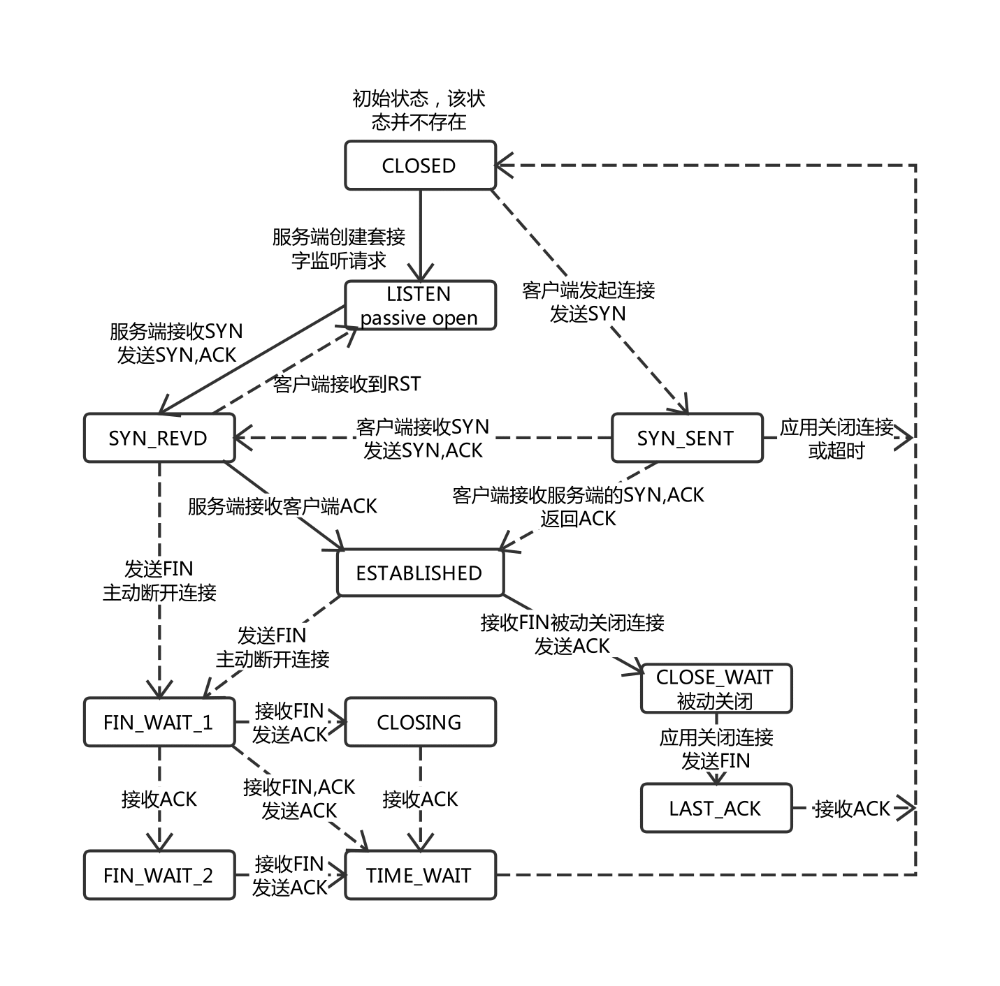

<!--more-->

- [x] TCP状态图
- [x] TIME_WAIT/CLOSE_WAIT大量出现是为什么，怎么解决
- [x] TCP为什么慢
- [ ] HTTP/2
- [x] 能不能用UDP代替TCP(QUIC协议)

# 协议分层（TCP/IP协议栈）
* 应用层(application-layer）的任务是通过应用进程间的交互来完成特定网络应用。应用层协议定义的是应用进程（进程：主机中正在运行的程序）间的通信和交互的规则。对于不同的网络应用需要不同的应用层协议。在互联网中应用层协议很多，如域名系统DNS，支持万维网应用的 HTTP协议，支持电子邮件的 SMTP协议等等。我们把应用层交互的数据单元称为报文。
* 传输层(transport layer)的主要任务就是负责向**两台主机进程之间的通信**提供通用的数据传输服务。应用进程利用该服务传送应用层报文。
* 运输层主要使用以下两种协议:
  * 传输控制协议 TCP（Transmission Control Protocol）--提供面向连接的，可靠的数据传输服务。
  * 用户数据协议 UDP（User Datagram Protocol）--提供无连接的，尽最大努力的数据传输服务（不保证数据传输的可靠性）。
* 网络层/网际层：在 计算机网络中进行通信的两个计算机之间可能会经过很多个数据链路，也可能还要经过很多通信子网。网络层的任务就是选择合适的网间路由和交换结点， 确保数据及时传送。 
* 网络接口层（数据链路层/物理层）：数据链路层：两台主机之间的数据传输，总是在一段一段的链路上传送的，这就需要使用专门的链路层的协议。 在两个相邻节点之间传送数据时，数据链路层将网络层交下来的 IP 数据报组装成帧，在两个相邻节点间的链路上传送帧。每一帧包括数据和必要的控制信息（如同步信息，地址信息，差错控制等）。物理层：实现相邻计算机节点之间比特流的透明传送，尽可能屏蔽掉具体传输介质和物理设备的差异。

# TCP协议
* 网络层只会向上提供简单灵活的，无连接的，尽最大努力交付的数据报服务。网络层不提供服务质量的承诺。不保证分组交付的时限所传送的分组可能出错，丢失，重复和失序。进程之间通信的可靠性由运输层负责

## TCP状态转换
* LISTEN: 等待远程TCP应用程序的连接建立请求
* SYN_SENT: 发送连接请求（SYN）后等待来自远程端点的确认。
* SYN_REVD: 当前端点已经接收到连接请求并发送确认。该端点正在等待最终确认(ACK)，TCP第二次握手后服务端所处的状态。
* ESTABLISHED: 客户端发出ACK后的状态，服务端接收到客户端ACK的状态，TCP连接完全建立。
* FIN_WAIT_1: 发出FIN后，等待远程端点对FIN的ACK
* FIN_WAIT_2: 收到远程端点对自己发出的FIN的ACK，等待来自远程TCP端点的连接中止请求(FIN)。
* **CLOSE_WAIT**: 接受到远程端点发送的FIN，并发送ACK之后的状态
* **LAST_ACK**: 对方向自己的连接已经关闭时，向对方发送FIN之后的状态
* **TIME_WAIT**: 收到远程端点的FIN，向远程端点发送ACK，等待2MSL以确保远程端点收到ACK，随后关闭连接进入CLOSED状态
* CLOSING: 发出FIN后，在等待远程端点对FIN的ACK时收到远程端点的FIN，进入该状态（同时关闭）。此时接收到远程端点的ACK会进入TIME_WAIT状态。


## 三次握手
### 过程
* TCP的三次握手：
    1. 发起者 SYN seq = x
    2. 接受者收到SYN seq = x，发回ACK x + 1 SYN seq = y。此时接收者的TCP状态切换为SYN RECEIVED，创建一个子连接加入到SYN_RCVD队列（半连接队列）
    3. 发起者收到ACK x + 1 SYN seq = y，发回ACK y + 1 seq = x + 1
    4. 接受者收到ACK x + 1 seq = y + 1，将2中创建的子连接移动到ESTABLISHED队列（全连接队列，accept队列）
    5. 接受者端用户程序调用accept()时，将连接从ESTABLISHED队列取出

### 为什么需要三次握手
* 总而言之，TCP双方建立连接时采用三次握手是为了感知双方的存在，同时确认双方的发送/接收能力是否正常。**同时，还可以在这个阶段交换一些参数**
* 第一次握手：发起者发送SYN x，在本次握手无法确认任何事。而接受者收到SYN x可以确定发起者的发送能力正常，接受者的接收能力正常。
* 第二次握手，接受者发送SYN y ACK x + 1，在本次接受者无法确认任何事，发起者收到SYN y ACK x + 1可以确定发起者的发送能力正常，发起者的接收能力正常，接收者的发送能力和接收能力都正常。此时发起者完成了对接受者的感知，而接受者尚未完成对发起者的感知。
* 第三次握手，发起者发送ACK y + 1，接受者接收到ACK y + 1后可以确认发起者的接受能力正常，接受者的发送能力正常。至此接受者也完成了对发起者的感知。

### 为什么第二次握手需要设置SYN = 1
意义不同。接收端传回发送端所发送的ACK是为了告诉发送端端，接收到的信息确实就是所发送的信号了，这表明从发送端到服务端的通信是正常的。而回传SYN则是为了建立并确认从接收端到发送端的通信。

## TCP vs UDP(TCP为什么慢)
* TCP: 要连接，要释放，无广播。因为要确保可靠传输，需要有序传输，确认机制，流量控制（发送方和接收方的速度同步），拥塞控制（网络状态差时减少发送），增加了很多开销。
* UDP：无连接，不需要确认，不提供可靠交付，即时性强

## TCP如何保证可靠传输
1. 应用数据被分割成 TCP 认为最适合发送的数据块。-> 粘包问题
2. TCP 给发送的每一个包进行编号，接收方对数据包进行排序，把有序数据传送给应用层。（有序传输）
2. 校验和： TCP 将保持它首部和数据的检验和。这是一个端到端的检验和，目的是检测数据在传输过程中的任何变化。如果收到段的检验和有差错，TCP 将丢弃这个报文段和不确认收到此报文段。
3. TCP 的接收端会丢弃重复的数据。
4. 流量控制： TCP 连接的每一方都有固定大小的缓冲空间，TCP的接收端只允许发送端发送接收端缓冲区能接纳的数据。当接收方来不及处理发送方的数据，能提示发送方降低发送的速率，防止包丢失。TCP 使用的流量控制协议是可变大小的滑动窗口协议。 （TCP 利用滑动窗口实现流量控制）
5. 拥塞控制： 当网络拥塞时，减少数据的发送。
6. ARQ协议（自动重传请求）： 也是为了实现可靠传输的，它的基本原理就是每发完一个分组就停止发送，等待对方确认。在收到确认后再发下一个分组。
7. 超时重传： 当 TCP 发出一个段后，它启动一个定时器，等待目的端确认收到这个报文段。如果不能及时收到一个确认，将重发这个报文段。

## ARQ协议：确认机制
* 在OSI模型的数据链路层和传输层都使用的错误纠正协议之一。通过确认和超时两个机制在不可靠的基础上实现可靠的信息传输。
### 停止-等待ARQ
每发完一个分组就停止发送等待对方确认（等待ACK的序号）。过了一段时间后没有得到ACK确认就重发，直到收到确认。
优点是简单，缺点是信道利用率低，等待时间长。
* 维护超时计时器，超时未确认则重传发送过的分组（自动重传ARQ）。如果收到重复分组则丢弃，但要再次发送确认。确认消息丢失或确认消息迟到都会导致重传，对重复的数据和重复的确认的处理是相同的，都是丢弃，重复数据会发送确认。

### 连续ARQ
* 发送方维护一个发送窗口，发送窗口内的分组连续发送出去而不需要等待确认，接收方采用累计确认，确认按序到达的最后一个分组，表明在此之前的所有分组都正确地收到了。
* 优点：信道利用率高
* 缺点：有时接收方无法向发送方反映正确收到的所有分组的信息。发送方发送了 5条 消息，中间第三条丢失（3号），这时接收方只能对前两个发送确认。发送方无法知道后三个分组的下落，而只好把后三个全部重传一次。这也叫 Go-Back-N（回退 N），表示需要退回来重传已经发送过的 N 个消息。

## TCP流量控制：滑动窗口
* 流量控制：控制发送方的发送速率，保证接收方来得及接收。

## TCP拥塞控制（4阶段）
在某段时间，若对网络中某一资源的需求超过了该资源所能提供的可用部分，网络的性能就要变坏。这种情况就叫拥塞。拥塞控制就是为了防止过多的数据注入到网络中，这样就可以使网络中的路由器或链路不致过载。拥塞控制是一个全局性的过程，涉及到所有的主机，所有的路由器，以及与降低网络传输性能有关的所有因素。（需要对比流量控制）
维护拥塞窗口，根据网络的拥塞程度动态变化，发送方将发送窗口调整为拥塞窗口和接收窗口中较小的一个。
* 慢开始：慢开始算法的思路是当主机开始发送数据时，如果立即把大量数据字节注入到网络，那么可能会引起网络阻塞，因为现在还不知道网络的符合情况。经验表明，较好的方法是先探测一下，即由小到大逐渐增大**发送窗口**，也就是**由小到大逐渐增大拥塞窗口数值**。cwnd初始值为1，每收到一个ACK，就将拥塞窗口大小+1。这样每经过一个传播轮次，cwnd就会加倍。
* 拥塞避免：慢开始阶段，窗口达到慢开始的阈值或发生丢包时，就会进入拥塞避免阶段，发送窗口立级减半。拥塞避免算法的思路是让拥塞窗口cwnd缓慢增大，即每收到一个ACK就把发送放的cwnd加1。此时cwnd会呈线性增长。
* 快重传与快恢复（Fast Retransmit and Recovery，FRR）：如果不使用快重传，数据包丢失时TCP将会使用定时器来要求传输暂停（等待ACK到来或超时重传），这段时间内没有新的或复制的数据包被发送。如果使用FRR，接收机接收到一个不按顺序的数据段，它会立即给发送机发送一个重复确认。如果发送机接收到三个重复确认，它会假定确认件指出的数据段丢失了，并立即重传这些丢失的数据段。有了 FRR，就不会因为重传时要求的暂停被耽误。
  * 在拥塞避免阶段，如果收到连续的3个重复的ACK，认为这个报文的下一个报文就丢失了，进入快重传阶段，立即重传丢失的数据段。进入快重传阶段
  * 此时对于接收端，要求接收端在收到第一个失序的报文段后立即发出重复确认，而不要等到自己要发数据时才进行捎带确认。
  * 快重传后进入快恢复阶段，将慢启动阈值修改为当前拥塞窗口值的一半，同时拥塞窗口值等于慢启动阈值，然后进入拥塞避免阶段。

## 四次挥手
### 过程
* 客户端-发送一个 FIN，用来关闭客户端到服务器的数据传送
* 服务器-收到这个 FIN，它发回一 个 ACK，确认序号为收到的序号加1 。和 SYN 一样，一个 FIN 将占用一个序号
* 服务器-关闭与客户端的连接，发送一个FIN给客户端
* 客户端-发回 ACK 报文确认，并将确认序号设置为收到序号加1。此时客户端会进入`TIME-WAIT`状态，等待2MSL（最长报文段寿命）
* 服务端收到ACK报文确认后会直接关闭TCP连接，客户端等待2MSL后也会关闭TCP连接

### 为什么要等待2MSL
* MSL(Maximum Segment Lifetime)：最大报文段寿命。
* 第一，防止客户端发送的最后一个ACK报文丢失。在这种情况下，服务端收不到客户端发送的最后一个ACK，会再次发送释放连接报文。
  * 其实这一目的并不十分重要，并且2MSL也并不是最保守的一个估计值。最保守的估计值应该是一直等待到对方的超时重传次数全部用完再加一个MSL。第一个目标虽然重要，但并不十分关键，因为既然已经到了关闭连接的最后一步，说明在这个TCP连接上的所有用户数据已经完成可靠传输，所以要不要完美的关闭这个连接其实已经不是那么关键了。
* 第二，如果不等待2MSL（不存在TIME_WAIT）状态，假如双方关闭连接后又经过三次握手建立了一个新的连接，使用的IP地址和端口和这个先前的连接完全相同，并且原先的连接中还有数据报残存在网络中，这样残存的数据报有可能成功到达通信的某一方，通信的某一方有可能接收到上一个连接残存的数据。为了防止这一点，TCP定义了TIME_WAIT状态，让释放连接的一方的socket等待2MSL后再接受同一个socket（同一个四元组）建立连接的请求。这足以让**两个方向**上的旧数据都过期。
  * 回忆四次挥手的最后两次：
    1. TCP的一端发送FIN报文后如果收不到对端针对该FIN的ACK，则会反复多次重传FIN报文（应该回有一个超时时间
    2. 被动关闭（第二次发送FIN报文的一端）处于`LAST-ACK`状态在收到最后一个ACK之后不会发送任何报文，立即进入`CLOSED`状态。
    3. 主动关闭的一端在收到FIN报文后回复ACK并进入`TIME-WAIT`状态。
    4. 处于`TIME_WAIT`状态的一端在收到重传的FIN时会重新计时
  * 假设A刚对B发出的FIN发回ACK，进入了`TIME_WAIT`状态，而B正处于`LAST_ACK`状态。B在收到最后一个ACK之前会重传FIN直至超时。
    * 如果ACK在网络中丢失，B会一直重传FIN直到超时。如果B的FIN能被A接收，那么计时器重置，双方的状态都不变。如果B的FIN始终无法传达到A，那么A在经历2MSL后状态会变为`CLOSED`，B会重传FIN到超时，在此之前都处于`LAST_ACK`状态。处于`LAST_ACK`状态的B不会向A建立新的连接，自然也就没有化身连接的问题。
    * 如果ACK被B接收到，从A发送到B接收经历了时间t，则必有`0 <= t <= MSL`。最极端的情况是，当`t = MSL`时，B在收到ACK的瞬间重传了一次FIN，那么这个FIN需要被丢弃，让A再等一个MSL即可让这个FIN失效。因此A至少需要等2MSL。

## 为什么TCP的初始序列号(Sequence Number)需要是随机的
* 为了防范针对TCP的攻击：IP欺骗
  * 首先回忆一下，TCP连接的双方都要生成一个初始序列号。
  * 对于一对相互信任的主机A和B，主机C如果知道了主机B的IP，在TCP初始序列号可预测的情况下，可以冒充主机B与主机A建立TCP连接
  * 具体流程: 主机C使用主机B的IP向主机A发送TCP SYN，主机A会将它的SYN + ACK发给主机B，主机B此时不会理会（因为不是它发起的连接）。此时主机C无从得知主机A发出的SYN + ACK的序列号，但是如果TCP初始序列号非随机（可预测），则主机C就可以直接构造出正确的序列号与主机A建立TCP连接。在建立之后主机A就会正常接收来自主机C的消息了。

## TCP Backlog，netstat中的RECV-Q和SEND-Q
### TCP的全连接队列和半连接队列
* 半连接队列：SYN_RCVD队列
* 全连接队列：accept队列

### backlog参数会影响什么，怎么影响
  * backlog是系统调用listen中的一个参数，能够影响半连接队列和全连接队列的长度
  * 能够影响上述两个队列长度的还有`/proc/sys/net/core/somaxconn`, `/proc/sys/net/ipv4/tcp_max_syn_backlog`这两个参数
  * 全连接队列的长度上限为`min(backlog, somaxconn)`
  * 半连接队列的长度上限为`roundup_pow_of_two(max(8, min(tcp_max_syn_backlog, min(backlog, somaxconn))) + 1)`，其中`roundup_pow_of_two(n)`是指大于等于`n`且最接近`n`的2的x次幂（返回2的x次幂的值）。
  * tcp_max_syn_backlog - INTEGER
	Maximal number of remembered connection requests, which have not
	received an acknowledgment from connecting client.
	The minimal value is 128 for low memory machines, and it will
	increase in proportion to the memory of machine.
	If server suffers from overload, try increasing this number.
    根据大意是指半连接队列的最大长度。
  * somaxconn - INTEGER
	Limit of socket listen() backlog, known in userspace as SOMAXCONN.
	Defaults to 128.  See also tcp_max_syn_backlog for additional tuning
	for TCP sockets.
  * 那为什么实际计算队列长的时候那么奇怪呢（

### netstat中的RECV-Q和SEND-Q
* 连接建立（ESTABLISHED）时，RECV-Q指的是连接到该socket的用户程序还没有复制（到用户空间）的字节数，SEND-Q指的是远端主机还没有确认收到的字节数。
* 在侦听状态中(LISTENING),RECV-Q指的是当前的SYN BACKLOG（since 2.6.18），SEND-Q指的是当前SYN BACKLOG的最大值。
* 根据文档，SYN backlog就是半连接队列（

## TCP粘包
* TCP会对用户数据进行调整后封装发送。这样会导致用户多次发送的数据被封装在一个TCP报文中，或者用户一次发送的数据被拆分成多个TCP报文；或者先被发送的数据需要等待一段时间，才能跟后面被发送的数据一起组成报文被发送出去。因为TCP是面向流的协议，同时为了解决大量小报文的情况下包头比负载大导致传输性价比太低的问题，TCP会对用户数据进行重新调整。
* 如果开发者需要解决数据被合并发送的问题，需要对应用层协议进行重新设计，例如让应用层协议数据以特定的标志开头，在应用层协议头表明该协议数据的长度，以便于在处理字节流时重新获取完整的包数据。
* 如果开发者希望让数据立级发送而不是等待，可以设置`TCP_NODELAY`来尝试解决。

## TIME_WAIT大量出现
### 确认
`netstat -an | grep TIME_WAIT`
### 可能的原因
* `TIME_WAIT`只会出现在主动发起四次挥手的一方。原因之一可能是因为HTTP服务器没有设置`keepalive`，导致每发送一个响应就要断开连接。而每次断开连接都需要等待2MSL。
* 还有谁用TCP连接？数据库...例如redis...MySQL...如果没有连接池，也可能大量出现这种状态

## CLOSE_WAIT大量出现
### 可能的原因
* `CLOSE_WAIT`出现在被动接受四次挥手的一方。具体出现在接受对方发送的FIN后发送出ACK之后，会转换到`CLOSE_WAIT`状态。如果一直保留在这个状态，说明当前端可能没有对连接进行`close`操作，导致一直保持半连接。

## TCP SYN洪泛攻击（SYN Flood）
### 是什么
* TCB(TCP传输控制块)是一个让OS感知TCP连接的数据结构。在半连接队列（SYN-RCVD队列，存在于内核）中，保存了已经收到SYN报文但是没有收到ACK报文的半连接。
* 服务器在接受到TCP连接请求时会为这个半连接分配资源，用这些资源保存此次请求的一些信息，例如四元组（目的IP和端口，源IP和端口）和一些TCP参数。
* backlog队列参数，限制TCB上限的数量。当该队列被占满时，服务器不再会响应新的请求，除非TCB能够被回收或从SYN-RCVD状态中被移除。
* SYN Flood：发送大量的SYN数据报占满服务器的半连接队列。
  * 直接攻击：不伪装IP，不对SYN-ACK报文进行响应
  * IP地址欺骗：在报文头中填入其它的IP地址，这些主机不会响应SYN-ACK报文
  * 分布式攻击：使用网络中的多台主机进行SYN洪泛攻击。

### 表现为？
* 在进入SYN_RCVD状态时，连接请求的接收方会向发起方发送SYN+ACK报文，并且有一个重传并等待超时的机制，因此SYN_RCVD状态会大量发生（netstat）？

### 解决方案
* 适当增大半连接队列的最大容量。（`backlog`参数，linux系统中的`backlog`和`somaxconn`参数）
* SYN Cookies
  * 目的：在不预分配资源的情况下，验证之后可能到达的ACK的有效性，保证这是一次完整的握手（要保证当前收到的ACK在之前的却发送过SYN，接受过从本服务器发出过的SYN + ACK），同时获得SYN报文中携带的TCP选项信息。
  * SYN Cookies让服务器在收到客户端的SYN报文时，不分配资源保存客户端信息，而是将这些信息保存在SYN + ACK的初始序列号和时间戳中。对正常的连接，在回复ACK时会将该序列号+1发送到服务器。服务器通过将该序列号-1即可还原出这些客户端信息，确认当前连接是经历三次握手建立的合法的连接。
  * Linux中的`/proc/sys/net/ipv4/tcp_syncookies`可以设置SYN Cookie的开关。
* 设置防火墙/代理，当服务端响应SYN+ACK后代理或防火墙伪装客户端直接向服务端返回假的ACK，避免半连接队列过长。如果客户端能再发回ACK，说明这是一个合法的连接。如果代理等待一段时间后检测不到客户端发回的ACK，则向服务端发送RST释放TCP连接。


# ARP
## 建立TCP连接与ARP的关系
应用接受用户提交的数据，触发TCP建立连接，TCP的第一个SYN报文通过connect函数到达IP层，IP层通过查询路由表：
* 如果目的IP和自己在同一个网段：
  * 当IP层的ARP高速缓存表中存在目的IP对应的MAC地址时，则调用网络接口send函数（参数为IP Packet和目的MAC））将数据提交给网络接口，网络接口完成Ethernet Header + IP + CRC的封装，并发送出去；
  * 当IP层的ARP高速缓存表中不存在目的IP对应的MAC地址时，则IP层将TCP的SYN缓存下来，发送ARP广播请求目的IP的MAC，收到ARP应答之后，将应答之中的`<IP地址，对应的MAC>`对缓存在本地ARP高速缓存表中，然后完成TCP SYN的IP封装，调用网络接口send函数（参数为IP Packet和目的MAC））将数据提交给网络接口，网络接口完成Ethernet Header + IP + CRC的封装，并发送出去。
* 如果目的IP地址和自己不在同一个网段，就需要将包发送给默认网关，这需要知道默认网关的MAC地址：
  * 当IP层的ARP高速缓存表中存在默认网关对应的MAC地址时，则调用网络接口send函数（参数为IP Packet和默认网关的MAC）将数据提交给网络接口，网络接口完成Ethernet Header + IP + CRC
  * 当IP层的ARP高速缓存表中不存在默认网关对应的MAC地址时，则IP层将TCP的SYN缓存下来，发送ARP广播请求默认网关的MAC，收到ARP应答之后，将应答之中的<默认网关地址，对应的MAC>对缓存在本地ARP高速缓存表中，然后完成TCP SYN的IP封装，调用网络接口send函数（参数为IP Packet和默认网关的MAC）将数据提交给网络接口，网络接口完成Ethernet Header + IP + CRC的封装，并发送出去。

# ICMP
* Internet控制消息协议，用于探测网络情况，主机是否可达等信息。

# HTTP
## 输入URL -> 页面加载完成
### 总体
1. DNS解析
2. TCP连接
3. 发送HTTP请求
4. 服务器处理请求并返回HTTP响应报文
5. 浏览器解析渲染页面
6. 连接结束

### DNS解析
* 唯一标识是IP地址，但是IP地址不方便记忆，在用户友好和可用性中做权衡 -> 域名到IP地址的解析（DNS解析）
* DNS解析：递归查询。
  * 使用UDP协议
  * （host文件？） -> 本地域名服务器 -> 根域名服务器(com, net, ...) -> 顶级域名服务器 -> （主）域名服务器
* DNS优化 -> DNS缓存
  * DNS存在多级缓存：浏览器缓存、系统缓存、路由器缓存、ISP（Internet Service Provider）服务器缓存、根域名服务器缓存、顶级域名服务器缓存、主域名服务器缓存
* DNS负载均衡：让DNS返回一个合适的机器IP给用户。

### TCP连接

### HTTP请求
构建HTTP请求报文，通过TCP协议发送到服务器指定端口。HTTP -> 80，HTTPS -> 443
#### 请求行
```
Method Request-URL HTTP-Version CRLF
```
#### 报头
允许客户端和服务器之间传递HTTP报文时携带附加信息和关于（客户端）自身的信息。
常见请求报头
* Cookie
* With-Cridential

自定报头：一般以`X-`开头

#### 请求正文
发送的数据。

### HTTP响应
#### 状态码
* 1xx：指示信息–表示请求已接收，继续处理。

* 2xx：成功–表示请求已被成功接收、理解、接受。
  * 200 OK
  * 202 Accepted

* 3xx：重定向–要完成请求必须进行更进一步的操作。
  * 301 Moved Permanently：
  * 302 Moved Temporarily
  * 304 Not Modified：不包含消息体，客户端可以直接使用本地缓存的请求结果

* 4xx：客户端错误–请求有语法错误或请求无法实现。
  * 400 Bad Request：语义有误、参数错误
  * 401 Unauthorized：需要进行用户验证
  * 403 Forbidden：拒绝执行，通常可以表示权限不足
  * 404 Not Found：指定的资源未找到

* 5xx：服务器端错误–服务器未能实现合法的请求。
  * 500 Internal Server Error：一般是服务器源代码出错。

#### 响应头
常见响应报头
* expires：http1.0的缓存控制响应头，表示未来资源会过期的时间，用于实现强制缓存。过期前会在本地缓存数据库中读取信息，过期后则向服务器发送请求。
* Cache-Control：HTTP1.1的缓存控制响应头，用于实现强制缓存（`max-age=xxx`）。`no-cache`使用协商缓存。`no-store`则禁用缓存
* Last-Modified：http1.0的缓存控制响应头，用于实现协商缓存。第二次及之后的请求时浏览器会首先带上If-Modified-Since请求头去访问服务器，而服务器将其中携带的时间与资源修改时间匹配。若不一致，服务器返回新的资源并更新Last-Modified。若一致，则返回304状态码。
* Etag：http1.1通过响应头的Etag字段(内容特征值)作为缓存标识。第一次请求时服务器将资源和Etag一并返回给浏览器。之后的请求时浏览器将Etag信息放到If-None-Match请求头去访问服务器。服务器收到请求后将服务器中的文件标识与浏览器发来的标识进行对比，如果不相同则返回新资源和新的Etag，否则返回304状态码。
* Connection：设置为`Keep-Alive`可以告诉客户端本次HTTP请求结束后不需要关闭TCP连接，方便下次HTTP请求使用相同的TCP连接。

#### 响应报文
返回的信息：HTML/CSS/JS/json...

### HTTPS
* HTTP是明文传输的。HTTPS为HTTP的内容进行加密：HTTP + SSL/TLS
* 对称加密需要提前协商密钥，但是协商密钥的过程可能会被发现，密钥可能会泄露。
* 使用非对称加密无法防范中间人攻击：非对称加密需要通信双方生成密钥对并且交换公钥，中间人在交换公钥的过程中可以截获通信一方的公钥，将自己的公钥发给另一方。这样，中间人可以用自己的私钥对通信双方的通信内容进行解密，同时生成假消息发送给通信双方。此时问题在于通信双方如何确认对方的身份，如何确定发送的消息没有经过中间人篡改。并且，非对称加密的性能消耗高，一直使用非对称加密会降低应用的性能表现。
* 确定消息没有经过篡改：摘要算法（数字签名，单向哈希）
  * 甲方对消息明文使用单向哈希算法生成摘要，再使用**自己的私钥**对摘要进行加密，得到一个数字签名。
  * 乙方对消息明文使用相同的单向哈希算法生成摘要，再使用**甲方的公钥**对数字签名进行解密，得到又一个摘要。如果这两个摘要是相等的，说明接收到的消息没有受到中间人篡改。
  * 单向哈希算法可以进行协商。
  * 但是，如果中间人彻底冒充了通信双方，即甲乙双方持有的是中间人的公钥，中间人持有甲乙双方的公钥，使用摘要算法也无法阻止消息被窃取和篡改：甲方持有的是中间人的公钥，因此无论是使用自己的私钥进行加密，还是用获得的公钥（中间人的公钥）进行加密，中间人都可以完成对消息内容的解密。不仅如此，因为乙方持有的也是中间人的公钥，所以中间人可以对消息内容进行篡改，然后用相同的单向哈希算法和他自己的私钥伪造数字签名再发送给乙方。乙方无法判断它在和甲方还是中间人通信。
  * 还需要一种机制，证明通信双方没有被冒充，防止公钥被替换
* 解决方案：证书中心（Certificate Authority，CA）
  * 让证书中心使用**证书中心的私钥**（保证了证书的来源是CA）对服务端的公钥和关于服务端的一些基本信息进行加密，生成**数字证书**。证书的内容包括证书颁发机构、服务端网址、用CA私钥加密后的服务端公钥，用**CA私钥加密后的证书签名**，证书签名是对服务端网址等服务端基本信息使用单向哈希算法生成的签名。
  * 在通信双方的公钥交换阶段，服务端直接返回证书，客户端收到证书后对证书的真伪进行验证。各大浏览器和OS已经维护了所有**权威的**证书机构的名称和公钥（至于非权威的，需要进行下载。。。比如12306），因此可以从本地找到对应的机构公钥，解密出证书签名。**回想一下，这个证书签名是使用单向哈希算法对服务端的一些基本信息（比如服务端的域名）生成签名（摘要）得到的**，因此客户端只需要使用同样的信息和同样的单向哈希算法计算出这个证书签名，并与解密得到的证书签名进行比对就可以确认证书的真伪了。
  * 客户端确认了公钥的来源，就可以用CA的公钥解密得到服务端的公钥，并使用服务端的公钥加密**客户端生成的对称加密密钥**，发送给服务端。
  * 最后，服务端得到了客户端生成的对称加密密钥，可以使用对称加密进行通信。
  * 在这个通信过程中，由于**数字证书**中的**证书签名**是使用**CA的私钥**进行加密的，中间人无法使用自己的相关信息生成一个假的**证书签名**，因为中间人没有CA的私钥。
    * 为什么需要证书签名？
      * 首先数字证书中的服务端网址是一个凭证：证明这个返回的数字证书确实是由客户端想要通信的服务端发回来的，公钥也的确是这个服务端的公钥
      * 那么怎么验证这个凭证的真伪？中间人偷偷把CA加密的服务端公钥换成自己的怎么办？

### HTTP长连接
* 在HTTP/1.0中默认使用短连接。也就是说，客户端和服务器每进行一次HTTP操作，就建立一次连接，任务结束就中断连接。当客户端浏览器访问的某个HTML或其他类型的Web页中包含有其他的Web资源（如JavaScript文件、图像文件、CSS文件等），每遇到这样一个Web资源，浏览器就会重新建立一个HTTP会话。
* 而从HTTP/1.1起，默认使用长连接，用以保持连接特性。使用长连接的HTTP协议，会在响应头加入`Connection: keep-alive`
* 在使用长连接的情况下，当一个网页打开完成后，客户端和服务器之间用于传输HTTP数据的TCP连接不会关闭，客户端再次访问这个服务器时，会继续使用这一条已经建立的连接。Keep-Alive不会永久保持连接，它有一个保持时间，可以在不同的服务器软件（如Apache）中设定这个时间。实现长连接需要客户端和服务端都支持长连接。**HTTP协议的长连接和短连接，实质上是TCP协议的长连接和短连接。**
* TCP长连接：
  * 理论上，TCP连接可以一直保持下去。但是需要一种机制判断当前连接是否具有通信能力。
  * TCP keepalive 保活机制
    * 如果一段时间(`tcp_keepalive_time`)内某一连接不活跃，开启保活功能的一端会向对方发送一个保活探测报文。
    * 如果对方正常存活且连接有效，对端会对探测报文进行响应，发送端如果能收到报文则可以判断TCP连接正常，此时重置保活时间计数器。
    * 若由于网络原因或其他原因导致，发送端无法正常收到保活探测报文的响应。那么在一定探测时间间隔（`tcp_keepalive_intvl`）后，将继续发送保活探测报文。直到收到对端的响应，或者达到配置的探测循环次数上限（`tcp_keepalive_probes`）都没有收到对端响应，这时对端会被认为不可达，TCP连接随存在但已失效，需要将连接做中断处理。

* HTTP长连接：
  * 开启`keep-alive`之后，服务器再响应后不会直接断开TCP连接，而是将TCP连接维持一段时间。在这段时间内，如果同一客户端再次发起HTTP请求，便可以复用此TCP连接向服务端发请求，并重置timeout时间计数器，再接下来一段时间还可以继续服用。如果一段时间后没有发送HTTP请求，则可以关闭TCP连接。

* 为什么有了TCP keepalive还需要HTTP keep-alive？
  * 如果双方节点和网络不出问题，连接双方不主动释放连接的话，理论上TCP连接可以**永远维持下去**，而维护大量的TCP连接显然是非常消耗资源的。
  * 但是，什么时候维持连接是合适的，什么时候应该断开连接，TCP协议是不知道的，TCP只知道“能不能维持当前连接”，至于维持和断开连接的时机判断**更取决于应用层**，不同应用层协议对应的场景不同，可能会有不同的策略。

## HTTP 1.0 vs 1.1
1. HTTP1.0默认使用短连接，不复用TCP连接。HTTP/1.1默认使用长连接。有非流水线方式和流水线方式。流水线：客户端收到HTTP响应报文之前就可以发送新的请求报文。非流水线：一定要收到前一个响应才可以发送下一个请求。
2. 新增错误状态响应码
3. 缓存处理：更多可选的缓存头
4. 带宽优化和网络连接的使用：`range`请求头，只请求资源的某个部分，返回码是206.

## HTTP 2.0
1. Server Push: 在clinet请求之前server就将资源发送给client。例如在clinet请求index.html时将js和css文件一并发送。

## HTTP3.0/QUIC协议/能不能用UDP代替TCP


# URI vs URL
* URI：资源的唯一标识
* URL：资源的唯一定位符，一种具体的URI，提供访问该资源的方式（即协议）

# 如何保存用户状态？
Cookie - Session
* Session：在服务端记录用户状态。那么当一个连接到来时，服务器如何判断这个连接对应的是哪一个用户？-> 给客户端一个对应Session的Session ID，让客户端后续发送请求时携带这个Session ID。
* 客户端要怎么保存这个Session ID -> 存放在Cookie中。
* 不要再Cookie中保存敏感用户信息。

# Some Random Shit
## TCP的传输成功和失败是否对编程者可感知？
* TCP编程接口的调用似乎只能让调用者知道"从用户缓冲区copy到内核缓冲区再copy到网络设备上是否成功"。对于这个数据报是否顺利到达似乎是不可知的。（比如是一次就发到并顺利收到Client的ACK，还是没发到Client/发到了Client但是Client的ACK丢了重传一万次直到传送成功/Timeout）。。
* 个人猜想：对于后一种情况，触发超时后TCP连接会被关闭（或者重启的客户端会对服务器发出Reset报文让TCP连接关闭）
  * 关闭TCP连接不代表已经发出去的TCP报文段不会重传
* 于是在应用层编程者需要额外加入一些机制保证应用层协议的可靠性
* 例如HTTP，假如用户发送一个请求需要修改某些数据，HTTP服务器收到请求后先改数据后发送响应，万一此时网络出现故障，响应可能相当长一段时间无法到达客户端。客户端可能无法知道操作是否发送成功而导致发送重复请求，造成重复操作。
  * 可能的解决方案1：让HTTP服务器收到请求后向客户端发送消息告知已经收到请求，并要求客户端显式地发回一个响应。如果收不到这个响应则不进行操作（或者回滚已经执行的操作） -> 重复套娃，无穷尽也？
  * 可能的解决方案2：在应用层协议层面不进行处理，让使用应用层协议的应用程序通过某些机制保证操作的幂等（完全相同的请求发送多次与发送一次的效果等价，But how？）